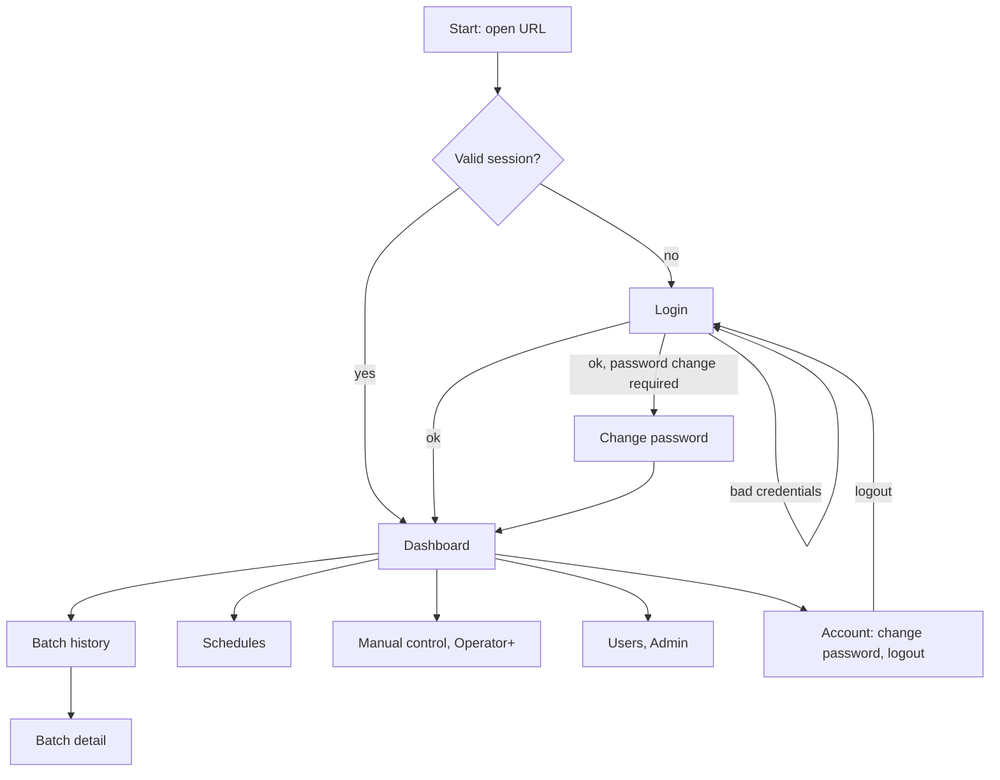

# 02 Appflow

Screen navigation, user journeys, and what each click does. Functional behavior of each component is in 12_UI_SPEC, visuals in 03_UI_UX_BRIEF. [PROPOSED, SPEC defines roles, session login, dashboard and history features]

## Scope note

Desanomia has no splash screen, sign up, email verification, or onboarding wizard. Accounts are created by an Admin (see 08_SECURITY), there is no self-registration and no email. The entry path is: open URL, session check, login if needed, Dashboard.

## Screen map

## Routes and access

| Route | Min role | Entered from | Leaves to |
| --- | --- | --- | --- |
| /login | none | Start, session expiry, logout | /change-password or Dashboard (or the page the user was on) |
| /change-password | any | Login when flagged, Account | Dashboard |
| / Dashboard | Viewer | Login, any nav item | History, Schedules, Manual, Users, Account |
| /batches | Viewer | Nav, active-batch link | Batch detail, Dashboard |
| /batches/:id | Viewer | History row, Dashboard timeline link | Back to History with filters kept |
| /schedules | Viewer (edit Operator+) | Nav | Dashboard |
| /manual | Operator | Nav | Dashboard |
| /users | Admin | Nav | Dashboard |
| /403, /404 | any | Guarded or unknown route | Dashboard |

Navigation shows only the routes the role may open. Direct URL access to a forbidden route goes to /403.

## Click behavior

| Action | What happens | Next |
| --- | --- | --- |
| Login submit, valid | Session cookie set, role loaded | Dashboard, or /change-password if flagged, or the page saved before expiry |
| Login submit, invalid | Generic error, field focus, rate limit applies | Stay on /login |
| Mulai Batch | Confirmation dialog states action and consequences | Dialog |
| Confirm in Mulai Batch dialog | Button locks, POST /batches/start, waits for command_result | See below |
| command_result accepted | Dialog closes, success toast, FSM card moves to FILLING_WATER via WebSocket | Dashboard |
| command_result rejected | Dialog stays, shows firmware reason verbatim (interlock id, state, fault) | Dialog, user closes |
| command_result timeout | Dialog shows timeout and tells user to check device state | Dialog, user closes |
| Reset Fault | Dialog shows fault code and cause, same confirm and result pattern | Dashboard, fault banner clears on success |
| History row click | Opens batch detail | /batches/:id |
| Back from batch detail | Returns with previous filters and page | /batches |
| Active batch link on History | Opens live view | Dashboard |
| Manual actuator toggle | Inline pending state, result toast, rejection shows reason | Stay on /manual |
| Schedule save or delete | Validation inline, toast, list refreshes with next-run times | Stay on /schedules |
| Create, edit, deactivate user | Dialog form, toast, list refreshes | Stay on /users |
| Logout | Session invalidated server side | /login |
| Session expired while on a page | Request returns 401, current path saved | /login, then back to saved path |

## State-driven Dashboard

| Condition | Mulai Batch | Reset Fault | Manual controls | Visible banner |
| --- | --- | --- | --- | --- |
| IDLE, no fault, device online | enabled (Operator+) | hidden | enabled | none |
| Batch running (any non-IDLE state) | disabled | hidden | disabled [PROPOSED, firmware still decides] | active batch id and state |
| Fault latched | disabled | enabled (Operator+) | disabled | fault code and cause |
| Device offline or stale | disabled | disabled | disabled | stale banner with last seen |
| WebSocket down | disabled | disabled | disabled | reconnecting banner |
| Viewer role | hidden | hidden | hidden | none |

## User journeys

Operator, scheduled day: opens Dashboard, confirms state is IDLE and Drum 1 concentrate is prepared (manual step outside the app), presses Mulai Batch, confirms, watches FSM card and timeline through DOSING, MIXING, STABILIZING, MEASURING_TDS, sees gate result in the timeline, watches DISTRIBUTING and BATCH_DEPLETED, opens the finished batch in History to review the TDS trace.

Operator, gate failure: Telegram alert arrives, Dashboard shows fault banner with GATE_FAIL and the measured ppm, Operator inspects the drum and sensor physically, presses Reset Fault, confirms, state returns to IDLE, batch is recorded as faulted in History. No re-dose is offered by the app.

Operator, schedule setup: Schedules, New, name and days and time, Save, sees next run, enables it.

Viewer, control room: kiosk opens Dashboard with the dedicated viewer account, sees live values only, no controls, screen recovers by itself after a network outage.

Admin, new user: Users, New user, username and role, temporary password, user logs in and is sent to /change-password before reaching the Dashboard.

## First run bootstrap [PROPOSED]

A CLI command on the Pi creates the first Admin (`python -m app.cli create-admin`). That account is flagged to change its password at first login. No default credentials ship in the image.

## Edge flows

Concurrent users: a state change by one Operator appears on every open Dashboard through WebSocket, a second Operator pressing Mulai Batch gets INVALID_STATE with the reason. Role change while logged in: next request returns the new permissions, UI reloads role on 403. Backend restart: UI shows reconnecting banner, then fresh snapshot, no page reload needed.
