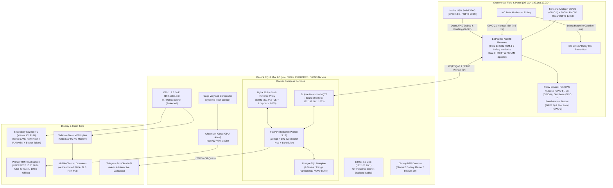
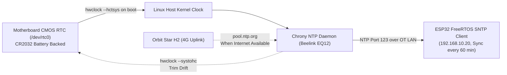

# 04 TRD (Technical Requirements Document)

> **System:** DESANOMIA Greenhouse Automated Fertigation System  
> **Platform:** Beelink EQ12 Mini PC (Intel N100) + ESP32-S3 N16R8 Edge Microcontroller  
> **Authority:** Aligned with [00_MASTER_RULES.md](file:///home/maria_zahra/Documents/projects/greenhouse/desanomia/brain/00_MASTER_RULES.md), [01_PRD.md](file:///home/maria_zahra/Documents/projects/greenhouse/desanomia/brain/01_PRD.md), [05_ARCHITECTURE.md](file:///home/maria_zahra/Documents/projects/greenhouse/desanomia/brain/05_ARCHITECTURE.md), and [18_DECISIONS.md](file:///home/maria_zahra/Documents/projects/greenhouse/desanomia/brain/18_DECISIONS.md) (D-001 through D-045).

---

## 1. System Architecture & Edge Platform

The Desanomia edge stack runs on an industrial on-site **Beelink EQ12 Mini PC** co-located inside the greenhouse control room, communicating with an **ESP32-S3 N16R8** microcontroller over an isolated wired industrial network.



### 1.1 Edge Host Hardware Profile [SPEC]

- **Host Model:** Beelink EQ12 Mini PC.
- **CPU:** Intel Processor N100 (Alder Lake-N, 4 Cores / 4 Threads, base 0.8 GHz, boost up to 3.4 GHz, 6W TDP).
- **GPU:** Intel UHD Graphics (24 Execution Units) with hardware QuickSync H.264/H.265 decoders.
- **Memory:** 16GB DDR5-4800 MHz SO-DIMM (single-channel).
- **Storage:** 500GB M.2 2280 PCIe 3.0 x4 NVMe SSD (internal) + 1x 2.5" SATA III expansion bay.
- **Networking:** Dual 2.5 Gbps RJ45 Ethernet ports (Intel i225-V / i226-V controller).
- **Wireless:** Wi-Fi 6 (Intel AX101 802.11ax) + Bluetooth 5.2.
- **I/O Ports:** 2x HDMI 2.0 (supports 4K@60Hz), 4x USB 3.2 Gen 2 (10 Gbps Type-A), 1x 12V DC-in jack (5.5×2.5 mm).
- **Power Envelope:** 12V 3A DC external power supply (36W peak, ~12W nominal idle load).
- **Environmental Rating:** Operating temperature -10°C to 45°C; 30% to 90% non-condensing relative humidity.
- **Power Loss Recovery:** BIOS American Megatrends (AMI) configured with `Restore on AC Power Loss: Power On` to ensure autonomous cold boot when mains electrical supply recovers.

### 1.2 Microcontroller Hardware Profile [SPEC]

- **Chipset:** Espressif ESP32-S3 N16R8 (Xtensa® Dual-Core 32-bit LX7 running at 240 MHz).
- **Memory:** 16MB Quad SPI Flash, 8MB Octal SPI PSRAM, 512KB internal SRAM.
- **Ethernet / Network Interface:** W5500 SPI Ethernet module connected via dedicated industrial Cat5e/Cat6 cable to Beelink ETH0 (100% wired physical Ethernet via unmanaged switch; Wi-Fi strictly disabled).
- **Real-Time OS:** FreeRTOS v10.x SMP (Dual-Core asymmetric configuration).

### 1.3 ESP32-S3 Conflict-Free GPIO Pin Allocation Table [SPEC]

To prevent catastrophic pin conflicts with the native USB Serial/JTAG controller and internal memory buses, the hardware GPIO mapping is strictly governed by [10_FIRMWARE_SPEC.md](file:///home/maria_zahra/Documents/projects/greenhouse/desanomia/brain/10_FIRMWARE_SPEC.md#pinout--gpio-allocation-spec). Refer to that document for the authoritative hardware pin assignments, electrical logic levels, and engineering safety constraints.

---

## 2. Display Tiers & Client Runtime Architecture

The system serves three strictly separated client display tiers:

| Tier | Display Hardware | Host Interface | Operating System / Shell | Authentication & Session Model | Intended Role |
| :--- | :--- | :--- | :--- | :--- | :--- |
| **Tier 1: Primary HMI Kiosk** | UPERFECT BE156PF 15.6" FHD (1920×1080) IPS, 10-point capacitive touch, 90 cm standing kiosk | Direct HDMI 2.0 + USB-C (Touch Data) to Beelink EQ12 | Debian 12 Minimal + Cage Wayland compositor running Chromium in `--kiosk` mode (`http://127.0.0.1:8080`) | Persistent local loopback `Operator` session (zero idle logout); modal PIN/Password elevation to `Admin` | Primary Operator Control (100% offline, 1-tap E-Stop) |
| **Tier 2: Secondary Gazebo Display** | Xiaomi TV A 43" FHD (1920×1080) Google TV™ 2026, VESA wall mount | Wired RJ45 Ethernet to Orbit Star H2 / Gazebo DMZ via 156.5m Tenda O1 PTP bridge | Android TV OS running Fully Kiosk Browser 24/7 | Auto-authenticated `Viewer` session via Nginx static IP allowlist (`192.168.1.50`) **AND** read-only device bearer token in headers (D-026). All mutations return `403 Forbidden` | Passive 24/7 Telemetry Mirror (zero control dispatch) |
| **Tier 3: Remote Mobile Clients** | Modern Mobile Smartphones (iOS / Android) | Tailscale Mesh VPN / Local Wi-Fi | Modern Mobile Browser (Chrome/Safari) running installed PWA via TLS/HTTPS (`:443`) with internal Local CA root certificate | Standard Username/Password credentials; sliding 8-hour idle timeout, 7-day absolute limit. Transmitted via `HttpOnly`, `SameSite=Lax`, `Secure` cookies with full Service Worker PWA support | Remote Monitoring & Guarded Control (two-step confirmation modal E-stop) |

---

## 3. Network Topology & Dual NIC Segmentation

The Beelink EQ12 utilizes its physical Dual 2.5 Gbps Ethernet interfaces to create an absolute hardware-level operational air-gap between greenhouse industrial controls and external networks:

```
[ ESP32-S3 Microcontroller ] 
         │ (192.168.10.20)
         ▼
[ Unmanaged Industrial Switch ] ─── ETH0 (192.168.10.1) ───► [ Beelink EQ12 ]
(OT LAN: 192.168.10.0/24)                                    [ Docker Compose ]
                                                                     │
[ Orbit Star H2 Modem / WAN ] ─── ETH1 (192.168.1.10) ◄──────────────┘
         │ (192.168.1.1)            (IT LAN: 192.168.1.0/24)
         ├────────────────────────────────────────┐
         ▼                                        ▼
[ Tenda O1 PTP Bridge ]                  [ Tailscale Mesh VPN ]
         │ (156.5m span)                          │
         ▼                                        ▼
[ Xiaomi TV 43'' Gazebo ]                [ Mobile Operator Phones ]
(192.168.1.50 - Allowlisted)             (PWA over TLS :443)
```

1. **OT Industrial Subnet (`ETH0` - `192.168.10.0/24`):**
   - Static IP: `192.168.10.1/24`.
   - Connected directly to the greenhouse fieldbus switch via physical Cat5e/Cat6 cable.
   - Dedicated solely to ESP32-S3 (`192.168.10.20`), sensor gateways, and local HMI. Wi-Fi is disabled on this segment.
   - **Mosquitto MQTT Binding Invariant:** Eclipse Mosquitto binds exclusively to `192.168.10.1:1883`. External interfaces (`ETH1`) are blocked from accessing MQTT port 1883 via Docker network isolation and host `nftables` firewall rules.
   - **Chrony NTP Server:** Beelink broadcasts NTP over `192.168.10.1:123` to provide local stratum-10 network clock synchronization for ESP32.
2. **IT / WAN Uplink Subnet (`ETH1` - `192.168.1.0/24`):**
   - Assigned IP: `192.168.1.10/24` via DHCP or static lease from Orbit Star H2 4G modem (`192.168.1.1`).
   - Carries traffic for:
     - Tenda O1 2.4 GHz Point-to-Point (PTP) wireless bridge (156.5m span to Gazebo).
     - Xiaomi TV A 43" (Gazebo Monitoring Display, static IP `192.168.1.50`).
     - Tailscale daemon for outbound WireGuard mesh tunnel to mobile clients.
     - Outbound HTTPS traffic to Telegram Bot API.
   - **Nginx Web Gateway:** Nginx binds to `192.168.1.10:80` (auto-redirect to HTTPS) and `192.168.1.10:443` (TLS with local CA certificate), plus `127.0.0.1:8080` for the local Kiosk loopback.
3. **Host OS Kernel & nftables Firewall Ruleset (D-043, TR-31):**
   - To support Docker bridge container networking while strictly prohibiting raw routing between OT and IT subnets:
     ```bash
     # Aktifkan forwarding di kernel untuk kebutuhan internal container networking
     sysctl -w net.ipv4.ip_forward=1
     ```
   - Configuration `/etc/nftables.conf`:
     ```text
     table inet filter {
         chain forward {
             type filter hook forward priority 0; policy drop;

             # Izinkan traffic yang established/related
             ct state established,related accept

             # Blokir total routing silang antara ETH0 (OT) dan ETH1 (IT)
             iifname "eth0" oifname "eth1" drop
             iifname "eth1" oifname "eth0" drop

             # Izinkan Docker bridge berkomunikasi keluar ke IT LAN saja
             iifname "docker0" oifname "eth1" accept
         }
     }
     ```

---

## 4. Technical Requirements (TR-01 through TR-30)

Each Technical Requirement directly satisfies and enforces its corresponding Product Requirement (PRD FR-01 through FR-30).

### TR-01: Batch Initiation, Recipe Snapshots & Pre-flight Interlock Validation
- **Subsystem:** Backend (FastAPI) & Firmware (ESP32-S3)
- **Protocol:** REST `POST /api/v1/batches` → MQTT `desanomia/gh1/cmd` (QoS 1)
- **Specification:**
  - When an Operator initiates a batch, backend verifies that the caller role is `Operator` or `Admin`.
  - Backend performs pre-flight validation against current telemetry: Drum 2 level must be $\le 5.0\text{ L}$, no active latched faults, ESP32 liveness online, and same-day distribution lock clear.
  - Generates an auto-incrementing `BIGINT` (`BIGSERIAL`) `batch_id` and unique UUIDv4 `cmd_id`. Snapshots the selected recipe parameters (name, target TDS, gate min/max, fill volume) into PostgreSQL table `batches`.
  - **Empirical Feedforward Dosing Formula:**
    $$V_{\text{dose\_mL}} = \frac{(\text{TDS}_{\text{target}} - \text{TDS}_{\text{baseline}}) \times V_{\text{water\_L}}}{K_{\text{fert}}}$$
    - $\text{TDS}_{\text{target}}$: Target TDS resep aktif ($1250\text{ ppm}$ Generatif, $1100\text{ ppm}$ Vegetatif, $1050\text{ ppm}$ Panen).
    - $\text{TDS}_{\text{baseline}}$: TDS air baku terukur saat pengisian air bersih selesai ($50 \le \text{TDS}_{\text{baseline}} < 350\text{ ppm}$).
    - $V_{\text{water\_L}}$: Volume aktual air bersih di Drum 2 ($140.0\text{ L}$).
    - $K_{\text{fert}} = 94.68\text{ ppm}\cdot\text{L/mL}$: Konstanta kelarutan pengayaan pupuk terlarut (berdasarkan kalibrasi empiris stok konsentrat $100\text{ g/L}$ pada `DOSE_TEST_RESULT.md`).
  - **Peristaltic Pump Runtime:**
    $$t_{\text{pump\_sec}} = V_{\text{dose\_mL}} \times 0.107\text{ s/mL}$$
  - **Dynamic Gate Band Definition:**
    - Rentang Gate Band lolos: $[\text{TDS}_{\text{target}} - 50\text{ ppm}] \le \text{TDS}_{\text{mean}} \le [\text{TDS}_{\text{target}} + 50\text{ ppm}]$.
  - Dispatches MQTT command `{ "cmd_id": "9b1deb4d-3b7d-4bad-9bdd-2b0d7b3dcb6d", "type": "START_BATCH", "batch_id": 1042, "recipe_id": 2, "target_tds_ppm": 1250, "tank_pair_id": 1, "timestamp": 1775807100 }` over QoS 1.

### TR-02: 12-State FSM Engine, Deterministic Cycle Timing & Safety Interlocks
- **Subsystem:** Firmware (ESP32-S3 Core 1)
- **Execution Domain:** FreeRTOS Task `fsm_task` pinned to Core 1, Priority 5 (highest application task).
- **Specification:**
  - Cycle frequency fixed at **20 Hz (50 ms tick period)** using `vTaskDelayUntil()`.
  - Implements the 12 lifecycle core operational states: `IDLE`, `FILLING_WATER`, `CHECK_BASE`, `DOSING`, `MIXING`, `STABILIZING`, `MEASURING_TDS`, `GATE_EVALUATE`, `TOPUP_DOSING`, `RECOVERY_MIX_EVALUATE`, `DISTRIBUTING`, and `BATCH_DEPLETED`.
  - Mode `BATCH_PAUSED_INSPECTION` dimodelkan sebagai **Latched Mode / Sub-State** di NVS saat restart atau cold-boot recovery untuk menahan eksekusi sebelum inspeksi manual / auto-resume timeout.
  - **Durasi Timer Siklus FSM Definitif:**
    - `MIXING`: Pompa sirkulasi submersible aktif selama tepat **120 detik**.
    - `STABILIZING`: Seluruh aktuator OFF, pengendapan turbulensi cairan selama tepat **15 detik**.
    - `MEASURING_TDS`: Akusisi data sensor ADC multisampling selama **10 detik** (frekuensi sampling 10 Hz, 10-sample moving trimmed median filter).
    - `GATE_EVALUATE`: Evaluasi terhadap gate band $[\text{TDS}_{\text{target}} - 50\text{ ppm}]$ s/d $[\text{TDS}_{\text{target}} + 50\text{ ppm}]$.
    - `TOPUP_DOSING`: Jika $[\text{TDS}_{\text{target}} - 250\text{ ppm}] \le \text{TDS}_{\text{mean}} < [\text{TDS}_{\text{target}} - 50\text{ ppm}]$, FSM menghitung dosis top-up:
      $$V_{\text{topup\_mL}} = \min\left( \frac{(\text{TDS}_{\text{target}} - \text{TDS}_{\text{mean}}) \times 140.0}{94.68}, 300.0\text{ mL} \right)$$
    - `RECOVERY_MIX_EVALUATE`: Single-pass recovery cycle terdiri dari mixing 60 s, stabilizing 15 s, dan measuring 10 s. Jika setelah siklus ini TDS tetap di luar gate band, sistem mengunci `FAULT_PPM_OUT_OF_RANGE`.
    - **Ambang Kelaparan (Starvation):** Jika $\text{TDS}_{\text{mean}} < (\text{TDS}_{\text{target}} - 250\text{ ppm})$, sistem membunyikan warning `STARVATION_SUSPECTED`.
  - **Matriks Terpadu 7 Safety Interlocks:**
    Semua 7 safety interlocks dieksekusi sinkron pada setiap siklus loop 50 ms sebelum memperbarui status GPIO relay:

| ID | Nama Interlock | Kondisi Pemicu (Sensor Input) | Kode Fault Latched | Respon Hardware ESP32 | Aturan Pembukaan Kunci (Reset Rule) |
| :--- | :--- | :--- | :--- | :--- | :--- |
| **IL-01** | **TDS Safety Gate** | TDS rata-rata $< (\text{Target}-50)$ atau $> (\text{Target}+50\text{ ppm})$ pasca evaluasi/recovery | `FAULT_PPM_OUT_OF_RANGE` | Pompa distribusi (GPIO 7) TERKUNCI MATI | Kuras manual tangki via gravity valve ke parit pembuangan hingga $\le 5.0\text{ L}$ |
| **IL-02** | **Radar Dry-Run Cutoff** | Level radar Drum 2 $< 5.0\text{ L}$ saat pompa distribusi aktif | `FAULT_DRY_RUN` | Matikan relay pompa distribusi (GPIO 7) dalam $< 50\text{ ms}$ | FSM kembali ke IDLE / isi air kembali |
| **IL-03** | **Batch Depletion Guard** | Perintah `START_BATCH` diterima saat volume Drum 2 $> 5.0\text{ L}$ | `FAULT_BATCH_REJECTED` | Tolak eksekusi batch, seluruh relay tetap mati | Kuras tangki hingga level $\le 5.0\text{ L}$ |
| **IL-04** | **Dual-Stage Fill Guard** | Level naik $< 1.0\text{ L}$ dalam $90\text{ s}$ atau total durasi pengisian $> 20\text{ min}$ | `FAULT_NO_WATER_SUPPLY` / `FAULT_FILL_TIMEOUT` | Tutup solenoid air bersih (GPIO 4) | Periksa pasokan air baku, tekan tombol `Resume Fill` di UI |
| **IL-05** | **Water Baseline Plausibility** | TDS air baku $< 50\text{ ppm}$, $> 2000\text{ ppm}$, atau baseline $\ge 350\text{ ppm}$ | `FAULT_TDS_INVALID` / `FAULT_BASE_TDS_HIGH` | Tutup solenoid fill, hentikan batch seketika | Periksa kabel/konektor probe TDS atau sanitasi sumber air baku |
| **IL-06** | **Radar Liveness Watchdog** | Frame UART radar hening / diskonek $> 3.0\text{ s}$ | `FAULT_RADAR_OFFLINE` | Matikan seluruh 4 relay seketika | Sambungkan kembali UART radar; auto-clear seketika saat frame valid diterima |
| **IL-07** | **Emergency Stop Guard** | Kontak NC switch terbuka (GPIO 21 loop terputus) | `FAULT_ESTOP` | Putus daya koil relay mekanis ($0\text{ ms}$) + GPIO Low ($< 5\text{ ms}$) | Putar switch fisik NC (`hw_estop_pressed = false`) DAN level Drum 2 $\le 5.0\text{ L}$ |

### TR-03: Multi-rate Analog TDS Signal Conditioning & Moving Trimmed Median Filter
- **Subsystem:** Firmware (ESP32-S3 Core 1)
- **Hardware Interface:** Analog TDS Probe connected to ESP32-S3 ADC1_CH0 (GPIO 1), conditioned via analog front-end board.
- **Specification:**
  - Sensor acquisition task runs on Core 1, Priority 3.
  - **Algoritma Filtering:** *Moving Window Trimmed Median Filter* 10-sampel dengan frekuensi sampling 10 Hz. Mengambil 10 pembacaan terakhir, membuang 2 nilai ekstrem (1 terendah dan 1 tertinggi), lalu menghitung median/rata-rata dari 8 sampel tersisa.
  - Telemetry publication frequency: **5.0 s** during standard states; accelerated to **1.0 s** during `MEASURING_TDS`, `GATE_EVALUATE`, and calibration wizard.
  - Temperature compensation formula: $\text{TDS}_{25} = \frac{\text{TDS}_{\text{raw}}}{1.0 + 0.02 \times (T_{\text{water}} - 25.0)}$. In Phase 1 without active water temp sensor, water temperature defaults to empirical baseline $27.0^\circ\text{C}$ ($T_{\text{comp}} = 1.04$).
  - Calibration slope $K_{\text{cell}}$ and baseline offset $V_{\text{offset}}$ are loaded from ESP32 NVS namespace `calib_tds`.

### TR-04: 60 GHz Millimeter-Wave Radar Level Sensing & Tank Volumetrics
- **Subsystem:** Firmware (ESP32-S3)
- **Hardware Interface:** 60 GHz FMCW Radar Level Sensor connected via UART1 (GPIO 17 TX, GPIO 18 RX), baud rate 115200 bps, 8N1.
- **Specification:**
  - Frame parser validates binary header, payload checksum, and distance frame ($D_{\text{mm}}$) at 10 Hz (frame time 100 ms).
  - Height-to-Volume conversion formula: $V_{\text{drum2}} = (H_{\text{total}} - D_{\text{mm}}) \times A_{\text{cross\_section}}$, with $5.0\text{ L}$ bottom suction sump offset.
  - Watchdog timer: If valid UART radar frames cease for $> 3.0\text{ s}$, the firmware immediately latches `FAULT_RADAR_OFFLINE` (IL-06) and cuts all actuator relays.

### TR-05: Relay Output Actuation & Mutual Exclusion Hardware Interlocks
- **Subsystem:** Firmware (ESP32-S3)
- **Hardware Interface:** 4-Channel Optoisolated Relay Board driven by GPIO 4 (Fill Valve AC 220V), GPIO 5 (Dosing Pump DC 12V), GPIO 6 (Mixing Pump AC 220V), GPIO 7 (Distribution Pump AC 220V). Active LOW logic.
- **Specification:**
  - Actuator DC 5V/12V Relay Coil Power Bus mengontrol kontak beban AC 220V dan DC 12V.
  - Firmware enforces **strict mutual exclusion**: Fill Valve and Distribution Pump must never energize simultaneously. Dosing Pump and Distribution Pump must never energize simultaneously.
  - Any relay transition enforces a minimum dead-band delay of $500\text{ ms}$ between de-energizing one pump and energizing another to eliminate inductive back-EMF relay cross-talk.

### TR-06: High-Resolution Batch Event Journaling & Telemetry Correlation
- **Subsystem:** Backend (FastAPI) & PostgreSQL
- **Specification:**
  - Every batch execution logs discrete transition events into table `batch_events`: `id` (BIGSERIAL PK), `batch_id` (BIGINT FK), `ts`, `state` (12 FSM states or PAUSED_INSPECTION), `event_type` ('state_enter', 'state_exit', 'gate', 'fault', 'command', 'topup', 'pause', 'resume', 'note'), and `payload JSONB`.
  - High-frequency telemetry during active batches is tagged with `batch_id`.
  - Frontend renders the interactive chronological step timeline with timestamp deltas, transition durations, and anomaly flags.

### TR-07: Batch Traceability, Detail Query Optimization & Indexed Storage
- **Subsystem:** PostgreSQL & Backend
- **Specification:**
  - Table `batches` maintains composite index `(started_at DESC, status)`.
  - Query endpoint `GET /api/v1/batches/:id` returns composite payload: batch summary, exact start/end timestamps, recipe snapshot, cumulative concentrate consumed, full event log, and downsampled TDS/Level curve in $< 100\text{ ms}$ (p95).

### TR-08: High-Performance Canvas Time-Series Rendering & Downsampled Telemetry
- **Subsystem:** Frontend (React + Apache ECharts)
- **Specification:**
  - Telemetry curves (TDS ppm, Drum 2 volume, actuator states) render via Apache ECharts in HTML5 Canvas mode (zero SVG DOM node overhead).
  - Incoming WebSocket telemetry updates are throttled in the browser using `requestAnimationFrame()` debouncing to guarantee 60 FPS UI rendering without main-thread blocking on the Intel N100 GPU or mobile devices.

### TR-09: Multi-Tier Heartbeat, MQTT LWT & Bidirectional Liveness Supervision
- **Subsystem:** Firmware, Mosquitto, Backend & Frontend
- **Specification:**
  - ESP32 maintains MQTT connection with Keep-Alive of 10 s and publishes Last Will and Testament (LWT) topic `desanomia/gh1/status` with payload `{"online": false, "reason": "lwt"}` (QoS 1, Retain True).
  - On successful connection, ESP32 publishes `{"online": true, "ip": "192.168.10.20", "fw_version": "1.0.0"}` to `desanomia/gh1/status`.
  - Backend marks hardware connectivity status as `STALE` if telemetry is silent for $> 12.0\text{ s}$ (toleransi 2 dropped packet frame pada interval 5s QoS 0) and `OFFLINE` if $> 20.0\text{ s}$. Frontend displays real-time connection badge with ping latency.

### TR-10: Gated Fault Latching, Outage Recovery & Dynamic Deficit Dosing
- **Subsystem:** Firmware (ESP32-S3 Core 1) & Backend
- **Specification:**
  - On any safety interlock trigger, firmware latches the corresponding fault code (`FAULT_DRY_RUN`, `FAULT_PPM_OUT_OF_RANGE`, `FAULT_BATCH_REJECTED`, `FAULT_RADAR_OFFLINE`, `FAULT_NO_WATER_SUPPLY`, `FAULT_FILL_TIMEOUT`, `FAULT_ESTOP`, `FAULT_TDS_INVALID`, `FAULT_BASE_TDS_HIGH`), cuts all 4 relays, and writes fault state to NVS.
  - **Gated Fault Reset Protocol:** Firmware rejects `RESET_FAULT` command if Drum 2 radar level reads $> 5.0\text{ L}$ (requiring operator to manually open gravity drain valve to waste ditch) or if physical NC E-Stop contacts remain open (`hw_estop_pressed == true`).
  - **Mid-Batch Power Outage Recovery & Dynamic Deficit Dosing (D-013):**
    - **Kondisi Boot:** ESP32 menyala dari cold-boot/power restoration, membaca NVS menemukan status batch aktif belum `DEPLETED`, dan sensor radar membaca volume Drum 2 $> 5.0\text{ L}$.
    - **Mode Hold:** FSM mengunci mode `BATCH_PAUSED_INSPECTION` (seluruh 4 relay terkunci OFF).
    - **Formula Defisit Konsentrat:**
      $$V_{\text{deficit\_mL}} = \frac{(\text{TDS}_{\text{target}} - \text{TDS}_{\text{current\_measured}}) \times V_{\text{current\_drum2\_L}}}{94.68}$$
    - **Ambang Batas Catastrophic Spike Anomaly:**
      Jika $\text{TDS}_{\text{current\_measured}} > (\text{TDS}_{\text{target}} + 500\text{ ppm})$ (misal $> 1750\text{ ppm}$ untuk target 1250 ppm) atau terdeteksi kebocoran anomali level, sistem mengunci permanen opsi resume otomatis. Operator diwajibkan membuka keran manual pengurasan ke parit hingga volume $\le 5.0\text{ L}$.
    - **Mekanisme Dual Timer Auto-Resume (30 Menit / 1800 s):**
      Timer software 30 menit ($1800\text{ s}$) dikelola oleh background worker FastAPI. Notifikasi alert dikirim ke HMI Kiosk dan Telegram dengan tombol `[Konfirmasi Pause Recovery]`. Jika operator tidak mengambil tindakan manual dalam 30 menit dan ketujuh interlock berstatus valid (tidak ada lonjakan katastropik), backend mendispatch perintah MQTT QoS 1:
      ```json
      {
        "cmd_id": "c1f7a240-8b1a-4d2b-98f5-19e4823ab001",
        "type": "RESUME_DEFICIT_BATCH",
        "timestamp": 1728518400
      }
      ```
      ESP32 mengeksekusi penambahan $V_{\text{deficit\_mL}}$, menyalakan mixer selama 120 detik, melakukan evaluasi TDS gate, dan melanjutkan distribusi mandiri.

### TR-11: Fine-Grained Manual Actuator Controls & Interlock Lockout Protocol
- **Subsystem:** Backend & Firmware
- **Specification:**
  - Manual controls accessible strictly on `/manual` for authenticated `Operator` or `Admin`.
  - Manual commands (`MANUAL_ACTUATOR`) are strictly rejected by ESP32 firmware whenever FSM state is not `IDLE`.
  - Manual dosing increments are hard-limited to $+10\text{ mL}$ pulses ($1.07\text{ s}$ per pulse); mixing pump runs are hard-capped at max $300\text{ s}$ duration.
  - All 7 safety interlocks remain 100% active in MANUAL mode: dry-run cut-off immediately halts distribution pump regardless of manual override attempts.

### TR-12: Zero-Conflict Unified Schedule-First Engine & Chrono Arbitration
- **Subsystem:** Backend (FastAPI async scheduler)
- **Specification:**
  - Background asyncio scheduling task runs every $1.0\text{ s}$, querying scheduled batches from PostgreSQL.
  - **Zero-Conflict Hydraulic Invariant (D-040):** Seluruh tangki distribusi berbagi pompa bertekanan tinggi dan pipa manifold utama yang sama. Scheduler menegakkan eksklusivitas mutlak **1 distribusi per hari kalender** untuk manifold bersama. Batas ambigu 90 menit dihapus; jika pair lain membutuhkan distribusi pada hari yang sama, wajib menggunakan alur `is_same_day_override: true` dengan pencatatan audit trail.
  - **Deferral Window Policy (D-024):** Scheduler memicu peringatan jika batch ad-hoc dieksekusi $< 15\text{ menit}$ sebelum jadwal otomatis. Jadwal otomatis yang tertunda memiliki batas toleransi penundaan (deferral window) maksimal **60 menit**, setelah itu jadwal dibatalkan otomatis disertai alert kritis Telegram ke operator.
  - Schedules trigger autonomously without requiring human operator attendance if all 7 pre-flight safety interlocks evaluate green.

### TR-13: Tier-Differentiated Authentication & Session Lifecycle Management
- **Subsystem:** Backend (FastAPI) & Nginx
- **Specification:**
  - Session tokens are cryptographically generated (32-byte CSPRNG hex), hashed (SHA-256), and stored in PostgreSQL table `user_sessions`.
  - **HMI Kiosk:** Bound to loopback interface (`127.0.0.1:8080`); runs a persistent, non-expiring `Operator` session.
  - **Gazebo TV (D-026):** Nginx memverifikasi IP asal (`192.168.1.50`) **DAN** Bearer Token read-only perangkat pada header. Seluruh mutasi HTTP (`POST`, `PUT`, `DELETE`) diblokir dengan `403 Forbidden` pada layer Nginx.
  - **Mobile Clients / Remote Web (TLS :443 Architecture):** Nginx menyediakan reverse proxy HTTPS port 443 dengan internal Local CA certificate yang terpasang di perangkat operator. Session tokens ditransmisikan via `HttpOnly`, `SameSite=Lax`, `Secure` cookies, mengaktifkan Service Worker PWA offline-first. Enforce sliding 8-hour idle timeout dan 7-day absolute limit.

### TR-14: Role-Based Access Control (RBAC) & Administrative Step-Up Elevation
- **Subsystem:** Backend (FastAPI Dependency Injection) & Frontend
- **Specification:**
  - Role hierarchy: `Admin` (Superuser) > `Operator` (Operational control) > `Viewer` (Read-only monitoring).
  - Admin-only routes (`/api/v1/users`, `/api/v1/recipes` modifications, system configs) require active `Admin` role.
  - **CLI User Provisioning (D-028):** Inisialisasi akun administrator sistem pertama kali dilakukan melalui CLI backend:
    ```bash
    python -m backend.cli seed-admin
    ```
  - On the HMI Kiosk, attempting an Admin action triggers a Step-Up Modal prompting for the Administrator password/PIN. On success, a temporary 15-minute elevation token is issued.

### TR-15: Resilient Outbound Telegram Alerting with Interactive Callback Handlers
- **Subsystem:** Backend (Telegram Bot Client)
- **Specification:**
  - Critical events (Faults, E-Stop, TDS Gate Failures, Low Fertilizer Stock, Outage Recoveries) dispatch markdown-formatted Telegram messages via HTTPS to configured chat IDs.
  - Messages include inline callback keyboard buttons aligned with D-007: `[Siram Sekarang]`, `[Tunda 1 Jam]`, and `[Konfirmasi Pause Recovery]`. (Non-operational kiosk links are omitted).
  - Callback queries received by the backend webhook/polling loop validate sender Telegram User ID against allowlisted administrators before executing actions.

### TR-16: Tamper-Evident Immutable System & Cryptographic Audit Logging
- **Subsystem:** PostgreSQL & Backend
- **Specification:**
  - PostgreSQL table `audit_logs` records every state-changing action with **Cryptographic Hash Chain SHA-256** (D-039):
    - Kolom: `id`, `timestamp`, `user_id`, `username`, `user_role`, `action_type`, `target_resource`, `payload_snapshot`, `prev_hash`, `row_hash`.
    - Formula Hash Chain:
      $$\text{row\_hash} = \text{SHA256}(\text{prev\_hash} \mathbin{\Vert} \text{timestamp} \mathbin{\Vert} \text{user\_id} \mathbin{\Vert} \text{action\_type} \mathbin{\Vert} \text{target\_resource} \mathbin{\Vert} \text{payload\_snapshot})$$
  - Append-only design: No `UPDATE` or `DELETE` permissions granted on `audit_logs` to the application DB role. Enforced via database triggers.

### TR-17: Dual E-Stop Implementation & Zero-Latency Hardware NC Trip
- **Subsystem:** Hardware, Firmware & Frontend
- **Specification:**
  - **Hardware Trip:** Physical twist-to-reset mushroom switch has normally-closed (NC) auxiliary contacts wired in series with the DC 5V/12V Relay Coil Power Bus of all 4 relays. Physical press cuts actuator power in $0\text{ ms}$ mechanically.
  - **Software Sense:** Secondary NC contact on mushroom switch is wired to ESP32 GPIO 21 with internal pull-up and hardware debouncing ($\le 1\text{ ms}$ RC filter). Falling/Rising edge triggers FreeRTOS ISR, de-energizing GPIO outputs in $< 5\text{ ms}$ and setting telemetry `hw_estop_pressed = true`.
  - **Dry-Run Latency Budget:** Total physical latency $\le 200\text{ ms}$ dari surutnya cairan di sump hisap, dengan firmware cut-off $< 50\text{ ms}$ setelah frame UART radar diterima.
  - **Dual UX:**
    - Local HMI Kiosk: Instant 1-tap E-Stop button (min $56 \times 56\text{ px}$) on screen header; zero modal confirmation; dispatches MQTT `ESTOP` immediately.
    - Remote Web / Mobile: Requires two-step confirmation modal (`aria-modal="true"`) to prevent accidental pocket taps.

### TR-18: Inferential Concentrate Virtual Stock Tracking & Depletion Warning
- **Subsystem:** Backend & Database
- **Specification:**
  - Concentrate Drum (Drum 1, 20 L) has no physical level sensor.
  - Virtual stock starts at $20.0\text{ L}$ ($20,000\text{ mL}$) upon manual operator refill confirmation on UI.
  - After each successful dosing and top-up execution, backend deducts the actual delivered concentrate volume (logged in mL) from the active stock.
  - When remaining virtual stock drops $\le 2\text{ batches}$ ($\approx 3,000\text{ mL}$), the system flags a Warning alert (`STOCK_LOW`) in-app and sends a Telegram refill notification.
  - **Dynamic Starvation Anomaly Detection:** If post-mix TDS is $< (\text{TDS}_{\text{target}} - 250\text{ ppm})$ (deficit $> 250\text{ ppm}$ below target, misal $< 1000\text{ ppm}$ pada target 1250 ppm, atau $< 850\text{ ppm}$ pada target 1100 ppm), system logs `STARVATION_SUSPECTED`.

### TR-19: In-Flight Hydraulic Fill Recovery & Solenoid Pulse Cycling
- **Subsystem:** Firmware (ESP32-S3) & Frontend
- **Specification:**
  - If Drum 2 water fill stalls (detecting `FAULT_NO_WATER_SUPPLY` via $< 1.0\text{ L}$ rise in $90\text{ s}$ or `FAULT_FILL_TIMEOUT` at $20\text{ min}$), solenoid closes and FSM halts without aborting or draining the batch.
  - Operator UI exposes `Resume Fill` action. Dispatches MQTT command `{ "type": "RESUME_FILL" }`.
  - Firmware resets fill timer, re-energizes Fill Solenoid (GPIO 4), and resumes filling toward the target $140.0\text{ L}$ level.

### TR-20: Unattended Schedule Execution & Single Upfront Batch Confirmation
- **Subsystem:** Backend & Frontend
- **Specification:**
  - Unified dialog captures Recipe, Timing (`Now` vs `Later`), and Tank Pair.
  - Once validated and confirmed upfront, the batch transitions from fill to mix to measure to distribution **100% autonomously** upon TDS Gate PASS.
  - Eliminates secondary manual "Confirm Distribution" prompts during automated routines, allowing unattended morning irrigation runs.

### TR-21: Autonomous Hardwired Local Panel Alarm Annunciation (Buzzer & Pilot Lamp)
- **Subsystem:** Firmware (ESP32-S3)
- **Hardware Interface:** GPIO 2 drives High-Decibel Acoustic Buzzer (DC 12V via NPN transistor); GPIO 3 drives Red Industrial Pilot Lamp (DC 12V via NPN transistor / optocoupler). GPIO 19 and 20 remain strictly reserved for hardware native USB Serial/JTAG.
- **Specification:**
  - Runs autonomously on ESP32 Core 1 independent of network, broker, or backend availability.
  - On transition to any latched `FAULT_*` or `FAULT_ESTOP`, GPIO 2 and 3 energize immediately:
    - Pilot Lamp (GPIO 3): Continuous solid ON.
    - Buzzer (GPIO 2): Intermittent pulsed tone ($500\text{ ms}$ ON / $500\text{ ms}$ OFF) for $60\text{ s}$, then mutes buzzer while keeping Pilot Lamp illuminated until fault is cleared.

### TR-22: Offline Telegram Store-and-Forward Queue with WAN Liveness Detection
- **Subsystem:** Backend (FastAPI Background Worker)
- **Specification:**
  - Table `alert_queue` stores pending external notifications: `id` (BIGSERIAL PK), `notification_id` (BIGINT FK to notifications.id), `severity` ('critical', 'warning'), `title`, `message`, `status` ('pending', 'sent', 'failed'), `retry_count`, `created_at`, and `sent_at`.
  - When 4G WAN drops, alerts are saved as `pending`.
  - Liveness worker probes `https://api.telegram.org` every $30\text{ s}$.
  - Upon reconnection, alerts are transmitted in chronological order with original event timestamps and inline action buttons. Rate-limited to max 20 messages/minute to satisfy Telegram API throttling.

### TR-23: Guided In-Situ TDS Sensor Calibration Wizard & NVS Constant Commit
- **Subsystem:** Frontend, Backend & Firmware
- **Specification:**
  - Rute antarmuka wizard dipusatkan pada `/manual` (D-036).
  - Step 1: Enforces Drum 2 drained $\le 5.0\text{ L}$ and FSM `IDLE` before allowing probe maintenance.
  - Step 2: Immerses probe in standard $1413\ \mu\text{S/cm}$ calibration buffer ($904\text{ ppm}$ at 0.64 factor); monitors real-time ADC stability over a 30-second window ($< 1\%$ drift) to calculate calibration slope $K_{\text{cell}}$.
  - Step 3: Pengukuran baseline air baku sumber ($V_{\text{offset}}$) untuk kompensasi offset zero-point air tanah riil di lokasi.
  - Step 4: Calculates and commits new constants $K_{\text{cell}}$ and $V_{\text{offset}}$ to ESP32 NVS namespace `calib_tds` via MQTT command `CALIBRATE_SENSOR`. Backend logs event to `sensor_calibration_events`.

### TR-24: Agronomic Named Recipe Presets Library & Traceable Batch Snapshots
- **Subsystem:** Backend & PostgreSQL
- **Specification:**
  - Presets perpustakaan resep agronomi default:
    - `Vegetatif`: Target TDS $1100\text{ ppm}$, Gate Band $1050\text{ ppm}$ s/d $1150\text{ ppm}$.
    - `Generatif`: Target TDS $1250\text{ ppm}$, Gate Band $1200\text{ ppm}$ s/d $1300\text{ ppm}$.
    - `Panen`: Target TDS $1050\text{ ppm}$, Gate Band $1000\text{ ppm}$ s/d $1100\text{ ppm}$.
  - Dynamic Gate Band Invariant: Seluruh resep mengevaluasi kelulusan pada $[\text{Target} - 50\text{ ppm}]$ hingga $[\text{Target} + 50\text{ ppm}]$.
  - Starting a batch snapshots preset attributes directly into the `batches` table row, guaranteeing historical recipe auditability even if preset defaults are modified later.

### TR-25: Multi-Tank 5-Pair Architectural Roadmap & Hydraulic Invariant
- **Subsystem:** Data Model & Scheduler
- **Specification:**
  - Data model supports 5 Concentrate Drums ($K_1$–$K_5$, 20 L each) and 5 Distribution Drums ($D_1$–$D_5$, 140 L each).
  - Phase 1 actively plumbs and sensors Pair 1 ($K_1$ / $D_1$). Pairs 2–5 display on Dashboard in `Standby / Belum Terpasang` status.
  - Hydraulic Invariant (D-040): All distribution drums share the single high-pressure distribution pump and delivery main; scheduler enforces 1 batch per calendar day across all pairs.

### TR-26: Same-Day Double Distribution Lockout & Cryptographic Override Audit
- **Subsystem:** Backend & Frontend
- **Specification:**
  - Backend checks table `batches` for any batch reaching `DISTRIBUTING` on the current calendar day (`CURRENT_DATE` in local time Asia/Jakarta UTC+7).
  - If detected, batch initiation is rejected unless request carries `{ "is_same_day_override": true, "override_reason": "..." }`.
  - Frontend enforces a high-friction Hard Confirmation Modal with agronomic salinity hazard warnings. Backend logs `SAME_DAY_FORCE_OVERRIDE` with user ID and SHA-256 hash chaining to `audit_logs`.

### TR-27: Dynamic Baseline Reference Shifting & Preemptive Conflict Cancellation
- **Subsystem:** Backend Scheduler
- **Specification:**
  - If an Operator triggers an ad-hoc batch on a day when an automated recurring schedule is pending, the scheduler preempts and suppresses the scheduled run.
  - **Dynamic Baseline Anchor (D-038):** Timestamp *mulai eksekusi ad-hoc* ($T_{\text{start}}$) secara dinamis menjadi baseline anchor baru $T_{\text{last\_run}}$ untuk interval rekurensi berikutnya (misal $T_{\text{next}} = T_{\text{start}} + 24\text{ hours}$).

### TR-28: Timeline Visual Arbitration Engine & Hydraulic Overlap Prevention
- **Subsystem:** Frontend & Backend
- **Specification:**
  - Dashboard features an interactive timeline/calendar widget plotting planned batches, manual testing windows, and historical runs.
  - Backend validation enforces D-040 (Zero-Conflict Invariant): Menolak pengajuan jadwal baru yang jatuh pada hari kalender yang sama dengan jadwal aktif lainnya tanpa flag override resmi.

### TR-29: Minimalist In-App Notification Hub & 5W1H Operational Alert Matrix
- **Subsystem:** Frontend & WebSocket Stream
- **Specification:**
  - Notification Center in header displays badge count of unread alerts.
  - Slide-out glassmorphic drawer organizes notifications by 4 severities: `Critical`, `Warning`, `Success`, `Info`.
  - Floating interactive toasts appear on screen for critical and warning events with 1-tap action buttons:
    - Tombol `[Lihat Detail]`, `[Konfirmasi Refill]`, dan tombol `[Kuras Drum]` pada modal notifikasi penolakan Drum 2 level $> 5.0\text{ L}$.
  - Web Audio API chimes play selectively on the HMI Kiosk: dual chime for `Critical`, subtle ping for `Warning`, completely silent for `Success` and `Info`.

### TR-30: Dual Visual Hierarchy & Optimized 60 FPS Fluid Surface Physics
- **Subsystem:** Frontend (SVG & HTML5 Canvas)
- **Specification:**
  - **Layer 1 (Horizontal Stepper):** High-contrast Apple-style pipeline bar displaying active node, completed milestones, elapsed step timer, and total batch duration.
  - **Layer 2 (Fluid Visualizer):** Tank visualizer renders dynamic wave physics synchronized to FSM states:
    - `FILLING_WATER`: Rising sinusoidal wave.
    - `MIXING` / `RECOVERY_MIX_EVALUATE`: Rotational vortex swirl.
    - `STABILIZING`: Glassy calm meniscus.
    - `MEASURING_TDS`: Glowing neon probe ring.
    - `DISTRIBUTING`: Draining wave.
    - `FAULT_*`: Pulsing red hazard wave.
    - `BATCH_PAUSED_INSPECTION`: Amber deficit wave.
  - Physics computations run via optimized mathematical sine curves on `<canvas>` rendered at 60 FPS, maintaining $< 5\%$ CPU load on the Intel N100 processor.

---

## 5. Communication Protocols & MQTT Infrastructure (TR-31)

### 5.1 MQTT Broker Configuration & Topic ACLs

Eclipse Mosquitto runs in Docker Compose on the Beelink EQ12:
- **Binding:** Binds strictly to `192.168.10.1:1883` (OT Industrial LAN). Unbound on external interfaces.
- **Persistence & QoS 1 (D-045):**
  - `persistence true` dengan penyimpanan pada `/mosquitto/data/`.
  - Mendukung penumpukan antrean QoS 1 bagi client yang offline sementara.
  - ESP32 dikonfigurasi dengan static client ID `esp32_gh1_edge` dan `clean_session = false`.
- **Authentication & ACLs:** Username and password authentication enforced (`allow_anonymous false`):
  - User `esp32_gateway`: restricted by ACL to publish on `desanomia/gh1/telemetry`, `desanomia/gh1/ack`, `desanomia/gh1/events`, `desanomia/gh1/status`; subscribe only to `desanomia/gh1/cmd`.
  - User `backend_service`: full read/write access to `desanomia/gh1/#`.
  - User `healthcheck`: read access to `$SYS/#`.
- **Liveness Supervision:** Timeout telemetri `STALE` dinaikkan ke **12.0 detik** (toleransi 2 dropped packet frame) dan `OFFLINE` pada **20.0 detik**.

### 5.2 MQTT Topic Namespace

```
desanomia/gh1/
  ├── telemetry       [QoS 0]  (ESP32 -> Backend: 5s normal, 1s measuring)
  ├── cmd             [QoS 1]  (Backend -> ESP32: state mutations and actuator commands)
  ├── ack             [QoS 1]  (ESP32 -> Backend: correlated execution handshake)
  ├── events          [QoS 1]  (ESP32 -> Backend: FSM state transitions & fault trips)
  └── status          [QoS 1]  (ESP32 -> Backend: LWT liveness heartbeat, retain=true)
```

### 5.3 Standard MQTT Payload Schemas

#### A. Command Payload Schema (`desanomia/gh1/cmd` - QoS 1):
```json
{
  "cmd_id": "9b1deb4d-3b7d-4bad-9bdd-2b0d7b3dcb6d",
  "type": "START_BATCH",
  "recipe_id": "RECIPE_VEGETATIF",
  "target_tds_ppm": 1100,
  "tank_pair_id": "PAIR_1",
  "timestamp": 1728518400
}
```
*Tipe perintah lainnya mematuhi skema yang sama:* `RESUME_FILL`, `RESUME_DEFICIT_BATCH`, `ESTOP`, `RESET_FAULT`, `MANUAL_ACTUATOR`, dan `CALIBRATE_SENSOR`.

#### B. Telemetry Payload Schema (`desanomia/gh1/telemetry` - QoS 0 / 5s):
```json
{
  "timestamp": 1728518405,
  "fsm_state": "MIXING",
  "drum2_volume_l": 140.0,
  "tds_ppm": 1102.5,
  "water_temp_c": 24.8,
  "relays": {
    "fill_valve": false,
    "dosing_pump": false,
    "mixing_pump": true,
    "dist_pump": false
  },
  "hw_estop_pressed": false,
  "active_fault": null,
  "cmd_ack_id": "9b1deb4d-3b7d-4bad-9bdd-2b0d7b3dcb6d",
  "wifi_rssi": null,
  "eth_link": true,
  "free_heap_bytes": 194820
}
```

### 5.4 Correlated UUID Handshake & 32-Slot NVS Idempotency

- Every command published by backend on `desanomia/gh1/cmd` carries a unique UUID `cmd_id`.
- ESP32 tracks executed `cmd_id`s in a 32-entry circular RAM cache.
- **Reboot Resilience (NVS Invariant):** To prevent duplicate execution of QoS 1 commands resent by the broker after an unexpected microcontroller reboot, the ESP32 persists the `last_executed_cmd_id` in NVS. Upon boot, any incoming command matching the persisted ID is acknowledged immediately without re-executing relays or state transitions.
- Backend enforces a **3.0-second ACK timeout** on `desanomia/gh1/ack`. If unacknowledged, backend flags `COMMAND_TIMEOUT` and surfaces an error toast.
- **Offline PSRAM Spooling:** If MQTT connection is lost, ESP32 autonomously executes the FSM and spools all state transitions and faults into a 500-event circular ring buffer in PSRAM, flushing them in chronological order upon reconnection.

---

## 6. Edge Database Architecture, Retention & Backup (TR-32)

### 6.1 Database Schema & PostgreSQL 16 DDL

PostgreSQL 16 Alpine berjalan di container Docker Compose dengan host timezone `Asia/Jakarta` (UTC+7) dan hardware RTC UTC:

> **Schema authority:** The full PostgreSQL 16 DDL (tables, types, indexes, constraints) lives exclusively in [06_DATA_MODEL.md](file:///home/maria_zahra/Documents/projects/greenhouse/desanomia/brain/06_DATA_MODEL.md). That file is the single source of truth for table names (e.g. `telemetry`, `telemetry_1m`, `concentrate_stock`), primary-key types (`batches.id` is `BIGSERIAL`), and nullability (`audit_logs.prev_hash` is nullable for the genesis row). This TRD does not duplicate DDL; any schema change must be made in `06_DATA_MODEL.md`.

### 6.2 Telemetry Ingestion & NVMe Wear Leveling

- **In-Memory Write Buffering:** FastAPI buffers incoming MQTT telemetry frames in RAM and performs asynchronous bulk inserts every **5.0 seconds** (`executemany` with unnested arrays), reducing NVMe write IOPS by over 80% compared to single-row inserts.
- **Declarative Monthly Partitioning:** Table `telemetry` uses PostgreSQL native range partitioning by `ts` (monthly tables `telemetry_y2026m10`, etc.).
- **90–120 Day Retention Cycle:** Dropping data occurs per complete monthly partition. Raw data retention effectively spans **90 to 120 days**. A daily background task verifies that 1-minute aggregations for the target month are 100% complete before executing a zero-cost `DROP TABLE telemetry_yYYYYmMM`, completely eliminating table bloat and `VACUUM FULL` overhead.
- **2-Year Aggregate Rollups:** Table `telemetry_1m` stores downsampled metrics retained for 2 years.

### 6.3 Dual-Target Automated Backup Strategy

To protect against physical NVMe drive failure on the Beelink EQ12:
1. **Primary Local Backup:** Nightly systemd timer executes `pg_dump -Fc desanomia` at 02:00 AM, compressed via zstd into `/var/backups/desanomia/local/` on the NVMe. Rotated to retain the last 30 daily snapshots.
2. **Secondary Off-Device Backup (TR-32.B):** Following local dump completion, an automated script copies the backup archive to an **off-device target**:
   - Primary Off-Device: Mounted external USB flash drive / 2.5" secondary SATA SSD (`/mnt/external_backup/`).
   - Network Fallback: Automated `rsync` over Tailscale to remote backup server when WAN uplink is available.
3. **Backup SOP, Restore & Alerting (D-044):** Setiap kegagalan dump lokal atau sync off-device memicu alert prioritas `CRITICAL` ke Telegram. Prosedur restore diverifikasi berkala menggunakan perintah `pg_restore -d desanomia_restore /var/backups/desanomia/local/latest.dump`.

---

## 7. Edge Time Synchronization & Stratum-10 NTP Master (TR-33)

Resolves **D-020**:



1. **Beelink Motherboard RTC Master:** The Beelink EQ12 motherboard features a dedicated hardware RTC backed by an internal CR2032 lithium coin battery. Systemd syncs system time on boot via `/dev/rtc0`.
2. **Local Chrony Stratum-10 Server:** Beelink runs `chrony` configured with `local stratum 10`, serving authoritative time on the OT LAN interface (`192.168.10.1:123`).
3. **ESP32 SNTP Synchronization:** The ESP32-S3 runs the standard lwIP SNTP client pointed to `192.168.10.1`, resynchronizing its FreeRTOS system clock once every hour. Drift remains $< 200\text{ ms}$ over 24 hours.
4. **Upstream Internet Drift Trimming:** Whenever the 4G uplink is connected, chrony synchronizes with public NTP pools (`pool.ntp.org`) and updates the motherboard RTC (`hwclock --systohc`), maintaining precise time year-round.

---

## 8. Host OS, Kiosk Runner & Docker Container Orchestration (TR-34)

- **Subsystem:** Edge Platform Infrastructure & Kiosk Runner
- **Specification:**
  - The edge host operates on Debian 12 Bookworm Minimal (x86_64) running a headless environment with Intel DRM GPU acceleration.
  - The touch kiosk is driven by a systemd unit (`kiosk.service`) launching the Cage Wayland compositor running Chromium in locked kiosk mode with touch events enabled.
  - Multi-service orchestration is handled by Docker Compose (`deploy/docker-compose.yml`), managing `mosquitto`, `postgres`, `backend`, and `frontend` (Nginx) with isolated network bindings and health checks.
  - Authoritative service definitions, environment configurations, and host systemd scripts live exclusively in [15_DEPLOYMENT.md](file:///home/maria_zahra/Documents/projects/greenhouse/desanomia/brain/15_DEPLOYMENT.md#compose-stack-deploydocker-composeyml).

### 8.3 Arsitektur TLS/HTTPS & PWA Service Worker (K-06)

Untuk mengaktifkan cookie berbendera `Secure` dan registrasi Service Worker PWA pada perangkat mobile tanpa ketergantungan koneksi internet:
1. **Internal Local CA:** Host Beelink EQ12 menampung sertifikat Root CA internal yang ditandatangani mandiri (`desanomia-root-ca.crt`).
2. **Device Trust Provisioning:** File sertifikat Root CA dipasang satu kali pada trust store sistem operasi HP Operator dan Gazebo TV.
3. **PWA Runtime:** Browser mengenali origin `https://192.168.1.10` sebagai konteks aman (Secure Context), mengizinkan Service Worker meng-cache seluruh asset frontend, icon, dan manifest secara persisten untuk keandalan offline 100%.

---

## 9. Phase 1 Firmware Tooling & Security Posture (TR-35)

- **Subsystem:** Firmware Toolchain & Security Lifecycle
- **Scope:** FreeRTOS firmware build, flashing, and open debugging
- **Specification:**
  1. **Tooling & Build System:** PlatformIO dengan Espressif 32 platform package, C++17 standard, dan native FreeRTOS SMP headers.
  2. **Phase 1 Non-Destructive Flashing (D-027):** Pada Phase 1, physical hardware eFuses pada ESP32-S3 tetap berada pada status **unburned** (tidak membakar Flash Encryption satu arah atau Secure Boot v2). Hal ini menjamin keterbukaan pengujian dan debugging mendalam melalui hardware native USB Serial/JTAG (GPIO 19 dan 20).
  3. **Memory Bus Protection:** Pin internal Octal PSRAM (GPIO 35, 36, 37) dilindungi secara mutlak dalam software dan hardware agar tidak pernah diakses sebagai GPIO eksternal.
  4. **Transport Security:** Keamanan komunikasi dijamin melalui isolasi kabel fisik OT LAN, username/password broker, serta ACL topik Mosquitto.
  5. **Phase 2 Hardening Roadmap:** Sebelum deployment produksi skala penuh, sistem akan mengaktifkan Flash Encryption (AES-XTS), Secure Boot v2 (RSA-3072), dan MQTTS (TLS 1.3).

---

## 10. Non-Functional Requirements & Performance Budgets

| Metric | Target Specification | Enforcement Mechanism |
| :--- | :--- | :--- |
| **Telemetry Latency** | $< 2.0\text{ s}$ from ESP32 sensor acquisition to HMI Kiosk display | Fast TCP MQTT over local OT LAN + 1 Hz WebSocket broadcast hub |
| **Emergency Stop Latency** | Hardware: $0\text{ ms}$; Software: $< 5\text{ ms}$ relay cut-off | Direct NC switch trip pada DC coil relay bus; GPIO interrupt ISR pada ESP32 Core 1 |
| **Dry-Run Pump Cut-off** | Fisik: $\le 200\text{ ms}$; Firmware: $< 50\text{ ms}$ reaksi setelah frame UART radar diterima | Eksekusi sinkron safety interlock IL-02 di dalam FSM loop 20 Hz |
| **Backend API Response** | p95 $< 300\text{ ms}$ across all REST endpoints | Async SQLAlchemy queries, indexed PostgreSQL tables, connection pooling |
| **Offline Resilience** | 100% operation without Internet connectivity | Static Vite bundle served locally via Nginx; Chrony local NTP master |
| **Command Delivery Ack** | Acknowledged within $3.0\text{ s}$ or flagged as failed | MQTT QoS 1 handshake on `desanomia/gh1/ack`; Pessimistic UI button locking |
| **Host Boot-to-UI Time** | $< 45\text{ s}$ from AC power restore to interactive Kiosk UI | UEFI Fast Boot, NVMe SSD, lightweight Cage Wayland compositor |
| **NVMe Endurance / Write Budget** | $< 5\text{ GB/day}$ written to SSD storage | RAM batch write buffering (5s intervals), declarative partition drops |

---

## 11. Cross-Reference Index (PRD FR to TRD TR & Decision Records)

| PRD FR | Judul Kebutuhan Fungsional | Pemetaan TRD | Decision Record (D-xxx) Acuan |
| :--- | :--- | :--- | :--- |
| **FR-01** | Automated Batch Sequence Execution | **TR-01** Batch Initiation, Recipe Snapshots & Pre-flight Validation | D-001, D-002, D-037, D-039, D-041 |
| **FR-02** | 12-State FSM Deterministic Control | **TR-02** 12-State FSM Engine, Deterministic Cycle Timing & Safety Interlocks | D-001, D-003, D-010, D-011, D-013, D-042 |
| **FR-03** | Analog TDS Multi-Sampling & Median Filter | **TR-03** Multi-rate Analog TDS Signal Conditioning & Moving Trimmed Median Filter | D-001, D-002, D-036 |
| **FR-04** | 60 GHz Radar Non-Contact Level Sensing | **TR-04** 60 GHz Radar Level Sensing & Tank Volumetrics | D-003, D-010 |
| **FR-05** | Actuator Relay Interface & Interlock Cutoff | **TR-05** Relay Output Actuation & Mutual Exclusion Interlocks | D-003, D-004, D-019 |
| **FR-06** | Real-Time Telemetry Streaming & WebSocket | **TR-06** High-Resolution Batch Event Journaling & Telemetry Correlation | D-042, D-044 |
| **FR-07** | Batch Historical Logging & Analytics | **TR-07** Batch Traceability, Detail Query Optimization & Indexed Storage | D-037, D-044 |
| **FR-08** | Automated Partitioning & Long-Term Retention | **TR-08** High-Performance Canvas Time-Series Rendering & Downsampled Telemetry | D-044 |
| **FR-09** | Hardware Liveness Watchdog & Status Badge | **TR-09** Multi-Tier Heartbeat, MQTT LWT & Bidirectional Liveness Supervision | D-003, D-010 |
| **FR-10** | Latching Fault States & Resilient Recovery | **TR-10** Gated Fault Latching, Outage Recovery & Dynamic Deficit Dosing | D-003, D-011, D-012, D-013, D-019 |
| **FR-11** | Gated Manual Actuator Testing Mode | **TR-11** Fine-Grained Manual Actuator Controls & Interlock Lockout Protocol | D-030 |
| **FR-12** | Autonomous Unattended Scheduling Engine | **TR-12** Zero-Conflict Unified Schedule-First Engine & Chrono Arbitration | D-024, D-038, D-040 |
| **FR-13** | Tiered Role-Based Access Control (RBAC) | **TR-13** Tier-Differentiated Authentication & Session Lifecycle Management | D-006, D-026 |
| **FR-14** | HMI Kiosk Loopback Auth & Admin Elevation | **TR-14** Role-Based Access Control (RBAC) & Administrative Step-Up Elevation | D-006, D-026, D-028 |
| **FR-15** | Telegram Bot Notifications & Outage Alerts | **TR-15** Resilient Outbound Telegram Alerting with Interactive Callback Handlers | D-007, D-013, D-024, D-025 |
| **FR-16** | Tamper-Evident Security & Audit Trail | **TR-16** Tamper-Evident Immutable System & Cryptographic Audit Logging | D-026, D-039 |
| **FR-17** | Emergency Stop Dual Hardware & UI Interlock | **TR-17** Dual E-Stop Implementation & Zero-Latency Hardware NC Trip | D-003, D-019 |
| **FR-18** | Drum 1 Concentrate Depletion Warning | **TR-18** Inferential Concentrate Virtual Stock Tracking & Depletion Warning | D-022, D-025 |
| **FR-19** | Dual-Stage Fill Timeout Protection | **TR-19** In-Flight Hydraulic Fill Recovery & Solenoid Pulse Cycling | D-003 |
| **FR-20** | Single Upfront Confirmation Modal | **TR-20** Unattended Schedule Execution & Single Upfront Batch Confirmation | D-041 |
| **FR-21** | Audiovisual Alerting Pilot Lamp & Buzzer | **TR-21** Autonomous Hardwired Local Panel Alarm Annunciation | D-003, D-019, D-025 |
| **FR-22** | Secondary Gazebo Monitoring Display | **TR-22** Offline Telegram Store-and-Forward Queue with WAN Liveness Detection | D-014, D-026 |
| **FR-23** | Guided Sensor Calibration Wizard | **TR-23** Guided In-Situ TDS Sensor Calibration Wizard & NVS Constant Commit | D-036 |
| **FR-24** | Named Recipe Presets Library Management | **TR-24** Agronomic Named Recipe Presets Library & Traceable Batch Snapshots | D-037 |
| **FR-25** | Multi-Tank 5-Pair Architecture Display | **TR-25** Multi-Tank 5-Pair Architectural Roadmap & Hydraulic Invariant | D-040 |
| **FR-26** | Same-Day Double Distribution Interlock | **TR-26** Same-Day Double Distribution Lockout & Cryptographic Override Audit | D-039 |
| **FR-27** | Unified Ad-Hoc Preemption & Scheduling | **TR-27** Dynamic Baseline Reference Shifting & Preemptive Conflict Cancellation | D-038 |
| **FR-28** | Zero-Conflict Multi-Tank Scheduling Grid | **TR-28** Timeline Visual Arbitration Engine & Hydraulic Overlap Prevention | D-040 |
| **FR-29** | In-App Glassmorphism Notification Hub | **TR-29** Minimalist In-App Notification Hub & 5W1H Operational Alert Matrix | D-025 |
| **FR-30** | Dual Visual Hierarchy & Fluid Canvas Waves | **TR-30** Dual Visual Hierarchy & Optimized 60 FPS Fluid Surface Physics | D-042 |
| **NFR / Core** | Dual NIC OT/IT Network Isolation & MQTT ACL | **TR-31** Communication Protocols & MQTT Infrastructure | D-015, D-017, D-043, D-045 |
| **NFR / Core** | PostgreSQL Partitioning & Dual-Target Backup | **TR-32** Edge Database Architecture, Retention & Backup | D-044 |
| **NFR / Core** | Chrony Master NTP Time Synchronization | **TR-33** Edge Time Synchronization & Stratum-10 NTP Master | D-020 |
| **NFR / Core** | Docker Compose Multi-Service Orchestration | **TR-34** Host OS, Kiosk Runner & Docker Container Orchestration | D-005, D-014, D-043 |
| **NFR / Core** | Phase 1 Open Debugging Firmware Flashing | **TR-35** Phase 1 Firmware Tooling & Security Posture | D-018, D-027 |
