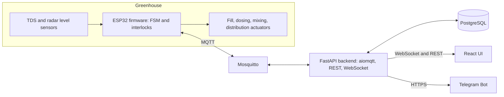

# 05 Architecture

## Components

All server components run as Docker Compose services on a Raspberry Pi. The control-room monitor opens the UI over local LAN. Remote users reach the Pi through Tailscale.

## Authority split

ESP32 owns process execution and safety: FSM, interlocks, gate evaluation, actuator outputs. [SPEC for interlocks, PROPOSED for FSM running on ESP32, see D-010]. Backend owns users, auth, schedules, history, alerts, and relays commands. UI never talks to the broker or hardware directly.

## Dosing and gate [SPEC]

Open-loop feedforward dosing: dose is computed before dosing from known volumes and base measurement, then not corrected. After mixing and stabilizing, TDS is measured and a one-way gate checks 550 to 650 ppm. Pass leads to distribution. Fail halts distribution and raises a fault, there is no automatic re-dose.

## FSM (10 states) [SPEC names, VERIFY descriptions]

Descriptions are inferred from state names, reconcile with SPEC.md.

| State | Purpose | Normal exit |
| --- | --- | --- |
| IDLE | Waiting for start | Start command or schedule |
| FILLING_WATER | Fill Drum 2 with water to batch volume | Level reached |
| CHECK_BASE | Measure base TDS of water for feedforward calculation | Base recorded |
| DOSING | Dose concentrate from Drum 1 into Drum 2 | Dose volume delivered |
| MIXING | Circulate to homogenize | Mix time elapsed |
| STABILIZING | Settle before measurement | Settle time elapsed |
| MEASURING_TDS | Sample TDS for gate | Stable reading captured |
| GATE_EVALUATE | Compare reading to 550 to 650 ppm | Pass to DISTRIBUTING, fail to fault |
| DISTRIBUTING | Pump to all 6 beds simultaneously | Drum 2 depleted |
| BATCH_DEPLETED | Close batch, record result | Return to IDLE |

Fault is a latched flag, not an eleventh state, because SPEC lists 10 states and has a Reset Fault action. [VERIFY]

## Data flow

Firmware publishes telemetry, state, actuator status, and events. Backend subscribes, persists, and fans out over WebSocket. UI commands go REST to backend, backend publishes a command with an id, firmware validates against interlocks and FSM state, then replies with an ack or reject on the ack topic. Backend returns the result to the UI.

## Failure posture

Broker or backend down: firmware continues the active batch to a safe end and buffers events. ESP32 offline: UI shows disconnected, no commands accepted, last known state marked stale. Details in 09_ERROR_HANDLING.

## Repo layout [PROPOSED]

firmware/, backend/, frontend/, deploy/ (compose, mosquitto, tailscale notes), simulator/, docs/SPEC.md, brain/.
