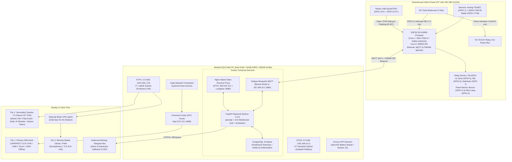
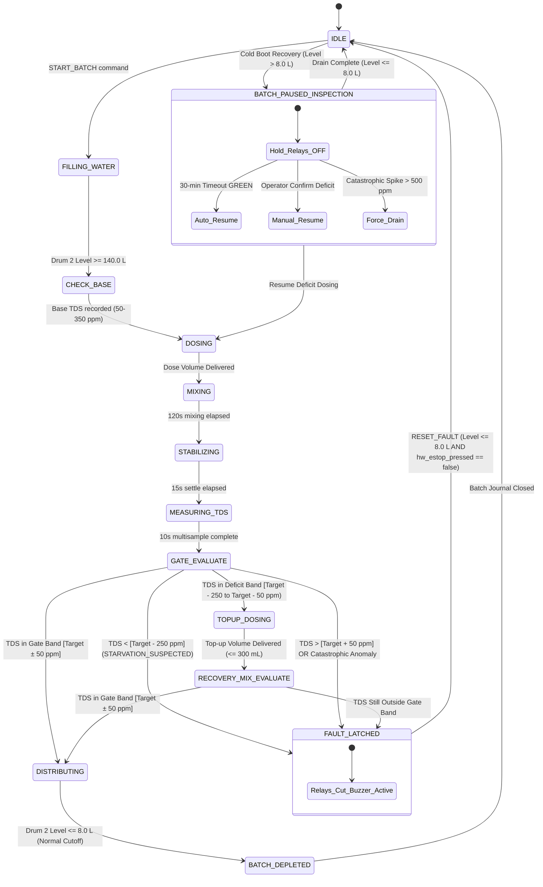
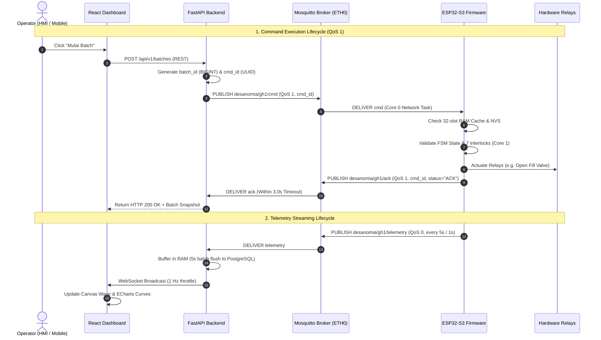

# 05 Architecture

> **System:** DESANOMIA Greenhouse Automated Fertigation System  
> **Platform:** Beelink EQ12 Mini PC (Intel N100) + ESP32-S3 N16R8 Edge Microcontroller  
> **Authority:** Governed by [00_MASTER_RULES.md](file:///home/maria_zahra/Documents/projects/greenhouse/desanomia/brain/00_MASTER_RULES.md), [04_TRD.md](file:///home/maria_zahra/Documents/projects/greenhouse/desanomia/brain/04_TRD.md), and [18_DECISIONS.md](file:///home/maria_zahra/Documents/projects/greenhouse/desanomia/brain/18_DECISIONS.md) (D-001 through D-046).

---

## 1. System Topology & Physical Architecture

The Desanomia system operates as an industrial on-site edge architecture deployed directly inside the greenhouse panel control room. It physically decouples real-time process execution and safety interlocks (handled on bare-metal microcontroller firmware) from supervisory management, analytics, and user interfaces (hosted on an industrial x86_64 mini PC).



### 1.1 Dual 2.5 GbE NIC Hardware Network Segmentation

The Beelink EQ12 leverages its dual physical Intel i225-V/i226-V 2.5 Gbps Ethernet controllers to enforce a strict hardware-level air-gap between the OT industrial fieldbus and external IT/WAN networks (D-043):

```
[ ESP32-S3 Microcontroller ] 
         │ (192.168.10.20 via W5500 SPI)
         ▼
[ Unmanaged Industrial Switch ] ─── ETH0 (192.168.10.1) ───► [ Beelink EQ12 ]
(OT LAN: 192.168.10.0/24)                                    [ Docker Compose ]
                                                                     │
[ Orbit Star H2 Modem / WAN ] ─── ETH1 (192.168.1.10) ◄──────────────┘
         │ (192.168.1.1)            (IT LAN: 192.168.1.0/24)
         ├────────────────────────────────────────┐
         ▼                                        ▼
[ Tenda O1 PTP Bridge ]                  [ Tailscale Mesh VPN ]
         │ (156.5m span)                          │
         ▼                                        ▼
[ Xiaomi TV 43'' Gazebo ]                [ Mobile Operator Phones ]
(192.168.1.50 - Allowlisted)             (PWA over TLS :443)
```

1. **OT Industrial Subnet (`ETH0` - `192.168.10.0/24`):**
   - Static IP: `192.168.10.1/24`.
   - Dedicated solely to the ESP32-S3 microcontroller (`192.168.10.20`), field sensors, and relay controllers over wired Cat5e/Cat6. Wi-Fi is strictly disabled.
   - **Mosquitto MQTT Isolation:** Eclipse Mosquitto binds exclusively to `192.168.10.1:1883`. Port 1883 is completely unreachable from ETH1.
   - **Chrony NTP Server:** Beelink broadcasts local Stratum-10 NTP over `192.168.10.1:123`, syncing ESP32 hardware time every 60 minutes.
2. **IT / WAN Uplink Subnet (`ETH1` - `192.168.1.0/24`):**
   - Assigned IP: `192.168.1.10/24` from the Orbit Star H2 4G modem router (`192.168.1.1`).
   - Connects the Tenda O1 2.4 GHz wireless PTP bridge (156.5m span to the Gazebo display), Tailscale WireGuard mesh tunnel, and outbound Telegram Bot HTTPS traffic.
   - **Nginx Web Gateway:** Nginx binds to `192.168.1.10:80` (auto-redirect to HTTPS) and `192.168.1.10:443` (TLS with local CA certificate), plus `127.0.0.1:8080` for the local Kiosk loopback.
3. **Firewall Isolation Policy (`nftables`):**
   - Host Linux kernel drops all forward traffic between `eth0` and `eth1` (`iifname "eth0" oifname "eth1" drop; iifname "eth1" oifname "eth0" drop`).
   - Prevents external network intrusions, broadcasts, or IP routing leaks from compromising greenhouse physical actuators.

### 1.2 Dedicated Client Display Tiers

The user-facing system serves three strictly segregated client tiers (D-014, D-026):

| Tier | Display Hardware & Environment | Host Interface & Compositor | Authentication & Role Lifecycle | Operational Authority |
| :--- | :--- | :--- | :--- | :--- |
| **Tier 1: Primary HMI Kiosk** | UPERFECT BE156PF 15.6" FHD (1920×1080) IPS, 10-point capacitive touch, 90 cm standing kiosk in greenhouse control room | Direct HDMI 2.0 + USB-C touch to Beelink EQ12; Debian 12 Minimal + Cage Wayland compositor running Chromium `--kiosk` at `http://127.0.0.1:8080` | Persistent local loopback `Operator` session with zero idle lockout; step-up modal PIN/Password elevation to `Admin` (15-min grant) | Primary local control, manual tests, sensor calibration, instant 1-tap E-Stop. 100% functional offline without internet. |
| **Tier 2: Secondary Gazebo Display** | Xiaomi TV A 43" FHD (1920×1080) Google TV™ 2026 on VESA 200×200 wall bracket in Gazebo | Wired RJ45 Ethernet across 156.5m Tenda O1 PTP bridge to Gazebo DMZ; running Fully Kiosk Browser 24/7 | Auto-authenticated `Viewer` session via Nginx IP allowlist (`192.168.1.50`) **AND** read-only device bearer token in request headers. All HTTP mutations return `403 Forbidden` | Passive 24/7 telemetry and drum visualizer mirror. Zero control dispatch capability. |
| **Tier 3: Remote Mobile Clients** | Modern Mobile Smartphones (iOS / Android) | Tailscale Mesh VPN / Local Wi-Fi; modern mobile browser running installed PWA over TLS/HTTPS (`:443`) | Standard username/password credentials; sliding 8-hour idle timeout, 7-day absolute expiration via `HttpOnly`, `SameSite=Lax`, `Secure` cookies | Remote monitoring, scheduled batch oversight, guarded control with two-step confirmation modal E-Stop. |

---

## 2. Subsystem Authority Split & FreeRTOS Dual-Core Model

The architecture enforces a strict physical separation of concerns:

```
[ Physical World & Actuators ]
             ▲
             │ Direct GPIO / ISR / High-Voltage Relay Coils
             ▼
[ ESP32-S3 Microcontroller ] ─── PROCESS EXECUTION & SAFETY AUTHORITY (D-003, D-010)
  ├── FreeRTOS Core 1 (240 MHz): 20 Hz FSM Tick, 7 Safety Interlocks, Analog Sensor DSP
  └── FreeRTOS Core 0 (240 MHz): W5500 SPI Ethernet, MQTT Client, QoS 1 ACK, PSRAM Spooler
             ▲
             │ Isolated OT LAN (MQTT QoS 1 / QoS 0)
             ▼
[ FastAPI Backend (Beelink) ] ─── SUPERVISORY & BUSINESS LOGIC AUTHORITY (D-005, D-038)
  ├── 1 Hz Unified Schedule-First Engine & Dynamic Baseline Reference Shifting
  ├── PostgreSQL 16 Persistence (Monthly Partitions, 5s NVMe Write Buffering)
  ├── In-App Notification Hub & 1 Hz WebSocket Broadcast Hub
  └── Outbound Telegram Bot Client with Interactive Callback Handlers
             ▲
             │ WebSocket Stream & REST API (:8080 Loopback / :443 TLS)
             ▼
[ React TypeScript Frontend ] ─── PRESENTATION & INTERACTION ONLY (D-029, D-042)
  ├── SVG / HTML5 Canvas Dynamic Wave Physics (60 FPS fluid surface indicators)
  ├── Apache ECharts Time-Series Visualizer & Multi-Tank 5-Pair Calendar Timeline
  └── Zero direct hardware access; all actions dispatch through Backend REST endpoints
```

### 2.1 Microcontroller FreeRTOS Dual-Core Asymmetric Task Allocation

To ensure safety interlocks and real-time FSM transitions are never starved by network I/O latency or packet drops, the ESP32-S3 assigns tasks across its two 240 MHz Xtensa LX7 cores:

1. **Core 1 — Real-Time Control & Safety Domain (Deterministic):**
   - **`fsm_task` (Priority 5 - Highest Application Task):** Executes the 12-state FSM at an exact **20 Hz cycle rate (50 ms tick period)** using `vTaskDelayUntil()`.
   - **Safety Interlock Matrix:** Evaluates all 7 safety interlocks synchronously during every 50 ms loop before GPIO relay registers are updated.
   - **`sensor_task` (Priority 3):** Performs 10 Hz ADC multisampling for the analog TDS probe, applying a 10-sample moving trimmed median filter, and parses 10 Hz FMCW radar level frames from UART1.
2. **Core 0 — Network & Asynchronous Communication Domain:**
   - **W5500 SPI Driver & TCP/IP Stack (Priority 4):** Manages physical Ethernet frames over SPI bus (GPIO 10–15).
   - **`mqtt_client_task` (Priority 2):** Maintains the MQTT connection to Mosquitto, dispatches QoS 0 telemetry (5s standard, 1s measuring), handles incoming QoS 1 commands, and manages the 32-slot circular RAM idempotency cache.
   - **`psram_spooler_task` (Priority 1):** In the event of network disruption, spools FSM transition events and faults into an 8MB Octal PSRAM ring buffer (capacity 500 events) and flushes them in chronological order upon reconnection.

---

## 3. Unified Schedule-First Engine, 5-Pair Topology & Hydraulic Invariants

All automated execution originates strictly from manual operator configuration. To eliminate split-brain logic between automated schedules and manual runs, every execution is managed by a single unified scheduling engine (D-038).

### 3.1 Unified Scheduler & Dynamic Baseline Reference Shifting

- **Immediate Batch Execution:** When an operator clicks `Mulai Sekarang` on the UI, the backend creates an immediate scheduled batch with `schedule_at = NOW`. There is no separate, un-journaled manual batch runner.
- **Preemption & Later Schedule Suppression:** If an operator triggers an ad-hoc batch at 10:00 when an automated schedule is set for 11:00 on that day, the 11:00 run is automatically deleted/suppressed to prevent duplicate irrigation.
- **Dynamic Recurrence Baseline Anchor:** The ad-hoc batch execution timestamp ($T_{\text{start}}$) dynamically becomes the new baseline reference anchor ($T_{\text{last\_run}}$) for the subsequent autonomous recurrence interval (e.g. $T_{\text{next}} = T_{\text{start}} + 24\text{ hours}$).
- **Imminent Schedule Warning & Deferral Window (D-024):**
  - If a manual run is initiated $< 15\text{ minutes}$ before an automated schedule, the UI surfaces an explicit postponement warning.
  - If an automated schedule triggers while Drum 2 level $> 5.0\text{ L}$ or during Pause Mode, the scheduler defers execution for up to **60 minutes**. If Drum 2 does not clear within 60 minutes, the schedule cancels automatically and dispatches a critical Telegram alert.

### 3.2 Multi-Tank 5-Pair Roadmap & Zero-Conflict Hydraulic Invariant

- **5-Pair Modular Topology (D-040):** Accommodates 5 Concentrate Drums (K1–K5, 20 L each) and 5 Distribution Drums (D1–D5, 140 L each). In Phase 1, Pair 1 (Concentrate Drum 1 and Distribution Drum 2) is actively plumbed and sensored; Pairs 2–5 are displayed on the Dashboard in `Standby / Belum Terpasang` status.
- **Zero-Conflict Hydraulic Invariant (D-040):** Because all distribution drums share a unified high-pressure pump and single main delivery line feeding the 6 beds (980 dripper points), **no two distribution tanks may distribute on the same calendar day or overlapping time slot**.
- **Same-Day Double Distribution Protection (D-039):** Only one distribution cycle is permitted per calendar day by default. Attempting a second distribution triggers a high-friction Hard Confirmation Modal with agronomic risk warnings (root asphyxiation, salt buildup). Confirming the run requires the `is_same_day_override: true` flag and permanently logs `SAME_DAY_FORCE_OVERRIDE` to the SHA-256 cryptographic audit trail.

---

## 4. 12-State FSM, Dosing Architecture & Safety Interlocks

### 4.1 Semi-Closed Loop Dosing & Dynamic Gate Band

The system employs semi-closed loop dosing (D-001) governed by empirical volume-to-time calibration:

1. **Initial Feedforward Dose:** Calculated from clean water volume ($140.0\text{ L}$) and measured baseline water TDS ($50 \le \text{TDS}_{\text{base}} < 350\text{ ppm}$):
   $$V_{\text{dose\_mL}} = \frac{(\text{TDS}_{\text{target}} - \text{TDS}_{\text{base}}) \times 140.0}{94.68}$$
   Peristaltic pump runtime: $t_{\text{pump\_sec}} = V_{\text{dose\_mL}} \times 0.107\text{ s/mL}$.
2. **Dynamic Gate Band:** The pass threshold is dynamically calculated based on the active recipe preset:
   $$[\text{TDS}_{\text{target}} - 50\text{ ppm}] \le \text{TDS}_{\text{mean}} \le [\text{TDS}_{\text{target}} + 50\text{ ppm}]$$
   - *Generatif:* Target 1250 ppm (Pass: 1200–1300 ppm).
   - *Vegetatif:* Target 1100 ppm (Pass: 1050–1150 ppm).
   - *Panen:* Target 1050 ppm (Pass: 1000–1100 ppm).
3. **Single-Pass Top-Up Recovery:** If post-mixing TDS falls below gate min but within 250 ppm of target, the FSM transitions to `TOPUP_DOSING`, delivering a calculated top-up volume capped at **300.0 mL max**, followed by a single recovery cycle (60s mix, 15s settle, 10s measure in `RECOVERY_MIX_EVALUATE`).
4. **Starvation & Overdose Protection:** If post-mix TDS is $> 250\text{ ppm}$ below target, the system sounds `STARVATION_SUSPECTED` (D-022). If TDS exceeds gate max or fails after top-up, it latches `FAULT_PPM_OUT_OF_RANGE` and locks the distribution pump OFF. There is no automatic second re-dose.

### 4.2 Authoritative 12-State FSM Engine



| State | Purpose | Hardware Outputs Active | Normal Exit / Next State | Anomaly / Fault Path |
| :--- | :--- | :--- | :--- | :--- |
| **`IDLE`** | Resting state, awaiting batch dispatch | All relays OFF | Valid `START_BATCH` command $\to$ `FILLING_WATER` | IL-03: Rejected if level $> 8.0\text{ L}$ |
| **`FILLING_WATER`** | Fill Drum 2 with clean water to 140.0 L | Relay 1 (Fill Valve AC 220V) ON | Radar level $\ge 140.0\text{ L} \to$ `CHECK_BASE` | IL-04: Rise $< 1.0\text{ L}$ in 90s or $> 20\text{ min} \to$ `FAULT_NO_WATER_SUPPLY` |
| **`CHECK_BASE`** | Measure raw groundwater baseline TDS | All relays OFF | Baseline captured ($50 \le \text{TDS} < 350\text{ ppm}) \to$ `DOSING` | IL-05: TDS $< 50\text{ ppm} \to$ `FAULT_TDS_INVALID`; $\ge 350\text{ ppm} \to$ `FAULT_BASE_TDS_HIGH` |
| **`DOSING`** | Deliver calculated fertilizer concentrate | Relay 2 (Peristaltic Pump DC 12V) ON | Pump runtime $t_{\text{pump\_sec}}$ elapsed $\to$ `MIXING` | E-Stop or Power cut |
| **`MIXING`** | Submersible pump circulation | Relay 3 (Mixing Pump AC 220V) ON | Timer $120\text{ s}$ elapsed $\to$ `STABILIZING` | E-Stop or Radar offline |
| **`STABILIZING`** | Turbulence settling before sampling | All relays OFF | Timer $15\text{ s}$ elapsed $\to$ `MEASURING_TDS` | E-Stop or Radar offline |
| **`MEASURING_TDS`** | Multisampling ADC acquisition (10 Hz) | All relays OFF | $10\text{ s}$ sampling complete $\to$ `GATE_EVALUATE` | IL-05: ADC noise / out of bounds |
| **`GATE_EVALUATE`** | Evaluate mean TDS against recipe band | All relays OFF | Pass: $[\text{Target} \pm 50\text{ ppm}] \to$ `DISTRIBUTING` | Deficit: $\to$ `TOPUP_DOSING`; Overshoot: $\to$ `FAULT_PPM_OUT_OF_RANGE` |
| **`TOPUP_DOSING`** | Deliver single-pass top-up ($\le 300\text{ mL}$) | Relay 2 (Peristaltic Pump DC 12V) ON | Top-up volume delivered $\to$ `RECOVERY_MIX_EVALUATE` | E-Stop or Power cut |
| **`RECOVERY_MIX_EVALUATE`** | Homogenize and re-evaluate top-up | Relay 3 ON (60s), Settle (15s), Measure (10s) | Pass: $[\text{Target} \pm 50\text{ ppm}] \to$ `DISTRIBUTING` | Fail: $\to$ `FAULT_PPM_OUT_OF_RANGE` |
| **`DISTRIBUTING`** | Irrigate 6 beds (980 drippers) | Relay 4 (Dist Pump AC 220V) ON | Drum 2 level $\le 8.0\text{ L} \to$ `BATCH_DEPLETED` | IL-02: Level $< 6.0\text{ L}$ cuts pump in $\le 200\text{ ms}$ (`D-048`) |
| **`BATCH_DEPLETED`** | Finalize batch and record totals | All relays OFF | Event log committed $\to$ `IDLE` | Database / queue retry |
| **`BATCH_PAUSED_INSPECTION`** *(Latched Mode)* | Outage cold-boot hold with Drum 2 $> 8.0\text{ L}$ | All relays OFF | 30-min auto-resume green OR manual confirm $\to$ `DOSING` | Catastrophic spike $> 500\text{ ppm} \to$ manual gravity drain to $\le 8.0\text{ L}$ |

### 4.3 Integrated 7 Firmware Safety Interlocks

All 7 interlocks execute in the 20 Hz FreeRTOS Core 1 loop prior to relay actuation (D-003):

| ID | Interlock Name | Trigger Condition | Latched Fault Code | Hardware Safety Response | Reset Requirement (Gated Reset) |
| :--- | :--- | :--- | :--- | :--- | :--- |
| **IL-01** | **TDS Safety Gate** | Final mean TDS $< (\text{Target}-50)$ or $> (\text{Target}+50\text{ ppm})$ | `FAULT_PPM_OUT_OF_RANGE` | Distribution pump (GPIO 7) locked OFF | Manual drain via gravity valve to ditch until level $\le 8.0\text{ L}$ |
| **IL-02** | **Radar Dry-Run Cutoff** | Drum 2 level $< 6.0\text{ L}$ while distribution pump is active | `FAULT_DRY_RUN` | Cut distribution pump (GPIO 7) in $\le 200\text{ ms}$ (`D-048`) | FSM returns to `IDLE` / refilling allowed |
| **IL-03** | **Batch Depletion Guard** | `START_BATCH` command received while Drum 2 $> 8.0\text{ L}$ | `FAULT_BATCH_REJECTED` | Reject command, all relays remain OFF | Drain residual water to $\le 8.0\text{ L}$ (`D-048`) |
| **IL-04** | **Dual-Stage Fill Guard** | Level rise $< 1.0\text{ L}$ in 90s OR total fill time $> 20\text{ min}$ | `FAULT_NO_WATER_SUPPLY` / `FAULT_FILL_TIMEOUT` | Close fill valve (GPIO 4), halt timer | Clear water supply issue, click `Resume Fill` on UI |
| **IL-05** | **Water Baseline Plausibility** | Raw water TDS $< 50$, $> 2000$, or baseline $\ge 350\text{ ppm}$ | `FAULT_TDS_INVALID` / `FAULT_BASE_TDS_HIGH` | Close fill valve, abort batch immediately | Inspect TDS probe cable or raw water source |
| **IL-06** | **Radar Liveness Watchdog** | Radar UART1 silent / missing frames for $> 3.0\text{ s}$ | `FAULT_RADAR_OFFLINE` | Cut all 4 relays immediately | Latched; de-latched via RESET_FAULT once valid frames stable $\ge 3.0\text{ s}$ (`D-048`) |
| **IL-07** | **Emergency Stop Guard** | Physical NC switch loop open (GPIO 21 High / ISR) OR software E-Stop command | `FAULT_ESTOP` | Mechanical power bus cut ($0\text{ ms}$) + GPIO Low ($< 5\text{ ms}$) | Twist physical switch NC (`hw_estop_pressed == false`) AND Drum 2 level $\le 8.0\text{ L}$ (or Tiered Recovery, `D-048`) |

---

## 5. Communication Architecture & Data Flow

Communication follows an asymmetric protocol stack: commands enforce strict bidirectional MQTT QoS 1 handshaking, while telemetry fans out via MQTT QoS 0 and a 1 Hz server-sent WebSocket stream.



### 5.1 Command Idempotency & Reboot Resilience (D-045)

- Every mutation published by the backend on `desanomia/gh1/cmd` carries a unique UUID `cmd_id`.
- The ESP32-S3 maintains a 32-entry circular RAM cache of executed `cmd_id`s.
- **Reboot Resilience (NVS Invariant):** To prevent duplicate relay actuation when the broker retransmits unacknowledged QoS 1 packets after an unexpected microcontroller reboot, the ESP32 writes `last_executed_cmd_id` to NVS flash upon execution. On reboot, matching commands are immediately acknowledged on `desanomia/gh1/ack` without re-triggering relays.
- **ACK Timeout:** The backend enforces a strict **3.0-second ACK timeout**. If no ACK arrives on `desanomia/gh1/ack`, the backend surfaces a `COMMAND_TIMEOUT` toast to the operator.

### 5.2 Offline PSRAM Event Spooling

If physical Ethernet connectivity to Mosquitto is interrupted, the ESP32-S3 continues executing the active batch autonomously. All state transitions, gate results, and fault trips are committed to a **500-event circular ring buffer in 8MB PSRAM**. When the network link recovers, the spooler flushes all buffered events chronologically to `desanomia/gh1/events`.

### 5.3 MQTT Topic Namespace & Liveness Supervision

```
desanomia/gh1/
  ├── telemetry       [QoS 0]  (ESP32 -> Backend: 5.0s standard, 1.0s measuring/calibrating)
  ├── cmd             [QoS 1]  (Backend -> ESP32: START_BATCH, RESUME_FILL, ESTOP, RESET_FAULT, etc.)
  ├── ack             [QoS 1]  (ESP32 -> Backend: correlated UUID execution receipt)
  ├── events          [QoS 1]  (ESP32 -> Backend: discrete FSM state transitions & safety trips)
  └── status          [QoS 1]  (ESP32 -> Backend: LWT liveness heartbeat, retain=true)
```

- **Keep-Alive & LWT:** ESP32 maintains a 10s MQTT keep-alive with LWT payload `{"online": false, "reason": "lwt"}` on `desanomia/gh1/status`.
- **Liveness Thresholds:** Backend flags hardware status as `STALE` if telemetry is silent for $> 12.0\text{ s}$ (allowing 2 dropped frames) and `OFFLINE` if $> 20.0\text{ s}$.

---

## 6. Edge Data Storage, Retention & Time Synchronization

### 6.1 PostgreSQL 16 Partitioning & NVMe Wear Protection (D-044)

The Beelink EQ12 runs PostgreSQL 16 Alpine with optimizations designed to protect the internal 500GB NVMe SSD against excessive write amplification:

1. **5-Second RAM Write Buffering:** Incoming 1 Hz telemetry readings are accumulated in backend RAM and bulk-inserted every 5 seconds in a single transaction.
2. **Monthly Range Partitioning:** Table `telemetry` is partitioned by month (`telemetry_y2026m10`, etc.). Data drops occur instantaneously via `DROP TABLE` on the oldest monthly partition (effective retention **90–120 days**), eliminating disk fragmentation and vacuum overhead.
3. **2-Year 1-Minute Rollups:** Long-term historical trend analysis uses table `telemetry_1m` (storing min, max, mean for TDS and level) retained for 2 years.
4. **Cryptographic Audit Trail (TR-16):** Table `audit_logs` enforces SHA-256 hash chaining:
   $$\text{row\_hash} = \text{SHA256}(\text{coalesce}(\text{prev\_hash}, \text{'GENESIS'}) \mathbin{\Vert} \text{ts} \mathbin{\Vert} \text{coalesce}(\text{user\_id}::\text{text}, \text{'system'}) \mathbin{\Vert} \text{action\_type} \mathbin{\Vert} \text{target\_resource} \mathbin{\Vert} \text{payload\_snapshot}::\text{text})$$
   Enforced append-only via database trigger; zero `UPDATE` or `DELETE` permissions granted.
5. **Dual-Target Backup Strategy:**
   - *Target A (Local NVMe):* Automated daily `pg_dump` compressed with `zstd` stored in `/var/backups/postgres` (retaining 30 daily snapshots).
   - *Target B (Off-Device):* Nightly backup script mirrors the latest snapshot to an external USB drive and synchronizes over the Tailscale mesh VPN to remote off-site storage.

### 6.2 Edge Time Synchronization & Stratum-10 NTP Master (D-020)

Because the greenhouse operates in rural conditions with intermittent cellular connectivity, the system cannot depend on public cloud NTP servers for scheduled batch timing:

1. **Hardware Time Master:** The Beelink EQ12 motherboard battery-backed RTC (`/dev/rtc0`) serves as the authoritative hardware clock master on cold boot (`hwclock --hctsys`).
2. **Local Chrony Stratum-10 NTP Server:** Chrony runs on Debian 12, serving NTP queries across the isolated OT LAN at `192.168.10.1:123`.
3. **Microcontroller Time Sync:** The ESP32-S3 runs a FreeRTOS SNTP client that synchronizes its internal RTC with `192.168.10.1` every 60 minutes.
4. **Upstream Internet Drift Correction:** Whenever the Orbit Star H2 4G connection is active, Chrony synchronizes against `pool.ntp.org` and updates the motherboard RTC (`hwclock --systohc`).

---

## 7. Architectural Failure Modes & Resilience Matrix

The edge system is designed to degrade gracefully across all failure boundaries:

| Failure Mode | Detection Mechanism | Immediate Autonomous Response | Safe Degradation & Recovery Path |
| :--- | :--- | :--- | :--- |
| **Mosquitto Broker or FastAPI Down** | ESP32 TCP socket disconnect / W5500 link timeout | ESP32 Core 1 continues active batch execution uninterrupted to safe completion (`DISTRIBUTING` or `FAULT`) | Commits all transitions into 500-event PSRAM spooler ring buffer. Flushes to database upon broker reconnection. |
| **ESP32 Disconnected or Crash** | MQTT LWT trip or telemetry silent for $> 12.0\text{ s}$ (`STALE`), $> 20.0\text{ s}$ (`OFFLINE`) | UI displays red connection banner; disables all control and batch start buttons | Microcontroller hardware watchdog auto-reboots ESP32 in $< 1.0\text{ s}$. State restored via NVS journal. |
| **Mid-Batch Power Outage (AC Loss)** | Mains loss un-energizes system; cold-boot detected on AC restoration | BIOS AMI auto-boots Beelink; ESP32 boots and reads NVS status: incomplete batch AND Drum 2 $> 5.0\text{ L}$ | Enters `BATCH_PAUSED_INSPECTION` mode (all relays OFF). UI displays deficit math. 30-min auto-resume timer triggers if all 7 interlocks pass, or operator performs manual gravity drain if spike $> 500\text{ ppm}$ (D-013). |
| **4G WAN / Cellular Modem Loss** | Ping probe to `api.telegram.org` fails | Greenhouse batch execution, HMI Kiosk, and local Gazebo TV operate 100% unaffected | Outbound Telegram alerts queue in table `alert_queue` (up to 1,000 items). Flushed chronologically upon WAN restoration (TR-22). |
| **Water Supply Stall / Solenoid Failure** | Dual-Stage Fill Guard (IL-04): Level rise $< 1.0\text{ L}$ in 90s OR fill time $> 20\text{ min}$ | De-energizes Fill Valve (GPIO 4); latches `FAULT_NO_WATER_SUPPLY` or `FAULT_FILL_TIMEOUT` | Batch is NOT aborted or drained. UI exposes `Resume Fill` button, allowing operator to resolve plumbing and resume filling without restarting batch (TR-19). |
| **Emergency Stop Mushroom Trip** | Direct series NC contact open ($0\text{ ms}$) + GPIO 21 falling edge ISR ($< 5\text{ ms}$) | Hardware relay coil bus cut mechanically; firmware de-energizes all GPIO outputs; latches `FAULT_ESTOP` | Local buzzer pulses for 60s; Pilot Lamp solid ON. Reset button is hard-locked until physical switch is twisted open (`hw_estop_pressed == false`) AND Drum 2 level $\le 8.0\text{ L}$ (or Tiered Recovery, `D-048`) (D-019). |

---

## 8. Repository Layout & Domain Boundaries

The repository enforces strict domain isolation governed by [00_MASTER_RULES.md](file:///home/maria_zahra/Documents/projects/greenhouse/desanomia/brain/00_MASTER_RULES.md) and [AGENTS.md](file:///home/maria_zahra/Documents/projects/greenhouse/desanomia/AGENTS.md):

```
desanomia/
  ├── brain/          # Architectural authority, PRD, TRD, Data Model, Decisions (D-001 to D-046)
  ├── firmware/       # ESP32-S3 C++/FreeRTOS firmware, drivers (ADS1115, FMCW radar), interlocks
  ├── backend/        # FastAPI Python 3.12 application, aiomqtt, SQLAlchemy models, Alembic migrations
  ├── frontend/       # React 19 + TypeScript + Vite dashboard, Canvas wave physics, Apache ECharts
  ├── hardware/       # Hardware schematics, KiCad files, pinouts, and BOM documentation
  ├── docs/           # Empirical calibration logs (DOSE_TEST_RESULT.md) and SPEC.md reference
  └── .agents/        # Architectural skills, issue templates, and agent workflow governance
```

### Domain Boundary Rules:
1. **Safety Critical Invariant:** Never modify, bypass, or weaken the 7 safety interlocks in `firmware/` or their representation in `brain/`.
2. **Domain Directory Isolation:** Changes must remain strictly inside their functional directory (`firmware/`, `backend/`, or `frontend/`). Cross-domain changes require explicit coordination.
3. **Authority Hierarchy:** `brain/00_MASTER_RULES.md` and `brain/18_DECISIONS.md` govern all software invariants; `docs/SPEC.md` governs frozen hardware constants.
