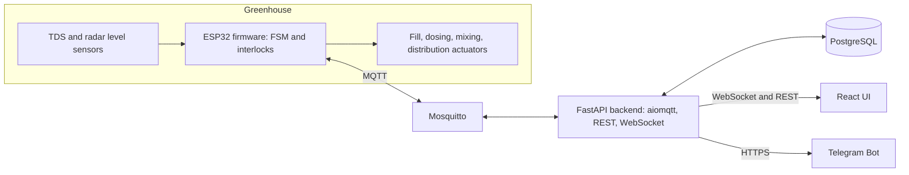

# 05 Architecture

## Components

All server components run as Docker Compose services on the on-site Beelink EQ12 Mini PC (Intel N100, 16GB DDR5, 500GB NVMe).

The system serves three dedicated client tiers:
1. **Primary HMI Touchscreen (Greenhouse Panel Room):** UPERFECT BE156PF 15.6" FHD (1920×1080) IPS, 10-point capacitive touch on a 90 cm standing kiosk, directly connected to Beelink EQ12 (HDMI + USB-C touch data), operating 100% offline with 1-tap E-Stop.
2. **Secondary Display Gazebo (Gazebo Monitoring):** Xiaomi TV A 43" FHD 2026 (Google TV™), 1920×1080, VESA 200×200 wall bracket, wired LAN RJ45 to Orbit Star H2 modem (Gazebo DMZ) across the 156.5m Tenda O1 2.4GHz PTP bridge, running Fully Kiosk Browser 24/7 in passive read-only mirror mode (`Viewer` role).
3. **Mobile Client (Operator/Admin Smartphones):** Responsive Web App (PWA) accessed over local WiFi or Tailscale VPN.

## Authority split

ESP32 owns process execution and safety: FSM, interlocks, gate evaluation, actuator outputs. [SPEC for interlocks, PROPOSED for FSM running on ESP32, see D-010]. Backend owns users, auth, schedules, history, alerts, and relays commands. UI never talks to the broker or hardware directly.

## Unified Schedule-First Engine & Dynamic Baseline Reference

All fertigation batches are managed by a single unified scheduling engine rooted in operator manual configuration. There is no independent, out-of-band manual batch runner.
- **Immediate Batch (`schedule_at = NOW`):** Ad-hoc operator batch runs are scheduled for immediate execution.
- **Preemption & Later Schedule Cancellation:** If an operator triggers an ad-hoc batch at 10:00 when an automated schedule is set for 11:00 on that day, the 11:00 run is automatically deleted/suppressed to prevent duplicate irrigation, and the 10:00 execution timestamp dynamically becomes the new baseline reference for the subsequent autonomous recurrence interval.
- **Single Upfront Confirmation & Autonomous Distribution:** Confirmation occurs upfront (Recipe, Timing ['Now'/'Later'], and Tank Pair). Once the 7 firmware safety interlocks and TDS gate evaluation pass, the system automatically proceeds to `DISTRIBUTING` without secondary operator confirmation.
- **Same-Day Protection:** Only one distribution cycle is permitted per calendar day by default; attempting a secondary distribution requires an explicit Hard Confirmation dialog with agronomic risk warnings.

## Multi-Tank 5-Pair Topology & Zero-Conflict Hydraulic Arbitration

- **5-Pair Modular Architecture:** Accommodates 5 Concentrate Drums (K1–K5, 20 L each) and 5 Distribution Drums (D1–D5, 140 L each). In Phase 1, Pair 1 is actively plumbed and sensored; Pairs 2–5 are displayed on the Dashboard in 'Standby / Belum Terpasang' status.
- **Zero-Conflict Hydraulic Invariant:** Because all distribution tanks share a unified high-pressure pump and single main delivery line to the 6 beds in Phase 1, no two distribution tanks may distribute on the same day or overlapping time slot.
- **Dashboard Calendar Arbitration:** The backend scheduler enforces and visually arbitrates non-overlapping time slots across all 5 tank pairs.

## Dosing and gate [SPEC]

Open-loop feedforward dosing: dose is computed before dosing from known volumes and base measurement, then not corrected. After mixing and stabilizing, TDS is measured and a one-way gate checks 550 to 650 ppm. Pass leads to distribution. Fail halts distribution and raises a fault, there is no automatic re-dose.

## FSM (10 states) [SPEC names, VERIFY descriptions]

Descriptions are inferred from state names, reconcile with SPEC.md.

| State | Purpose | Normal exit |
| --- | --- | --- |
| IDLE | Waiting for start | Start command or schedule |
| FILLING_WATER | Fill Drum 2 with water to batch volume | Level reached |
| CHECK_BASE | Measure base TDS of water for feedforward calculation | Base recorded |
| DOSING | Dose concentrate from Drum 1 into Drum 2 | Dose volume delivered |
| MIXING | Circulate to homogenize | Mix time elapsed |
| STABILIZING | Settle before measurement | Settle time elapsed |
| MEASURING_TDS | Sample TDS for gate | Stable reading captured |
| GATE_EVALUATE | Compare reading to 550 to 650 ppm | Pass to DISTRIBUTING, fail to fault |
| DISTRIBUTING | Pump to all 6 beds simultaneously | Drum 2 depleted |
| BATCH_DEPLETED | Close batch, record result | Return to IDLE |

Fault is a latched flag, not an eleventh state, because SPEC lists 10 states and has a Reset Fault action. [VERIFY]

## Data flow

Firmware publishes telemetry, state, actuator status, and events. Backend subscribes, persists, and fans out over WebSocket. UI commands go REST to backend, backend publishes a command with an id, firmware validates against interlocks and FSM state, then replies with an ack or reject on the ack topic. Backend returns the result to the UI.

## Failure posture

Broker or backend down: firmware continues the active batch to a safe end and buffers events. ESP32 offline: UI shows disconnected, no commands accepted, last known state marked stale. Details in 09_ERROR_HANDLING.

## Repo layout [PROPOSED]

firmware/, backend/, frontend/, deploy/ (compose, mosquitto, tailscale notes), simulator/, docs/SPEC.md, brain/.
