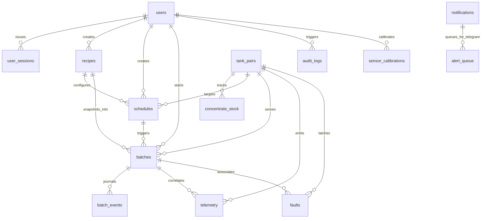

# 06 Data Model

PostgreSQL 16, migrations managed with Alembic, asynchronous ORM with SQLAlchemy 2.0. All timestamps are `timestamptz` stored in UTC. Aligned with [00_MASTER_RULES.md](file:///home/maria_zahra/Documents/projects/greenhouse/desanomia/brain/00_MASTER_RULES.md), [01_PRD.md](file:///home/maria_zahra/Documents/projects/greenhouse/desanomia/brain/01_PRD.md), [04_TRD.md](file:///home/maria_zahra/Documents/projects/greenhouse/desanomia/brain/04_TRD.md), [18_DECISIONS.md](file:///home/maria_zahra/Documents/projects/greenhouse/desanomia/brain/18_DECISIONS.md), and [20_GLOSSARY.md](file:///home/maria_zahra/Documents/projects/greenhouse/desanomia/brain/20_GLOSSARY.md). [SPEC]

---

## 1. Relational Schema Architecture



---

## 2. Table Definitions

### 2.1 Identity & Authentication

```sql
CREATE EXTENSION IF NOT EXISTS citext;

-- User accounts with role-based access control (Admin, Operator, Viewer)
CREATE TABLE users (
    id UUID PRIMARY KEY DEFAULT gen_random_uuid(),
    username CITEXT UNIQUE NOT NULL,
    password_hash TEXT NOT NULL,                     -- Argon2id password hash
    role TEXT NOT NULL CHECK (role IN ('admin', 'operator', 'viewer')),
    is_active BOOLEAN NOT NULL DEFAULT TRUE,
    created_at TIMESTAMPTZ NOT NULL DEFAULT NOW(),
    last_login_at TIMESTAMPTZ NULL
);

-- Tier-differentiated user sessions with Kiosk elevation and sliding expiry (TRD TR-13, D-026)
CREATE TABLE user_sessions (
    id TEXT PRIMARY KEY,                             -- SHA-256 hash of random 32-byte CSPRNG token
    user_id UUID NOT NULL REFERENCES users(id) ON DELETE CASCADE,
    client_tier TEXT NOT NULL CHECK (client_tier IN ('kiosk', 'gazebo', 'mobile_web')),
    created_at TIMESTAMPTZ NOT NULL DEFAULT NOW(),
    expires_at TIMESTAMPTZ NOT NULL,
    last_activity_at TIMESTAMPTZ NOT NULL DEFAULT NOW(), -- Sliding 8h idle tracking for mobile clients
    is_elevated BOOLEAN NOT NULL DEFAULT FALSE,       -- Kiosk 15-minute temporary Admin elevation flag
    elevated_until TIMESTAMPTZ NULL,                 -- Timestamp when elevation expires back to Operator
    ip INET NULL,
    user_agent TEXT NULL
);

CREATE INDEX idx_user_sessions_user_id ON user_sessions(user_id);
CREATE INDEX idx_user_sessions_expires_at ON user_sessions(expires_at);
```

---

### 2.2 Tank Infrastructure & Inventory

```sql
-- Multi-Tank 5-Pair Architecture (PRD FR-25, APPFLOW UX-FR-16, D-040)
CREATE TABLE tank_pairs (
    id INT PRIMARY KEY CHECK (id BETWEEN 1 AND 5),
    name TEXT NOT NULL,                              -- 'Pair 1', 'Pair 2', etc.
    concentrate_label TEXT NOT NULL,                 -- 'Concentrate Drum 1 (K1)', etc.
    distribution_label TEXT NOT NULL,                -- 'Distribution Drum 2 (D1)', etc.
    status TEXT NOT NULL CHECK (status IN ('active', 'standby', 'disabled')),
    distribution_capacity_l NUMERIC(6, 2) NOT NULL DEFAULT 140.00,
    concentrate_capacity_l NUMERIC(6, 2) NOT NULL DEFAULT 20.00,
    created_at TIMESTAMPTZ NOT NULL DEFAULT NOW(),
    updated_at TIMESTAMPTZ NOT NULL DEFAULT NOW()
);

-- Inferential virtual stock tracking per Concentrate Drum (PRD FR-18, TRD TR-18)
CREATE TABLE concentrate_stock (
    tank_id INT PRIMARY KEY REFERENCES tank_pairs(id),
    current_volume_ml NUMERIC(10, 2) NOT NULL DEFAULT 20000.00 CHECK (current_volume_ml >= 0.00),
    capacity_ml NUMERIC(10, 2) NOT NULL DEFAULT 20000.00,
    low_stock_threshold_ml NUMERIC(10, 2) NOT NULL DEFAULT 3000.00, -- Warning alert at <= 2 batches (3.0 L)
    last_refilled_at TIMESTAMPTZ NOT NULL DEFAULT NOW(),
    last_refilled_by UUID NULL REFERENCES users(id),
    updated_at TIMESTAMPTZ NOT NULL DEFAULT NOW()
);
```

---

### 2.3 Recipes & Schedules

```sql
-- Named Recipe Presets Library for agricultural growth phases (PRD FR-24, D-037)
CREATE TABLE recipes (
    id UUID PRIMARY KEY DEFAULT gen_random_uuid(),
    name TEXT UNIQUE NOT NULL,                       -- e.g. 'Fase Vegetatif', 'Fase Generatif', 'Fase Panen'
    description TEXT NULL,
    target_tds_ppm INT NOT NULL CHECK (target_tds_ppm BETWEEN 500 AND 1800),
    tolerance_band_ppm INT NOT NULL DEFAULT 50 CHECK (tolerance_band_ppm BETWEEN 10 AND 150),
    water_volume_l NUMERIC(6, 2) NOT NULL DEFAULT 140.00,
    is_default BOOLEAN NOT NULL DEFAULT FALSE,
    is_archived BOOLEAN NOT NULL DEFAULT FALSE,       -- Soft-archival to protect historical references
    created_by UUID NULL REFERENCES users(id),
    created_at TIMESTAMPTZ NOT NULL DEFAULT NOW(),
    updated_at TIMESTAMPTZ NOT NULL DEFAULT NOW()
);

CREATE INDEX idx_recipes_is_archived ON recipes(is_archived);

-- Unified schedule timetable enforcing the Zero-Conflict Hydraulic Invariant (PRD FR-20, FR-28, D-040)
CREATE TABLE schedules (
    id UUID PRIMARY KEY DEFAULT gen_random_uuid(),
    name TEXT NOT NULL,
    tank_id INT NOT NULL DEFAULT 1 REFERENCES tank_pairs(id),
    recipe_id UUID NOT NULL REFERENCES recipes(id) ON DELETE RESTRICT,
    target_tds_ppm INT NOT NULL,                     -- Active target TDS ppm
    tolerance_band_ppm INT NOT NULL DEFAULT 50,      -- Allowable gate offset (default ±50 ppm)
    days_of_week INT[] NOT NULL,                     -- ISO weekdays: 1 (Monday) to 7 (Sunday)
    time_of_day TIME NOT NULL,
    timezone TEXT NOT NULL DEFAULT 'Asia/Jakarta',
    enabled BOOLEAN NOT NULL DEFAULT TRUE,
    last_run_at TIMESTAMPTZ NULL,                    -- Dynamic Baseline Reference timestamp (D-038)
    next_run_at TIMESTAMPTZ NULL,
    created_by UUID NULL REFERENCES users(id),
    created_at TIMESTAMPTZ NOT NULL DEFAULT NOW(),
    updated_at TIMESTAMPTZ NOT NULL DEFAULT NOW()
);

CREATE INDEX idx_schedules_enabled_next_run ON schedules(enabled, next_run_at);
```

---

### 2.4 Batches & Lifecycle Event Journal

```sql
-- Batch execution records with snapshot parameters and top-up recovery metrics (TRD TR-01, TR-02, D-001)
CREATE TABLE batches (
    id BIGSERIAL PRIMARY KEY,
    trigger TEXT NOT NULL CHECK (trigger IN ('schedule', 'ad_hoc_now')),
    started_by UUID NULL REFERENCES users(id),
    schedule_id UUID NULL REFERENCES schedules(id),
    tank_id INT NOT NULL DEFAULT 1 REFERENCES tank_pairs(id),
    recipe_id UUID NULL REFERENCES recipes(id) ON DELETE SET NULL,
    recipe_name TEXT NOT NULL,                       -- Immutable snapshot of recipe preset name
    is_same_day_override BOOLEAN NOT NULL DEFAULT FALSE, -- Requires SAME_DAY_FORCE_OVERRIDE audit log
    status TEXT NOT NULL CHECK (status IN ('running', 'paused', 'completed', 'faulted', 'aborted')),
    target_tds_ppm INT NOT NULL,                     -- Snapshot target (e.g. 1250 ppm)
    gate_min_ppm INT NOT NULL,                       -- Snapshot lower gate limit (target - tolerance)
    gate_max_ppm INT NOT NULL,                       -- Snapshot upper gate limit (target + tolerance)
    water_volume_l NUMERIC(6, 2) NOT NULL DEFAULT 140.00,
    base_tds_ppm NUMERIC(6, 2) NULL,                 -- Measured clean water baseline (50..350 ppm)
    dose_ml NUMERIC(6, 2) NULL,                      -- Primary feedforward concentrate dose delivered
    topup_ml NUMERIC(6, 2) NOT NULL DEFAULT 0.00,    -- Single-pass recovery top-up delivered (<= 300 mL)
    topup_performed BOOLEAN NOT NULL DEFAULT FALSE,
    initial_measured_tds_ppm NUMERIC(6, 2) NULL,     -- TDS reading prior to top-up recovery
    measured_tds_ppm NUMERIC(6, 2) NULL,             -- Final measured solution TDS ppm
    gate_result TEXT NULL CHECK (gate_result IN ('pass', 'fail')),
    cmd_id UUID NULL,                                -- Unique client/backend command UUID for idempotency
    paused_at TIMESTAMPTZ NULL,                      -- Outage pause timestamp (BATCH_PAUSED_INSPECTION)
    resumed_at TIMESTAMPTZ NULL,
    started_at TIMESTAMPTZ NOT NULL DEFAULT NOW(),
    ended_at TIMESTAMPTZ NULL
);

CREATE INDEX idx_batches_created_status ON batches(started_at DESC, status);
CREATE INDEX idx_batches_tank_started ON batches(tank_id, started_at DESC);

-- Append-only high-resolution batch state transition event journal (TRD TR-06)
CREATE TABLE batch_events (
    id BIGSERIAL PRIMARY KEY,
    batch_id BIGINT NOT NULL REFERENCES batches(id) ON DELETE CASCADE,
    ts TIMESTAMPTZ NOT NULL DEFAULT NOW(),
    state TEXT NOT NULL,                             -- One of 12 FSM states or PAUSED_INSPECTION
    event_type TEXT NOT NULL CHECK (event_type IN (
        'state_enter', 'state_exit', 'gate', 'fault', 'command', 'topup', 'pause', 'resume', 'note'
    )),
    payload JSONB NULL
);

CREATE INDEX idx_batch_events_batch_id_ts ON batch_events(batch_id, ts ASC);
```

---

### 2.5 High-Frequency Telemetry & Rollups

```sql
-- Native Monthly Range-Partitioned Raw Telemetry Table (TRD TR-03, TR-04, D-044)
CREATE TABLE telemetry (
    ts TIMESTAMPTZ NOT NULL,
    batch_id BIGINT NULL REFERENCES batches(id) ON DELETE SET NULL,
    tank_id INT NOT NULL DEFAULT 1 REFERENCES tank_pairs(id),
    tds_ppm NUMERIC(6, 2) NOT NULL,
    ec_ms_cm NUMERIC(5, 3) NULL,
    water_temp_c NUMERIC(4, 2) NULL DEFAULT 27.00,
    drum2_level_pct NUMERIC(5, 2) NOT NULL,
    drum2_volume_l NUMERIC(6, 2) NOT NULL,
    hw_estop_pressed BOOLEAN NOT NULL DEFAULT FALSE
) PARTITION BY RANGE (ts);

-- Initial Monthly Partitions (example definition, created by partition maintenance worker)
-- CREATE TABLE telemetry_y2026m10 PARTITION OF telemetry
--     FOR VALUES FROM ('2026-10-01 00:00:00+00') TO ('2026-11-01 00:00:00+00');

CREATE INDEX idx_telemetry_ts_tank ON telemetry(ts DESC, tank_id);
CREATE INDEX idx_telemetry_batch_id ON telemetry(batch_id) WHERE batch_id IS NOT NULL;

-- 1-Minute Historical Aggregates (Rolled up after 90 days, retained 2 years)
CREATE TABLE telemetry_1m (
    bucket TIMESTAMPTZ NOT NULL,
    tank_id INT NOT NULL DEFAULT 1 REFERENCES tank_pairs(id),
    tds_avg NUMERIC(6, 2) NOT NULL,
    tds_min NUMERIC(6, 2) NOT NULL,
    tds_max NUMERIC(6, 2) NOT NULL,
    level_avg NUMERIC(5, 2) NOT NULL,
    volume_avg NUMERIC(6, 2) NOT NULL,
    sample_count INT NOT NULL DEFAULT 60,
    PRIMARY KEY (bucket, tank_id)
);

CREATE INDEX idx_telemetry_1m_bucket ON telemetry_1m(bucket DESC);
```

---

### 2.6 Actuator Auditing, Faults & Sensor Calibrations

```sql
-- Actuator state transition history with command idempotency tracking (TRD TR-05, TR-45)
CREATE TABLE actuator_logs (
    id BIGSERIAL PRIMARY KEY,
    ts TIMESTAMPTZ NOT NULL DEFAULT NOW(),
    actuator TEXT NOT NULL,                          -- 'fill_solenoid', 'dosing_pump', 'mixing_pump', 'distribution_pump'
    state TEXT NOT NULL CHECK (state IN ('on', 'off', 'jog')),
    source TEXT NOT NULL CHECK (source IN ('fsm', 'manual', 'interlock')),
    tank_id INT NOT NULL DEFAULT 1 REFERENCES tank_pairs(id),
    cmd_id UUID NULL,                                -- Unique command ID
    duration_ms INT NULL,                            -- Exact runtime duration for jogs or timed pulses
    user_id UUID NULL REFERENCES users(id)
);

CREATE INDEX idx_actuator_logs_ts ON actuator_logs(ts DESC);

-- Latched hardware/firmware faults with Gated Reset compliance verification (TRD TR-10, Master Rule 7)
CREATE TABLE faults (
    id BIGSERIAL PRIMARY KEY,
    batch_id BIGINT NULL REFERENCES batches(id) ON DELETE SET NULL,
    tank_id INT NOT NULL DEFAULT 1 REFERENCES tank_pairs(id),
    code TEXT NOT NULL,                              -- FAULT_DRY_RUN, FAULT_PPM_OUT_OF_RANGE, etc.
    source TEXT NOT NULL CHECK (source IN ('firmware', 'backend')),
    raised_at TIMESTAMPTZ NOT NULL DEFAULT NOW(),
    cleared_at TIMESTAMPTZ NULL,
    cleared_by UUID NULL REFERENCES users(id),
    reset_cmd_id UUID NULL,
    drum2_volume_at_raise NUMERIC(6, 2) NULL,
    drum2_volume_at_clear NUMERIC(6, 2) NULL CHECK (drum2_volume_at_clear IS NULL OR drum2_volume_at_clear <= 5.00),
    detail JSONB NULL
);

CREATE INDEX idx_faults_raised_at ON faults(raised_at DESC);
CREATE INDEX idx_faults_unresolved ON faults(cleared_at) WHERE cleared_at IS NULL;

-- Guided Sensor Calibration Wizard history and NVS commit log (PRD FR-23, D-036)
CREATE TABLE sensor_calibrations (
    id BIGSERIAL PRIMARY KEY,
    ts TIMESTAMPTZ NOT NULL DEFAULT NOW(),
    sensor_type TEXT NOT NULL CHECK (sensor_type IN ('tds_probe', 'radar_level')),
    tank_id INT NOT NULL DEFAULT 1 REFERENCES tank_pairs(id),
    calibrated_by UUID NULL REFERENCES users(id),
    raw_adc_mv NUMERIC(6, 2) NULL,                   -- Raw ADC voltage reading during immersion
    standard_buffer_val NUMERIC(6, 2) NOT NULL DEFAULT 1413.00, -- Calibration reference (1413 µS/cm buffer)
    raw_water_baseline_ppm NUMERIC(6, 2) NOT NULL,   -- Measured greenhouse source water baseline
    calibrated_slope NUMERIC(10, 6) NOT NULL,        -- Kcell slope committed to ESP32 NVS
    calibrated_offset NUMERIC(10, 6) NOT NULL,       -- Voffset baseline committed to ESP32 NVS
    notes TEXT NULL
);

CREATE INDEX idx_sensor_calibrations_ts ON sensor_calibrations(ts DESC);
```

---

### 2.7 Device Status, Notification Hub & Store-and-Forward Queue

```sql
-- ESP32 Edge Device Status with Wired Ethernet Telemetry & Liveness (TRD TR-09, 1.2)
CREATE TABLE device_status (
    device_id TEXT PRIMARY KEY,                      -- 'esp32_gh1'
    ip INET NOT NULL DEFAULT '192.168.10.20',        -- W5500 SPI Ethernet IP on OT Subnet
    connection_type TEXT NOT NULL DEFAULT 'ethernet',-- Wi-Fi strictly disabled in Phase 1
    liveness TEXT NOT NULL CHECK (liveness IN ('online', 'stale', 'offline')),
    fw_version TEXT NOT NULL,
    uptime_seconds BIGINT NULL,
    free_heap_bytes INT NULL,
    last_seen TIMESTAMPTZ NOT NULL DEFAULT NOW()
);

-- In-App Notification Hub supporting the 4-Tier 5W1H matrix (PRD FR-29, APPFLOW UX-FR-29)
CREATE TABLE notifications (
    id BIGSERIAL PRIMARY KEY,
    ts TIMESTAMPTZ NOT NULL DEFAULT NOW(),
    severity TEXT NOT NULL CHECK (severity IN ('critical', 'warning', 'success', 'info')),
    code TEXT NOT NULL,                              -- Event code (e.g. 'FAULT_ESTOP', 'STOCK_LOW')
    title TEXT NOT NULL,
    message TEXT NOT NULL,
    action_payload JSONB NULL,                       -- 1-tap interactive inline action (e.g. {"action": "refill_modal"})
    is_read BOOLEAN NOT NULL DEFAULT FALSE,          -- Header notification bell unread counter
    read_at TIMESTAMPTZ NULL,
    is_dismissed BOOLEAN NOT NULL DEFAULT FALSE,     -- Slide-out drawer 'Bersihkan Semua' action
    dismissed_at TIMESTAMPTZ NULL
);

CREATE INDEX idx_notifications_unread ON notifications(is_read, ts DESC) WHERE NOT is_read;
CREATE INDEX idx_notifications_ts ON notifications(ts DESC);

-- Outbound Telegram Store-and-Forward queue during 4G WAN outages (PRD FR-22, TRD TR-22)
CREATE TABLE alert_queue (
    id BIGSERIAL PRIMARY KEY,
    notification_id BIGINT NULL REFERENCES notifications(id) ON DELETE SET NULL,
    severity TEXT NOT NULL CHECK (severity IN ('critical', 'warning')),
    title TEXT NOT NULL,
    message TEXT NOT NULL,
    status TEXT NOT NULL CHECK (status IN ('pending', 'sent', 'failed')),
    retry_count INT NOT NULL DEFAULT 0,
    created_at TIMESTAMPTZ NOT NULL DEFAULT NOW(),
    sent_at TIMESTAMPTZ NULL
);

CREATE INDEX idx_alert_queue_pending ON alert_queue(status, created_at ASC) WHERE status = 'pending';
```

---

### 2.8 Tamper-Evident Cryptographic Audit Logging & System Settings

```sql
-- Cryptographic Hash-Chained System Audit Log (TRD TR-16, D-039)
CREATE TABLE audit_logs (
    id BIGSERIAL PRIMARY KEY,
    ts TIMESTAMPTZ NOT NULL DEFAULT NOW(),
    user_id UUID NULL REFERENCES users(id),
    username TEXT NOT NULL,
    user_role TEXT NOT NULL CHECK (user_role IN ('admin', 'operator', 'viewer', 'system')),
    action_type TEXT NOT NULL,                       -- 'SAME_DAY_FORCE_OVERRIDE', 'CONCENTRATE_REFILLED', etc.
    target_resource TEXT NOT NULL,                   -- 'batches', 'schedules', 'firmware', 'users'
    payload_snapshot JSONB NOT NULL,
    prev_hash TEXT NULL,                             -- SHA-256 hash of preceding row (NULL on Genesis block)
    row_hash TEXT NOT NULL,                          -- SHA-256(prev_hash || ts || user_id || action_type || target_resource || payload_snapshot)
    ip INET NULL,
    user_agent TEXT NULL
);

CREATE INDEX idx_audit_logs_ts ON audit_logs(ts DESC);
CREATE INDEX idx_audit_logs_action ON audit_logs(action_type, ts DESC);

-- Application Settings & Safety Mirroring
CREATE TABLE settings (
    key TEXT PRIMARY KEY,                            -- 'tds_target_default', 'gate_band_default', etc.
    value JSONB NOT NULL,
    updated_by UUID NULL REFERENCES users(id),
    updated_at TIMESTAMPTZ NOT NULL DEFAULT NOW()
);
```

---

## 3. Data Integrity Invariants & Operational Rules

1. **Recipe Preset Snapshotting & Permanent Traceability:**
   When a batch is initiated, `target_tds_ppm`, `gate_min_ppm`, `gate_max_ppm`, and `recipe_name` are permanently snapshotted into `batches`. Subsequent modifications to the recipe library in `recipes` never alter completed or running historical batch records.
2. **Append-Only Event Journal:**
   The `batch_events` table is strictly append-only. Application database roles are granted `INSERT` and `SELECT` only; `UPDATE` and `DELETE` operations are prohibited.
3. **Cryptographic SHA-256 Hash Chaining:**
   The `audit_logs` table forms a tamper-evident hash chain. Every new row computes:
   $$\text{row\_hash} = \text{SHA256}(\text{coalesce}(\text{prev\_hash}, \text{'GENESIS'}) \mathbin{\Vert} \text{ts} \mathbin{\Vert} \text{coalesce}(\text{user\_id}::\text{text}, \text{'system'}) \mathbin{\Vert} \text{action\_type} \mathbin{\Vert} \text{target\_resource} \mathbin{\Vert} \text{payload\_snapshot}::\text{text})$$
   A database `BEFORE UPDATE OR DELETE` trigger strictly aborts any modification of committed audit rows.
4. **RAM Telemetry Buffering & Monthly Partitioning:**
   Raw telemetry is gathered asynchronously by the FastAPI MQTT subscriber in memory and flushed via bulk inserts every 5.0 seconds to prevent NVMe write exhaustion. Partitions are split by calendar month (`PARTITION BY RANGE (ts)`). Complete monthly partitions are dropped after 90–120 days, once 1-minute historical rollups in `telemetry_1m` are verified complete.
5. **Session Lifecycle & Tier Differentiation:**
   - **Primary HMI Kiosk (`127.0.0.1:8080`):** Authenticates into a persistent local `Operator` session with zero idle timeout. Opening administrative interfaces prompts for an Admin password, issuing a temporary 15-minute elevation flag (`is_elevated = true`, `elevated_until = NOW() + INTERVAL '15 minutes'`).
   - **Secondary Gazebo TV (`192.168.1.50`):** Operates under a read-only `Viewer` bearer token verified by Nginx. Mutation endpoints return `403 Forbidden`.
   - **Remote Mobile PWA:** Transmits SHA-256 token hashes via `HttpOnly`, `SameSite=Lax`, `Secure` cookies with sliding 8-hour idle expiration (`last_activity_at`) and a 7-day absolute limit.
6. **Zero-Conflict Hydraulic Invariant:**
   Because all distribution tanks share a unified high-pressure distribution pump and delivery main in Phase 1, only one distribution cycle is permitted per calendar day. The scheduler and batch creation validation reject conflicting runs. If a secondary batch must run on the same day, `is_same_day_override` must be set to `TRUE`, requiring an upfront Hard Confirmation modal and generating an immutable `SAME_DAY_FORCE_OVERRIDE` record in `audit_logs`.
7. **Dynamic Baseline Reference:**
   Executing an ad-hoc batch ('Now') earlier than a planned schedule on that calendar day automatically cancels that day's remaining schedule and registers the ad-hoc batch timestamp into `schedules.last_run_at`, dynamically re-anchoring subsequent recurring intervals.
8. **Virtual Stock Tracking & Refill Gate:**
   Concentrate Drum (Drum 1 / K1–K5) virtual stock in `concentrate_stock` is initialized at 20,000.00 mL (20.0 L). Every completed batch deducts `dose_ml + topup_ml`. If stock drops to $\le 3000.00\text{ mL}$ ($\le 2\text{ batches}$), the system raises a Warning notification. If depleted, batch initiation is interlocked until the operator performs the physical refill and confirms via `Konfirmasi Isi Ulang`, which resets `current_volume_ml` to 20,000.00 mL and logs `CONCENTRATE_REFILLED` in `audit_logs`.
9. **Gated Fault Reset Verification:**
   When a fault is cleared, `faults.drum2_volume_at_clear` records the tank level confirmed by radar. The check constraint `drum2_volume_at_clear <= 5.00` enforces that no fault can be marked cleared without verifying that contaminated solution was physically drained via gravity to the waste ditch.
10. **Store-and-Forward Offline Resilience:**
    During 4G WAN dropouts, critical and warning alerts are committed to `alert_queue` with `status = 'pending'`. A background worker polls WAN connectivity and flushes pending alerts in chronological order with original timestamps upon reconnection.
11. **Settings Synchronization Authority:**
    Modifications to `settings` affecting core safety limits (TDS target, gate band) must be pushed over MQTT to ESP32 NVS and acknowledged. The database acts as a operational cache; the ESP32 microcontroller remains the final autonomous authority for safety interlocks.
