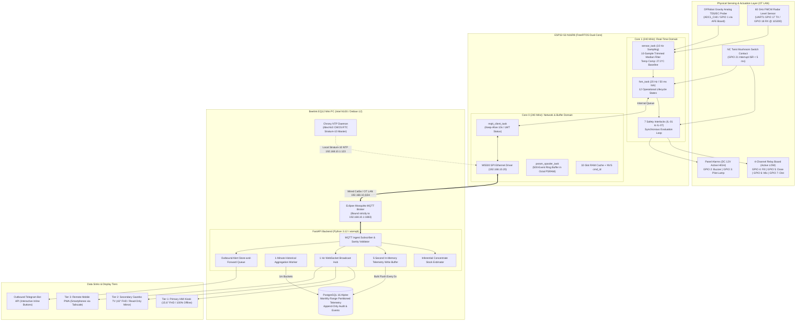

# 07 Data Sources

> **System:** DESANOMIA Greenhouse Automated Fertigation System  
> **Platform:** Beelink EQ12 Mini PC (Intel N100) + ESP32-S3 N16R8 Edge Microcontroller  
> **Authority:** Aligned with [00_MASTER_RULES.md](file:///home/maria_zahra/Documents/projects/greenhouse/desanomia/brain/00_MASTER_RULES.md), [01_PRD.md](file:///home/maria_zahra/Documents/projects/greenhouse/desanomia/brain/01_PRD.md), [04_TRD.md](file:///home/maria_zahra/Documents/projects/greenhouse/desanomia/brain/04_TRD.md), [05_ARCHITECTURE.md](file:///home/maria_zahra/Documents/projects/greenhouse/desanomia/brain/05_ARCHITECTURE.md), [06_DATA_MODEL.md](file:///home/maria_zahra/Documents/projects/greenhouse/desanomia/brain/06_DATA_MODEL.md), and [18_DECISIONS.md](file:///home/maria_zahra/Documents/projects/greenhouse/desanomia/brain/18_DECISIONS.md) (D-001 through D-050). [SPEC]

---

## 1. System Data Architecture & Signal Flow

Desanomia employs a strictly segregated edge data architecture. Real-time sensor signal conditioning, digital filtering, and safety interlocks run autonomously on bare-metal microcontroller firmware (ESP32-S3 Core 1), while data transport, caching, persistence, and client fan-out execute on the edge mini PC (Beelink EQ12).



---

## 2. Physical Sensor Inputs & Signal Conditioning Chain

### 2.1 Analog TDS / EC Probe (Distribution Drum / Drum 2) [SPEC]

- **Hardware Transducer:** DFRobot Gravity Analog Electrical Conductivity / TDS Probe tapped into the lower sidewall of Distribution Drum (Drum 2).
- **Physical Interface:** ESP32-S3 ADC1_CH0 (GPIO 1) driven via an active Analog Front-End (AFE) conditioning board providing galvanic isolation, impedance buffering, and high-frequency noise filtering (0.0–3.3V dynamic range).
- **Processing Domain:** FreeRTOS `sensor_task` on Core 1, Priority 3.
- **Multisampling & Digital Filtering:**
  - Raw ADC voltage is acquired at **10 Hz (100 ms period)**.
  - Signal conditioning implements a **10-Sample Moving Window Trimmed Median Filter**:
    1. Collects a rolling array of 10 consecutive raw voltage samples: $[V_0, V_1, \dots, V_9]$.
    2. Sorts the window in ascending order: $[V_{(0)}, V_{(1)}, \dots, V_{(9)}]$.
    3. Trims the two extreme outliers: drops the minimum sample $V_{(0)}$ and the maximum sample $V_{(9)}$.
    4. Computes the arithmetic mean of the remaining 8 central samples:
       $$V_{\text{filtered}} = \frac{1}{8} \sum_{i=1}^{8} V_{(i)}$$
- **Temperature Compensation Formula:**
  Raw electrical conductivity drifts by approximately $+2.0\%/\Delta^\circ\text{C}$ relative to the standard reference temperature ($25.0^\circ\text{C}$). The normalized value is computed as:
  $$\text{TDS}_{25} = \frac{\text{TDS}_{\text{raw}}}{1.0 + 0.02 \times (T_{\text{water}} - 25.0)}$$
  In Phase 1, prior to the integration of an in-line submersible PT100/NTC probe, water temperature defaults to the empirical greenhouse baseline:
  $$T_{\text{water}} = 27.0^\circ\text{C} \quad \implies \quad T_{\text{comp}} = 1.0 + 0.02 \times (27.0 - 25.0) = \mathbf{1.04}$$
- **NVS Calibration Commit & Electrical Mapping:**
  - Voltage-to-TDS conversion uses the calibrated cell constant $K_{\text{cell}}$ and baseline offset $V_{\text{offset}}$ stored in ESP32 non-volatile storage namespace `calib_tds`:
    $$\text{TDS}_{\text{raw}} = K_{\text{cell}} \times (V_{\text{filtered}} - V_{\text{offset}})$$
  - Calibration parameters are updated exclusively via the Guided Sensor Calibration Wizard ([02_APPFLOW.md UX-FR-13](file:///home/maria_zahra/Documents/projects/greenhouse/desanomia/brain/02_APPFLOW.md)) using a certified 1413 µS/cm buffer.
- **Publication Frequency:**
  - Standard operating states (`IDLE`, `FILLING_WATER`, `DOSING`, `MIXING`, `DISTRIBUTING`): Published every **5.0 seconds** over MQTT QoS 0.
  - Active evaluation states (`MEASURING_TDS`, `GATE_EVALUATE`) and active calibration mode: Accelerated to **1.0 second** over MQTT QoS 0.

### 2.2 60 GHz FMCW Millimeter-Wave Radar Level Sensor (Drum 2) [SPEC]

- **Hardware Transducer:** 60 GHz Millimeter-Wave Frequency-Modulated Continuous-Wave (FMCW) Industrial Tank Level Sensor mounted non-invasively through the top inspection flange of Distribution Drum (Drum 2).
- **Physical Interface:** ESP32-S3 UART1 (GPIO 17 TX, GPIO 18 RX) at 115200 bps, 8 data bits, no parity, 1 stop bit (8N1).
- **Frame Parsing Protocol:**
  - Sensor emits structured binary measurement frames at **10 Hz (100 ms period)**.
  - Frame structure: `[0xAA, 0x55, LEN, CMD, PAYLOAD..., CHECKSUM, 0x0D, 0x0A]`.
  - Firmware validates the 2-byte preamble, payload length, and 8-bit XOR checksum before extracting the distance reading $D_{\text{mm}}$ (distance from radar antenna horn to liquid surface).
- **Volumetric Height-to-Volume Conversion:**
  Liquid volume is computed geometrically based on the calibrated drum cross-sectional profile and bottom suction sump buffer:
  $$V_{\text{drum2\_L}} = \max\left(0.0, \frac{(H_{\text{total\_mm}} - D_{\text{mm}}) \times A_{\text{cross\_mm}^2}}{1\,000\,000}\right) + V_{\text{sump\_offset}}$$
  - $H_{\text{total\_mm}} = 920.0\text{ mm}$ (calibrated distance from horn to physical drum bottom).
  - $A_{\text{cross\_mm}^2} = 153\,800.0\text{ mm}^2$ (standard 140 L open-top HDPE chemical barrel internal cross-section).
  - $V_{\text{sump\_offset}} = 5.0\text{ L}$ (un-pumpable physical liquid reserve below the distribution pump suction inlet pipe).
  - Percentage: $\text{Level}_{\%} = \min\left(100.0, \frac{V_{\text{drum2\_L}}}{140.0} \times 100.0\right)$.
- **Watchdog Liveness Supervision (IL-06):**
  If valid UART frames cease for $> 3.0\text{ seconds}$, the firmware immediately asserts `FAULT_RADAR_OFFLINE`, cuts all 4 relays, and halts active batch execution.

### 2.3 Hardware Emergency Stop Contact Sensor (Panel Door) [SPEC]

- **Hardware Transducer:** Industrial 40 mm red mushroom-head twist-to-reset Emergency Stop switch (Schneider Electric / IDEC) mounted on the control panel enclosure door.
- **Dual-Contact Safety Topology:**
  1. *Primary Contact (Direct Relay Bus Cutoff):* Hardwired normally-closed (NC) contact plumbed directly in series with the DC 5V/12V relay coil power bus. When pushed, coil power is physically broken in **0 ms**, instantly de-energizing all relays regardless of microcontroller health.
  2. *Secondary Contact (Firmware State Sensing):* Dedicated auxiliary NC contact wired between ESP32-S3 GPIO 21 and Ground with a $10\text{ k}\Omega$ pull-up resistor to 3.3V and a hardware low-pass RC debouncing filter ($\tau \le 1\text{ ms}$).
- **Firmware Interrupt ISR:**
  - Configured as `GPIO_INTR_ANYEDGE` on Core 1.
  - When the switch trips (contacts open $\to$ GPIO 21 transitions HIGH), an external interrupt ISR fires in $< 5\text{ ms}$, immediately latches `FAULT_ESTOP` (IL-07), pulls all GPIO relay registers LOW, and trips the panel alarm buzzer and pilot lamp.
- **Telemetry Streaming:**
  Firmware streams `hw_estop_pressed: true` continuously while physical contacts remain open. The web dashboard locks the `Reset Fault` button with the inline label *"Tombol E-Stop Fisik Masih Tertekan — Putar untuk Melepas"*, unlocking only when contacts physically close and Drum 2 level is $\le 5.0\text{ L}$.

---

## 3. Virtual & Inferential Data Sources

### 3.1 Concentrate Drum (Drum 1) Virtual Stock Tracker (D-022, FR-18)

- **Physical Reality:** Concentrate Drum (Drum 1, 20 L capacity) has **no hardware level or pressure sensor**. Liquid fertilizer is manually dissolved by operators (2.0 kg NPK into 20.0 L water).
- **Virtual Inventory Invariant:**
  - The backend PostgreSQL table `concentrate_stock` maintains the single authoritative inventory count (`current_volume_ml`).
  - Upon fresh physical replenishment, the operator confirms the refill via the Refill Confirmation Gate (`POST /api/v1/concentrate/refill`), resetting `current_volume_ml` to **20,000.00 mL (20.0 L)** and committing `CONCENTRATE_REFILLED` to the SHA-256 audit log.
  - Following each successful batch distribution, the backend automatically deducts the exact injected volume:
    $$\Delta V_{\text{consumed}} = V_{\text{dose\_mL}} + V_{\text{topup\_mL}}$$
    $$V_{\text{remaining}} = \max\left(0.0, V_{\text{current}} - \Delta V_{\text{consumed}}\right)$$
- **Operational Alarm Thresholds:**
  - *Warning Level (Low Stock):* When $V_{\text{remaining}} \le 3000.00\text{ mL}$ ($\le 2\text{ batches}$ / 3.0 L reserve), an In-App Warning Notification and Telegram alert are triggered, and Drum 1 UI animation pulses amber.
  - *Depletion Lock (Station Starved):* When $V_{\text{remaining}} < 1500.00\text{ mL}$, batch initiation is strictly locked (`STATION_LOCKED: CONCENTRATE_DEPLETED`) until the operator performs a physical refill and confirms via the UI gate.

### 3.2 Concentrate Starvation & Depletion Anomaly Detector (D-022)

- **Detection Principle:** If an operator fails to refill Drum 1 or the peristaltic suction tube draws air/cavitation, batch dosing injects air instead of concentrate.
- **Mathematical Yield Deviation Check:**
  - Following the 120-second mixing and 15-second stabilizing period, the FSM measures the resulting TDS.
  - Based on empirical calibration (`DOSE_TEST_RESULT.md`), fertilizer concentration enrichment constant is $K_{\text{fert}} = 94.68\text{ ppm}\cdot\text{L/mL}$.
  - The expected post-mixing TDS is:
    $$\text{TDS}_{\text{expected}} = \text{TDS}_{\text{baseline}} + \frac{V_{\text{dose\_mL}} \times 94.68}{140.0}$$
  - **Starvation Flag:** If the actual measured TDS is $> 250\text{ ppm}$ below target:
    $$\text{TDS}_{\text{measured}} < (\text{TDS}_{\text{target}} - 250\text{ ppm})$$
    The system dispatches an immediate Critical Alert `STARVATION_SUSPECTED`, warns the operator to inspect Drum 1 for liquid exhaustion, and blocks single-pass top-up from delivering more than the hard ceiling of 300.0 mL.

### 3.3 Clean Water Baseline Estimator (Drum 2) [SPEC]

- **Execution State:** Measured automatically during FSM state `CHECK_BASE` once Drum 2 reaches 140.0 L clean water fill.
- **Acceptance Criteria (IL-05):**
  - Expected raw groundwater baseline: $50\text{ ppm} \le \text{TDS}_{\text{baseline}} < 350\text{ ppm}$.
  - If $\text{TDS}_{\text{baseline}} < 50\text{ ppm}$: sensor cable disconnected or open circuit $\to$ `FAULT_TDS_INVALID`.
  - If $\text{TDS}_{\text{baseline}} \ge 350\text{ ppm}$: contaminated water supply or residual salt $\to$ `FAULT_BASE_TDS_HIGH`.
  - If $\text{TDS}_{\text{baseline}} > 2000\text{ ppm}$: sensor probe short-circuited $\to$ `FAULT_TDS_INVALID`.

---

## 4. Actuators, Relay Drivers & Alarm Outputs

### 4.1 4-Channel Optoisolated Relay Board [SPEC]

The ESP32-S3 controls a 4-channel optoisolated industrial relay board with active LOW logic (GPIO output LOW = relay energized / contact closed).

| Relay | Actuator Name | Electrical Load | ESP32 Pin | Nominal Flow / Rating | Firmware Safety Rules & Interlocks |
| :--- | :--- | :--- | :--- | :--- | :--- |
| **Relay 1** | Clean Water Fill Solenoid | AC 220V 50Hz, 3/4" BSP | **GPIO 4** | ~12.5 L/min at 2.5 bar | Closed on level $\ge 140.0\text{ L}$. Guarded by IL-04 (rise $< 1.0\text{ L}$ in 90s or total fill $> 20\text{ min} \to$ `FAULT_NO_WATER_SUPPLY` / `FAULT_FILL_TIMEOUT`). |
| **Relay 2** | Peristaltic Dosing Pump | DC 12V 2A, Silicone Tube | **GPIO 5** | $9.35\text{ mL/s}$ ($0.107\text{ s/mL}$) | Dosing runtime strictly bounded by formula $t = V_{\text{dose}} \times 0.107\text{ s}$. Top-up hard-capped at 300.0 mL max ($32.1\text{ s}$). |
| **Relay 3** | Submersible Mixing Pump | AC 220V 50Hz, 100W | **GPIO 6** | ~3500 L/h recirculation | Active during `MIXING` ($120\text{ s}$) and recovery mix ($60\text{ s}$). Strictly de-energized during `MEASURING_TDS` to eliminate electrical noise. |
| **Relay 4** | High-Pressure Distribution Pump | AC 220V 50Hz, 750W | **GPIO 7** | ~40 L/min at 3.0 bar to 980 drippers | Guarded by IL-01 (TDS gate [Target $\pm 50\text{ ppm}$]) and IL-02 (instant cutoff in $< 50\text{ ms}$ when radar level $< 5.0\text{ L}$). |

### 4.2 Local Control Panel Alarm Drivers (D-025, UX-FR-10)

- **Buzzer Driver (GPIO 2):** Drives a DC 12V high-decibel piezo buzzer via an NPN transistor switch (Active HIGH).
  - *Error-Only Policy:* Acoustic buzzer sounds **strictly during FAULT and E-STOP states**. Routine batch readiness, dosing start, or distribution completion are 100% silent.
- **Pilot Lamp Driver (GPIO 3):** Drives an industrial red 22 mm panel indicator lamp (Active HIGH).
  - Illuminates continuously during latched faults and pulses (2 Hz) during active Emergency Stop.

### 4.3 Hardware Mutual Exclusion Interlocks

Firmware enforces mutual exclusion in hardware output registers prior to relay assertion:
1. `fill_valve` and `dist_pump` must **never** be energized simultaneously.
2. `dosing_pump` and `dist_pump` must **never** be energized simultaneously.

---

## 5. MQTT Fieldbus Transport Contract

Telemetry, events, and control commands are transmitted across the isolated OT LAN (ETH0:1883, Mosquitto on Beelink EQ12) between the ESP32-S3 and FastAPI backend.

- **Authoritative Topic & Payload Schemas:** All topic namespaces (`cmd`, `ack`, `telemetry`, `events`, `status`), QoS rules, JSON payload schemas, and command type discriminators are defined authoritatively in [11_API_CONTRACT.md](file:///home/maria_zahra/Documents/projects/greenhouse/desanomia/brain/11_API_CONTRACT.md#mqtt-fieldbus-contract-desanomiagh1).
- **Physical & Broker Isolation:** W5500 SPI Ethernet module (`192.168.10.20`) binds directly to Mosquitto on `192.168.10.1:1883`. Port 1883 is physically and firewall-isolated from IT/WAN (`ETH1`), see [08_SECURITY.md](file:///home/maria_zahra/Documents/projects/greenhouse/desanomia/brain/08_SECURITY.md).
- **Idempotency & Spooling:** The ESP32-S3 enforces a 32-slot circular RAM cache with NVS `last_executed_cmd_id` boot persistence (D-045) and an 8MB Octal PSRAM ring buffer (500 events) for offline event survival, as detailed in [10_FIRMWARE_SPEC.md](file:///home/maria_zahra/Documents/projects/greenhouse/desanomia/brain/10_FIRMWARE_SPEC.md) and [11_API_CONTRACT.md](file:///home/maria_zahra/Documents/projects/greenhouse/desanomia/brain/11_API_CONTRACT.md).

---

## 6. Edge Ingestion Pipeline, Validation & Buffer Architecture

### 6.1 Ingestion Bounds & Sanity Validation Matrix

When telemetry frames arrive at the FastAPI MQTT subscriber, they are verified against physical sanity bounds before acceptance:

| Parameter | Valid Operating Range | Hard Ingestion Rejection Bound | Anomaly Condition & Automated Reaction |
| :--- | :--- | :--- | :--- |
| **Solution TDS** | 1000–1400 ppm (batch) | $< 0\text{ ppm}$ or $> 5000\text{ ppm}$ | Rejection drops reading from chart rollup; flags sensor fault alert. |
| **Clean Water Baseline** | 50–350 ppm (`CHECK_BASE`) | $< 50\text{ ppm}$ or $\ge 350\text{ ppm}$ | Trips IL-05: `FAULT_TDS_INVALID` (< 50) or `FAULT_BASE_TDS_HIGH` ($\ge 350$). |
| **Post-Dosing TDS Yield** | $[\text{Target} \pm \text{tolerance\_band\_ppm}]$ (nominal $\pm 50\text{ ppm}$) | Anomaly delta $> 229.3\text{ ppm}$ deficit | Flags `STARVATION_SUSPECTED` warning; halts batch without energizing Relay 2 (top-up exceeds $300\text{ mL}$ cap, `D-051`). |
| **Drum 2 Level** | 0.0–140.0 L ($0\%–100\%$) | $< 0.0\text{ L}$ or $> 145.0\text{ L}$ | Discards corrupt radar frame; if frames drop $> 3\text{ s} \to$ `FAULT_RADAR_OFFLINE`. |
| **E-Stop Sensing** | Boolean `false` (normal) | Invalid JSON type | Asserts `hw_estop_pressed = true` failsafe on deserialization failure. |
| **Relay Feedback** | Boolean map of 4 relays | Invalid relay dictionary | Compares against expected FSM state; logs `ACTUATOR_DISCREPANCY` if mismatched. |

### 6.2 5-Second In-Memory RAM Buffer for NVMe SSD Preservation (D-044)

Continuous 1.0 s or 5.0 s single-row SQL inserts exhaust NVMe SSD write endurance on the Beelink EQ12 mini PC. The backend ingestion layer implements an asynchronous RAM write buffer:
1. Incoming telemetry frames are appended to an in-memory `asyncio.Queue`.
2. A background worker flushes buffered readings via a single PostgreSQL `execute_values()` bulk insert every **5.0 seconds** (or when the queue reaches 50 samples).
3. The table `telemetry` uses native monthly range partitioning (`PARTITION BY RANGE (ts)`).
4. Drops occur cleanly per monthly table partition after 90–120 days, once 1-minute historical rollups in `telemetry_1m` are validated complete.

### 6.3 Liveness Supervision & UI Stale Detection

- **STALE State (Warning):** If no telemetry frame arrives for **12.0 seconds** (tolerating 2 dropped packets), the backend marks the device state as `STALE`. The UI displays a yellow pulsing header badge and freezes active timer displays.
- **OFFLINE State (Critical):** If no telemetry frame arrives for **20.0 seconds** or the broker delivers the LWT payload, the device state transitions to `OFFLINE`. The UI displays a red offline indicator, disables mutation buttons, and dispatches a Critical Telegram alert.

---

## 7. Edge Time Source & Hardware Synchronization Contract (D-020)

To guarantee drift-free unattended fertigation schedules without external internet reliance:

```mermaid
flowchart LR
  RTC["Motherboard CMOS RTC (/dev/rtc0)\nCR2032 Battery Master"] -->|hwclock --hctsys on boot| Kernel["Linux Host OS Clock\nBeelink EQ12 Mini PC"]
  Kernel --> Chrony["Chrony NTP Daemon\nStratum-10 Local Master"]
  Chrony -->|NTP UDP 123 over OT LAN (192.168.10.1)| ESP["ESP32-S3 SNTP Client\nSync every 60 minutes"]
  WAN["Orbit Star H2 (ETH1 192.168.1.1)\nInternet Uplink"] -.->|pool.ntp.org (When Available)| Chrony
  Chrony -.->|hwclock --systohc| RTC
```

1. **Local Hardware Master:** The Beelink EQ12 motherboard CR2032 battery-backed CMOS RTC (`/dev/rtc0`) serves as the authoritative time master on cold boot (`hwclock --hctsys`).
2. **Local Stratum-10 NTP Server:** The edge host runs `chrony` configured as a local stratum-10 NTP server listening on the isolated OT LAN (`192.168.10.1:123`).
3. **Microcontroller Synchronization:** The ESP32-S3 runs the FreeRTOS SNTP service, synchronizing its internal hardware clock against `192.168.10.1:123` every **60 minutes**.
4. **Internet Discipline (Opportunistic):** When the 4G modem (Orbit Star H2) uplink is connected, `chrony` disciplines the system clock against `pool.ntp.org` and updates the CMOS RTC via `hwclock --systohc`. The system never halts or desynchronizes during prolonged internet outages.

---

## 8. Outbound Data Integration Sinks

### 8.1 1 Hz WebSocket Telemetry Broadcast Hub

- **Endpoint:** `GET /api/v1/ws/telemetry`
- **Protocol:** WebSocket (JSON frames, RFC 6455).
- **Rate:** Broadcasts a complete consolidated state and telemetry snapshot every **1.0 second** to all connected client tiers:
  - *Primary HMI Kiosk (Panel Room):* Drives 60 FPS modular drum liquid animations and live pipeline stepper.
  - *Secondary Gazebo TV:* 24/7 passive read-only billboard.
  - *Remote Mobile PWA:* Smartphone browser monitoring.
- **Fast Hydration (< 500 ms):** Upon connection or reconnection, the WebSocket hub immediately pushes a full state snapshot (batch status, recipe, volume, TDS, relay states, active faults) within $< 500\text{ ms}$ before resuming 1 Hz updates.

### 8.2 PostgreSQL 16 Persistence System of Record

Every physical and virtual data event is persisted to PostgreSQL 16 Alpine:
- `telemetry`: Monthly partitioned raw time-series data (90–120 day retention).
- `telemetry_1m`: 1-minute historical aggregate rollups (retained 2 years).
- `batches`: Immutable batch records with recipe preset snapshots and top-up metrics.
- `batch_events`: Append-only high-resolution lifecycle state transition journal.
- `actuator_logs`: Exact relay actuation logs with command UUID traceability.
- `faults`: Latched fault history with Gated Fault Reset verification (`drum2_volume_at_clear <= 8.0`).
- `sensor_calibrations`: Audit log of all sensor calibration wizard commits.
- `audit_logs`: SHA-256 cryptographically chained immutable audit log.

### 8.3 In-App Notification Hub (PRD FR-29, APPFLOW UX-FR-29)

- In-app operational alerts are delivered via an Apple-style glassmorphic UI interface:
  - Persistent header notification bell with live unread badge count.
  - Slide-out frosted glass notification drawer with 4-tier filtering (*Semua*, *Kritis*, *Peringatan*, *Info*).
  - Floating interactive toasts with 1-tap action buttons (`[Lihat Detail]`, `[Konfirmasi Refill]`, `[Kuras Drum]`).
- Audio Chime Policy: Subtle Apple-style UI chimes play on Primary HMI Kiosk speakers *strictly for Critical and Warning events* (silent for Success and Info).

### 8.4 Outbound Telegram Bot Alert Sink (D-007, TR-22)

- **Channel:** Telegram Bot API via outbound HTTPS over IT LAN (`ETH1`).
- **Store-and-Forward Offline Resilience (FR-22, TR-22):**
  - During 4G WAN outages, critical and warning alerts are committed to the PostgreSQL `alert_queue` table with `status = 'pending'`.
  - A background worker polls WAN connectivity and flushes buffered alerts chronologically with original timestamps the moment internet connectivity returns.
- **Interactive Inline Action Buttons:** Critical alert messages feature secure 1-tap callback buttons:
  - `[Siram Sekarang]` (Ad-hoc run authorization).
  - `[Tunda 1 Jam]` (Schedule postponement).
  - `[Konfirmasi Pause Recovery]` (Acknowledge mid-batch recovery).
  Tapping a button dispatches an authenticated callback query to FastAPI, logging the action in `audit_logs` without requiring shell or terminal access.
