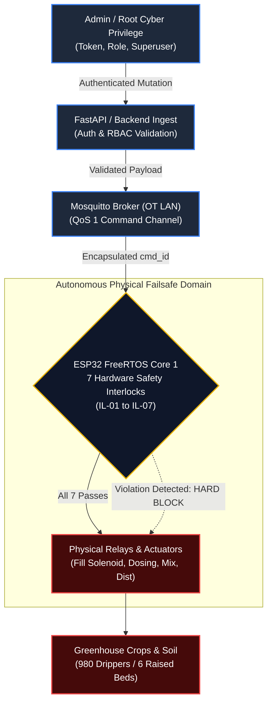
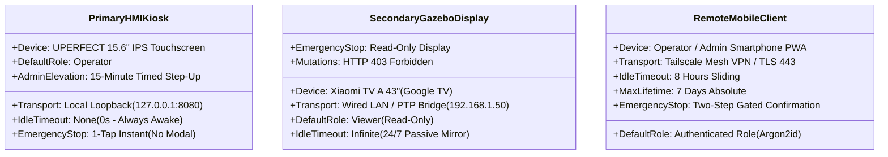

# 08 Security

> **System:** DESANOMIA Greenhouse Automated Fertigation System  
> **Platform:** Beelink EQ12 Mini PC (Intel N100) + ESP32-S3 N16R8 Edge Microcontroller  
> **Authority:** Aligned with [00_MASTER_RULES.md](file:///home/maria_zahra/Documents/projects/greenhouse/desanomia/brain/00_MASTER_RULES.md), [01_PRD.md](file:///home/maria_zahra/Documents/projects/greenhouse/desanomia/brain/01_PRD.md), [02_APPFLOW.md](file:///home/maria_zahra/Documents/projects/greenhouse/desanomia/brain/02_APPFLOW.md), [04_TRD.md](file:///home/maria_zahra/Documents/projects/greenhouse/desanomia/brain/04_TRD.md), [05_ARCHITECTURE.md](file:///home/maria_zahra/Documents/projects/greenhouse/desanomia/brain/05_ARCHITECTURE.md), [06_DATA_MODEL.md](file:///home/maria_zahra/Documents/projects/greenhouse/desanomia/brain/06_DATA_MODEL.md), [07_DATA_SOURCES.md](file:///home/maria_zahra/Documents/projects/greenhouse/desanomia/brain/07_DATA_SOURCES.md), [18_DECISIONS.md](file:///home/maria_zahra/Documents/projects/greenhouse/desanomia/brain/18_DECISIONS.md), and [SPEC.md](file:///home/maria_zahra/Documents/projects/greenhouse/desanomia/docs/SPEC.md). [SPEC]

---

## 1. Security Philosophy & Primacy of Physical Safety

Desanomia is a precision cyber-physical IoT installation operating in an active agricultural environment. Cyber attacks or software anomalies have direct physical consequences: crop chemical toxicity, root drowning, pump dry-run cavitation, electrical fires, or water depletion.

### The Invariant: Safety Overrides Cybersecurity
The foundational invariant governing Desanomia security architecture is that **hardware and firmware safety interlocks supersede all cyber credentials, user privileges, API tokens, and administrative roles**.



- **Zero Cyber Override:** No database role, configuration flag, debug parameter, or API override can disable or loosen the 7 autonomous firmware safety interlocks (`D-003`, `D-019`, `D-024`):
  1. *TDS Gate:* Distribution pump locked OFF if mean TDS is outside `[Target − 50 ppm, Target + 50 ppm]`.
  2. *Radar Dry-Run Cutoff:* Distribution pump instantly de-energized if Drum 2 level $< 5.0\text{ L}$.
  3. *Batch Depletion Guard:* New batch command rejected if Drum 2 level $> 5.0\text{ L}$.
  4. *Dual-Stage Fill Guard:* Solenoid closed if early rise $< 1.0\text{ L}$ in 90 s or total fill $> 20\text{ min}$.
  5. *Water Baseline & Plausibility:* Abort if clean water $< 50\text{ ppm}$ or $> 2000\text{ ppm}$, or baseline $\ge 350\text{ ppm}$.
  6. *Radar Liveness Watchdog:* Actuators de-energized if UART silent $> 3\text{ s}$.
  7. *Emergency Stop Guard:* All relays instantly de-energized if physical NC mushroom switch opens (`hw_estop_pressed == true`) or software E-stop triggers.
- **Fail-Safe De-energization:** All control relays operate in **Active LOW** configuration with Normally Open (NO) power contacts. A power loss, microcontroller crash, communication timeout, or watchdog trip drops relay coils to the un-energized open state, instantly arresting all fluid motion.

---

## 2. Threat Modeling & Attack Surface (STRIDE Analysis)

A structured STRIDE threat analysis evaluated against Desanomia's physical greenhouse deployment:

| STRIDE Category | Threat Description | Attack Vector / Surface | Impact & Blast Radius | Mitigation & Defense-in-Depth |
| :--- | :--- | :--- | :--- | :--- |
| **Spoofing** | Attacker impersonates ESP32-S3 or Backend service to issue commands. | Malicious node injected into OT or IT switch; forged MQTT packets. | Unauthorized valve/pump operation; invalid sensor telemetry injected into DB. | Dual-NIC physical network isolation (`D-043`), Mosquitto `allow_anonymous false`, dedicated service accounts (`esp32_gateway`, `backend_service`), topic ACLs. |
| **Tampering** | Man-in-the-middle modification of telemetry, recipe targets, or firmware binaries. | Packet interception on LAN; altered OTA firmware payload; DB record editing. | Over-dosing chemical concentrate; corrupting historical compliance logs. | SHA-256 OTA digest verification; PostgreSQL append-only cryptographic hash chaining (`prev_hash` $\to$ `row_hash`); local TLS 1.3 on IT LAN. |
| **Repudiation** | Operator denies initiating an ad-hoc batch or modifying system calibration. | Shared terminal credentials; missing or generic audit log entries. | Inability to audit agronomic liability or operational mistakes. | Immutable `audit_logs` table protected by DB trigger; client IP, user ID, session ID, and timestamp captured per action (`TR-16`). |
| **Information Disclosure** | Leakage of proprietary fertigation recipes, telemetry, or network credentials. | Eavesdropping on unencrypted traffic; git repository exposure; database exfiltration. | Theft of nutrient formulas; credential stuffing attacks against remote VPN. | Zero secrets in git (`.env` gitignored); Tailscale encrypted WireGuard tunnel; Nginx TLS 1.3; Argon2id password hashing. |
| **Denial of Service** | MQTT message flood, WebSocket exhaustion, or broadcast storm on Fieldbus. | Malicious client flooding broker or REST API; Wi-Fi deauth/jamming (if enabled). | HMI kiosk freeze; missed telemetry frames; delayed emergency stop notification. | ESP32 Wi-Fi permanently disabled (hardwired W5500 SPI Ethernet); rate-limiting on Nginx/FastAPI; FreeRTOS fixed memory pools; 500-event ring buffer in PSRAM. |
| **Elevation of Privilege** | Secondary Gazebo TV viewer or remote viewer attempts batch trigger or reset. | Manipulation of HTTP verbs or client-side DOM inspection. | Unauthorized batch trigger; resetting latched safety faults prematurely. | Server-side FastAPI role enforcement (`Depends(require_role)`); Gazebo display IP allowlist hardcoded to read-only in Nginx; step-up auth for Kiosk admin tasks (`D-026`). |

---

## 3. Physical & Dual-NIC Network Segmentation (D-043)

Desanomia strictly prohibits direct port forwarding or public IP exposure. The Beelink EQ12 edge host enforces physical dual-NIC network segmentation between the operational fieldbus (OT) and the greenhouse IT network.

```mermaid
flowchart TD
    classDef ot fill:#042f2e,stroke:#0d9488,stroke-width:2px,color:#fff;
    classDef it fill:#1e1b4b,stroke:#6366f1,stroke-width:2px,color:#fff;
    classDef edge fill:#1e293b,stroke:#3b82f6,stroke-width:2px,color:#fff;
    classDef vpn fill:#3b0764,stroke:#a855f7,stroke-width:2px,color:#fff;

    subgraph OTLAN ["OT Fieldbus Subnet (192.168.10.0/24) - Air-Gapped Physical Switch"]
        ESP["ESP32-S3 Microcontroller\n(W5500 SPI Ethernet: 192.168.10.20)\nWi-Fi Permanently Disabled"]:::ot
        SW_OT["Unmanaged Industrial DIN Switch\n(100 Mbps Full Duplex)"]:::ot
    end

    subgraph HostEdge ["Edge Host: Beelink EQ12 Mini PC (Intel N100 / Debian 12)"]
        ETH0["NIC 0: ETH0 (2.5 GbE)\nIP: 192.168.10.1/24"]:::ot
        ETH1["NIC 1: ETH1 (2.5 GbE)\nIP: 192.168.1.10/24"]:::it
        TS0["Virtual: tailscale0\nIP: 100.x.y.z/32"]:::vpn
        
        Mosq["Mosquitto MQTT Broker\n(Docker: 192.168.10.1:1883:1883)\nIsolated from ETH1 & TS0"]:::ot
        Nginx["Nginx Reverse Proxy\n(Ports 80, 443; Kiosk: 127.0.0.1:8080)"]:::it
        App["FastAPI Backend & PostgreSQL 16\n(Docker Bridge: 172.18.0.0/16)"]:::edge
    end

    subgraph ITLAN ["IT / WAN Subnet (192.168.1.0/24)"]
        Router["Orbit Star H2 4G Gateway\n(192.168.1.1)"]:::it
        Bridge["Tenda O1 Gazebo PTP Bridge\n(192.168.1.50)"]:::it
        GazeboTV["Secondary Display: Xiaomi TV A 43\"\n(Fully Kiosk Browser - Read-Only)"]:::it
    end

    subgraph RemoteVPN ["Encrypted Mesh VPN (Tailscale WireGuard)"]
        Phone["Operator Smartphone / PWA\n(Tailscale 100.x.y.z)"]:::vpn
        DevNode["Inference & Backup Node\n(Host 2 lenovo-latop: 100.125.131.95)"]:::vpn
    end

    ESP <-->|W5500 MII/SPI| SW_OT
    SW_OT <-->|Cat6 Industrial| ETH0
    ETH0 <--> Mosq
    Mosq <--> App

    ETH1 <-->|Cat6 Direct| Router
    Router <--> Bridge
    Bridge <--> GazeboTV

    ETH1 <--> Nginx
    TS0 <--> Nginx
    Nginx <--> App

    Router -.->|4G Cellular WAN| RemoteVPN
    RemoteVPN <--> TS0
```

### 3.1 Network Subnet Allocation

| Interface | Network Domain | Subnet / CIDR | Assigned Static IPs | Allowed Protocols & Ports | Physical Medium |
| :--- | :--- | :--- | :--- | :--- | :--- |
| **`eth0`** | OT Fieldbus | `192.168.10.0/24` | `192.168.10.1` (Beelink Host)<br>`192.168.10.20` (ESP32-S3) | MQTT: 1883 TCP (Mosquitto container published to `192.168.10.1:1883`)<br>NTP: 123 UDP (Chrony Stratum-10) | Unmanaged DIN rail industrial switch, shielded Cat6. Air-gapped from IT. |
| **`eth1`** | IT / WAN Uplink | `192.168.1.0/24` | `192.168.1.10` (Beelink Host)<br>`192.168.1.1` (Orbit 4G Gateway)<br>`192.168.1.50` (Tenda O1 / Xiaomi TV) | HTTP: 80 TCP (301 Redirect to 443)<br>HTTPS: 443 TCP (TLS 1.3 Nginx)<br>WSS: 443 TCP (WebSocket Telemetry) | Cat6 to Orbit Star H2; 5 GHz PTP Wireless Bridge to Gazebo. |
| **`lo`** | Local Kiosk | `127.0.0.1/8` | `127.0.0.1` (Beelink Local Display) | HTTP: 8080 TCP (Nginx static bundle & FastAPI proxy bound strictly to `127.0.0.1:8080`) | HDMI + USB Touchscreen loopback (`UPERFECT BE156PF`). |
| **`tailscale0`** | Secure Remote Mesh | `100.64.0.0/10` (CGNAT) | Assigned Tailscale IP (`100.x.y.z`) | HTTPS: 443 TCP<br>SSH: 22 TCP (Tailscale SSH keys only)<br>*(Backups pushed outbound over Tailscale SSH; no inbound port)* | WireGuard encrypted peer-to-peer overlay network. Zero open WAN ports. |

### 3.2 Linux Kernel Isolation & Firewall Drop Rules
The host OS enables IPv4 forwarding solely to support Docker bridge networking, while `nftables` strictly drops all packet forwarding across physical interfaces (`eth0` $\leftrightarrow$ `eth1`), preventing any routing from the IT network into the OT microcontroller fieldbus:

```bash
# /etc/sysctl.d/99-desanomia-networking.conf
# Required for Docker bridge container networking and internal service routing
net.ipv4.ip_forward = 1
net.ipv4.conf.all.send_redirects = 0
net.ipv4.conf.all.accept_redirects = 0
net.ipv4.conf.all.accept_source_route = 0
```

`nftables` rules enforce unidirectional boundaries, isolate Docker containers, and lock down service binding:

```nftables
table inet desanomia_firewall {
    chain inbound {
        type filter hook input priority 0; policy drop;

        # Connection tracking
        ct state established,related accept
        iif "lo" accept

        # OT Fieldbus Interface (eth0) - Strictly ESP32-S3
        iif "eth0" ip saddr 192.168.10.20 tcp dport 1883 accept  # Mosquitto MQTT
        iif "eth0" ip saddr 192.168.10.20 udp dport 123 accept   # Chrony NTP

        # IT Interface (eth1) - Greenhouse Local IT
        iif "eth1" tcp dport 80 accept                           # Nginx HTTP (Redirect)
        iif "eth1" tcp dport 443 accept                          # Nginx HTTPS (TLS)

        # Tailscale VPN Interface (tailscale0) - Remote Access
        iif "tailscale0" tcp dport 443 accept                    # Remote Web Dashboard
        iif "tailscale0" tcp dport 22 accept                     # Tailscale SSH
    }

    chain forward {
        type filter hook forward priority 0;

        # Strictly prevent bridging/routing between OT Fieldbus and IT/WAN
        iifname "eth0" oifname "eth1" drop
        iifname "eth1" oifname "eth0" drop

        # Allow Docker container bridge traffic
        iifname "docker0" accept
        oifname "docker0" accept
    }
}
```

> [!NOTE] OT Fieldbus Unreachability Verification
> Isolation between IT and OT rests on the explicit bind address plus the `nftables` input/forward chains. Verify from any device on the IT network (`192.168.1.0/24`) that Mosquitto is completely unreachable:
> ```bash
> nc -zv -w 2 192.168.1.10 1883
> # Expected: Connection timed out or connection refused (0 bytes transferred)
> ```

---

## 4. Authentication Architecture & Tier-Differentiated Sessions (D-026, TR-13, TR-14)

Desanomia distinguishes three operational client display tiers to balance emergency responsiveness with robust administrative protection:



### 4.1 Tier 1: Primary HMI Kiosk (15.6" Touchscreen on Standing Kiosk)
- **Zero-Barrier Operator Mode:** The primary physical terminal operates via loopback (`127.0.0.1:8080`). It maintains a persistent, un-expiring `Operator` session. In agricultural emergencies, the operator must never be blocked by a login screen or session timeout to trigger an emergency stop, silence an alarm, or pause a batch.
- **Strict Loopback Binding & Port Isolation:** The passwordless Operator session is safe from remote exploitation *only* if Nginx binds strictly to the loopback interface (`listen 127.0.0.1:8080;`) and never wildcard `0.0.0.0:8080`. Verify during deployment:
  ```bash
  ss -tlnp | grep 8080
  # Expected: LISTEN 127.0.0.1:8080 (NEVER 0.0.0.0:8080 or :::8080)
  ```
- **Administrative Step-Up Elevation (`is_elevated = true`):**
  - Accessing administrative routes (`/settings`, `/users`, recipe preset calibration defaults, or sensor calibration wizard `/manual`) triggers a modal requesting an Admin password.
  - Upon successful verification, the session issues a signed temporary elevation token granting Admin privileges for **exactly 15 minutes**.
  - A persistent amber glassmorphic countdown banner displays in the top navigation bar (`Elevasi Admin Aktif: 14:59`).
  - Upon timer expiry, the session automatically and silently downgrades back to the un-elevated `Operator` role. The operator can explicitly click `[Kunci Kembali]` to terminate elevation immediately.

### 4.2 Tier 2: Secondary Gazebo Display (Xiaomi TV A 43" via PTP Bridge)
- **Passive Read-Only Monitoring:** Located in the greenhouse gazebo across the 5 GHz wireless bridge (`192.168.1.50`), running Fully Kiosk Browser 24/7.
- **IP Allowlist & Machine Token:** Nginx identifies the client IP `192.168.1.50` and automatically injects a scoped, read-only machine bearer token.
- **Proxy-Level Mutation Lockdown:** The Nginx reverse proxy configuration hard-blocks any non-idempotent HTTP methods (`POST`, `PUT`, `PATCH`, `DELETE`) originating from this IP, returning `HTTP 403 Forbidden` before requests reach FastAPI.

### 4.3 Tier 3: Remote Mobile Clients / PWA (Over Tailscale VPN)
- **Session Security Parameters:**
  - Sliding idle timeout: **8 hours** (resets on user interaction).
  - Absolute session hard expiry: **7 days** (mandates re-authentication).
  - Storage mechanism: Secure, HTTP-only cookies (`HttpOnly`, `SameSite=Lax`, `Secure` over HTTPS port 443).
- **Two-Step E-Stop Confirmation:** Remote web clients enforce an intrusive modal confirmation (`aria-modal="true"`) before dispatching an emergency stop command, preventing catastrophic accidental pocket-taps while maintaining < 1s execution speed.

### 4.4 User Provisioning & Password Hashing (D-028)
- **Zero Self-Registration:** Public registration endpoints are non-existent.
- **CLI Bootstrap (`python -m backend.cli seed-admin`):** Generates the initial system administrator account during edge host provisioning. On first login, the user is redirected to a mandatory password change screen.
- **Argon2id Specification:** Password hashes are computed using Argon2id with parameters tuned for the Intel N100:
  - Memory cost: $65536\text{ KiB}$ (64 MB).
  - Time cost: $3\text{ iterations}$.
  - Parallelism: $4\text{ threads}$.
  - Minimum password length: 12 characters.
- **Brute-Force Lockout:** 5 consecutive failed login attempts lock the targeted username for 15 minutes, logging an alert to `audit_logs` and notifying the Telegram bot.

---

## 5. Granular Role-Based Access Control (RBAC) Matrix

Every FastAPI backend endpoint enforces role verification via dependency injection (`Depends(require_role(...))`). Hiding UI elements is strictly cosmetic.

| API Route / Action Group | HTTP Method | Viewer | Operator | Kiosk Elevated Admin | Admin | Safety Interlock Precedence & Validation |
| :--- | :---: | :---: | :---: | :---: | :---: | :--- |
| `GET /api/v1/telemetry/latest` | `GET` | Allowed | Allowed | Allowed | Allowed | Unrestricted read. |
| `WS /ws/telemetry` | `GET` (WS) | Allowed | Allowed | Allowed | Allowed | 1 Hz telemetry broadcast. |
| `GET /api/v1/batches` | `GET` | Allowed | Allowed | Allowed | Allowed | Batch historical inspection. |
| `POST /api/v1/batches` | `POST` | **403** | Allowed | Allowed | Allowed | Blocked if Drum 2 level $> 5.0\text{ L}$ (`IL-03`). Blocked if schedule imminent (`D-024`). Blocked if duplicate same-day (`D-039`). |
| `POST /api/v1/batches/:id/pause` | `POST` | **403** | Allowed | Allowed | Allowed | Safe pause during fill/mix/dist. |
| `POST /api/v1/batches/:id/resume` | `POST` | **403** | Allowed | Allowed | Allowed | Checks deficit dosing & interlocks (`D-013`). |
| `POST /api/v1/batches/:id/cancel` | `POST` | **403** | Allowed | Allowed | Allowed | Aborts batch, de-energizes all relays. |
| `POST /api/v1/faults/reset` | `POST` | **403** | Allowed | Allowed | Allowed | **Hard Gated:** Firmware rejects if `hw_estop_pressed == true` or Drum 2 $> 5.0\text{ L}$ (`IL-07`, `D-019`). |
| `POST /api/v1/actuators/:name` | `POST` | **403** | Allowed | Allowed | Allowed | **Hard Gated:** Rebuffed with 409 Conflict if FSM is NOT in `IDLE` (`D-030`). |
| `POST /api/v1/sensors/calibrate` | `POST` | **403** | **403** | Allowed | Allowed | Gated to Admin. FSM must be `IDLE`, Drum 2 $\le 5.0\text{ L}$ (`D-036`). |
| `POST /api/v1/recipes` | `POST` | **403** | **403** | Allowed | Allowed | Recipe preset additions (`D-037`). |
| `PUT /api/v1/recipes/:id` | `PUT` | **403** | **403** | Allowed | Allowed | Recipe target modifications (`D-037`). |
| `POST /api/v1/users` | `POST` | **403** | **403** | Allowed | Allowed | User provisioning (`D-028`). |
| `DELETE /api/v1/users/:id` | `DELETE` | **403** | **403** | Allowed | Allowed | Prevent deleting last active admin. |
| `POST /api/v1/system/backup` | `POST` | **403** | **403** | Allowed | Allowed | Manual backup snapshot trigger (`D-044`). |

---

## 6. MQTT Broker Infrastructure & Transport Hardening (D-015, D-017, D-043, D-045)

The Eclipse Mosquitto broker acts as the low-latency message bus between the edge backend and the ESP32-S3 microcontroller. It runs in Docker on the Beelink EQ12, with its external port mapped exclusively to the physical `ETH0` interface (`192.168.10.1`).

### 6.1 Broker Configuration (`mosquitto.conf`) & Docker Compose Binding
Inside the container, Mosquitto listens on standard port 1883. Docker Compose publishes port 1883 strictly to the OT IP `192.168.10.1`, while internal Docker containers (FastAPI backend) connect over the bridge network via service DNS (`mosquitto:1883`):

```yaml
# docker-compose.yml snippet
services:
  mosquitto:
    image: eclipse-mosquitto:2.0
    restart: unless-stopped
    ports:
      # Bound strictly to OT Fieldbus NIC (eth0); unreachable from eth1 (IT) or tailscale0
      - "192.168.10.1:1883:1883"
    volumes:
      - ./config/mosquitto/mosquitto.conf:/mosquitto/config/mosquitto.conf:ro
      - ./config/mosquitto/passwd:/etc/mosquitto/passwd:ro
      - ./config/mosquitto/acl:/etc/mosquitto/acl:ro
    networks:
      - desanomia_net
```

```ini
# /etc/mosquitto/mosquitto.conf
listener 1883
allow_anonymous false
password_file /etc/mosquitto/passwd
acl_file /etc/mosquitto/acl

# Security & Buffer Limits
max_connections 10
max_queued_messages 1000
message_size_limit 65536
persistent_client_expiration 1d
```

### 6.2 Topic ACL Matrix & Service Accounts
Two isolated service accounts prevent cross-client topic pollution. Wildcard subscriptions across domain boundaries are rejected.

| Service Account Name | Allowed Publish Topics | Allowed Subscribe Topics | Purpose |
| :--- | :--- | :--- | :--- |
| `esp32_gateway` | `desanomia/gh1/telemetry`<br>`desanomia/gh1/events`<br>`desanomia/gh1/ack`<br>`desanomia/gh1/status` | `desanomia/gh1/cmd/#` | ESP32 FreeRTOS client. Strictly publishes sensor frames and acks; receives actuator and FSM commands. |
| `backend_service` | `desanomia/gh1/cmd/#` | `desanomia/gh1/telemetry`<br>`desanomia/gh1/events`<br>`desanomia/gh1/ack`<br>`desanomia/gh1/status` | FastAPI edge backend service. Dispatches state transitions; ingests telemetry and alarms. |

### 6.3 Command Idempotency & Replay Protection Protocol (D-045)
All MQTT commands from backend to firmware are published with **QoS 1** (At Least Once Delivery) and must conform to the strict idempotency envelope:

```json
{
  "cmd_id": "9b1deb4d-3b7d-4bad-9bdd-2b0d7b3dcb6d",
  "command": "START_BATCH",
  "recipe_id": "REC-GEN-01",
  "tds_target": 1250,
  "volume_target": 140.0,
  "timestamp": 1791625200
}
```

- **ESP32 Circular RAM Cache:** Firmware maintains a 32-slot circular buffer of recently executed UUID `cmd_id`s in internal SRAM.
- **NVS Persistent Recovery:** The most recently completed `last_executed_cmd_id` is committed to NVS flash upon state transition.
- **Replay Discard:** If network jitter causes Mosquitto to re-transmit a QoS 1 command whose `cmd_id` matches an entry in RAM or NVS, the ESP32 firmware:
  1. Immediately replies with an `ACK` topic packet carrying the cached execution status.
  2. Discards the payload without re-triggering physical relays or advancing the FSM.

---

## 7. Firmware & Hardware Security Posture (D-027, TR-35)

ESP32-S3 firmware security follows a pragmatic, phased operational lifecycle designed for agricultural reliability and verifiable development.

```mermaid
flowchart LR
    subgraph Phase1 ["Phase 1: Active Greenhouse Trials (Current)"]
        direction TB
        P1_1["eFuses: UNBURNED\n(Open Native USB-JTAG & UART)"]
        P1_2["Flashing: Fast Iteration\n(PlatformIO / esptool via USB)"]
        P1_3["Transport Security:\nPhysical OT LAN + MQTT ACLs"]
        P1_4["OTA: SHA-256 Digest Check\n(Strictly in IDLE FSM State)"]
    end

    subgraph Phase2 ["Phase 2: Full Production Lockdown (Roadmap)"]
        direction TB
        P2_1["Secure Boot v2:\nRSA-3072 Signature Scheme"]
        P2_2["Flash Encryption:\nAES-256-XTS Hardware eFuse Key"]
        P2_3["JTAG/UART Disabled:\nDIS_PAD_JTAG & DIS_USB_JTAG"]
        P2_4["Transport: MQTTS\n(Mutual TLS 1.3 Client Certs)"]
    end

    Phase1 ==>|Production Cutover Gate| Phase2
```



### 7.1 Phase 1 Posture: Open Debugging & Rapid Iteration (D-027)
- **Unburned Hardware eFuses:** To prevent accidental bricking during iterative greenhouse calibration, ESP32-S3 physical eFuses remain completely unburned.
- **Physical Debugging:** Hardware native USB Serial/JTAG (GPIO 19 and 20) remains active, enabling direct FreeRTOS task inspection, Core 1 crash stack dumps, and rapid PlatformIO flashing.
- **PSRAM Memory Bus Protection:** Internal Octal PSRAM data and clock lines (GPIO 35, 36, and 37) are strictly protected in firmware source code and board definitions (`platformio.ini`) to prevent assignment as general-purpose I/O.
- **OTA Verification:** Firmware updates delivered over the OT network require SHA-256 binary digest verification against the build manifest. OTA flashing is rejected if the FSM is in any active operational state (`FILLING`, `DOSING`, `MIXING`, `DISTRIBUTING`), enforcing execution strictly when the system is in `IDLE`.

### 7.2 Phase 2 Lockdown Roadmap (Off-Premise Commercial Manufacturing Only)

> [!CAUTION] Hardware Safety Invariant: Do NOT Burn Physical eFuses on Greenhouse Hardware
> Burning eFuses (`FLASH_CRYPT_KEY`, `DIS_PAD_JTAG`, `DIS_USB_JTAG`, `DIS_DOWNLOAD_MODE`) is completely irreversible and permanently disables hardware native USB Serial/JTAG debugging.
> On this research installation, **Phase 1 (unburned eFuses + active USB-JTAG + physical cabinet lock + air-gapped OT fieldbus switch)** is the permanent, authoritative operational standard.
> Phase 2 is an optional off-premise commercial manufacturing concept only and MUST NOT be applied to greenhouse field controllers.

Prior to hypothetical multi-site commercial manufacturing, edge microcontrollers could undergo irreversible hardware lockdown:
1. **Secure Boot v2:** Burns the SHA-256 digest of an RSA-3072 public key into BLK0 eFuses, verifying the second-stage bootloader and application binary on every hardware reset.
2. **Flash Encryption:** Burns an internally generated AES-256-XTS key into eFuse BLOCK4 (`FLASH_CRYPT_KEY`), permanently encrypting SPI flash contents.
3. **Hardware JTAG Disablement:** Irreversibly sets `DIS_PAD_JTAG`, `DIS_USB_JTAG`, and `DIS_DOWNLOAD_MODE` eFuses, preventing physical chip extraction or firmware readout.

---

## 8. Audit Trail Immutability & Data Integrity (D-039, D-044, TR-16, TR-32)

Every state-changing operation (batch initiation, manual actuator jog, safety fault reset, recipe modification, sensor calibration, and elevation grant) is immutably committed to the PostgreSQL `audit_logs` table.

### 8.1 Database Append-Only Trigger Protection
To eliminate the write-lock serialization bottlenecks and operational failure modes of blockchain-style hash chaining on a single-node edge database, immutability is enforced directly at the database engine level. A PostgreSQL PL/pgSQL trigger protects the `audit_logs` table against retroactive tampering or deletion:

```sql
CREATE OR REPLACE FUNCTION enforce_audit_logs_immutability()
RETURNS TRIGGER AS $$
BEGIN
    IF (TG_OP = 'UPDATE') THEN
        RAISE EXCEPTION 'SECURITY VIOLATION: audit_logs records are immutable and cannot be updated.';
    ELSIF (TG_OP = 'DELETE') THEN
        RAISE EXCEPTION 'SECURITY VIOLATION: audit_logs records are append-only and cannot be deleted.';
    END IF;
    RETURN NULL;
END;
$$ LANGUAGE plpgsql;

CREATE TRIGGER trg_audit_logs_immutability
BEFORE UPDATE OR DELETE ON audit_logs
FOR EACH ROW EXECUTE FUNCTION enforce_audit_logs_immutability();
```

### 8.2 Audit Log Record Structure
Audit log entries record the full operational context of every system mutation:
- `id`: Auto-incrementing bigserial identifier.
- `timestamp`: UTC ISO-8601 timestamp generated at database write time (`TIMESTAMPTZ DEFAULT clock_timestamp()`).
- `user_id`: Authenticated user or service account identifier (`esp32_gateway`, `backend_service`, or user UUID).
- `client_ip`: Originating IP address (`127.0.0.1` for Kiosk, `100.x.y.z` for remote Tailscale, `192.168.10.20` for ESP32).
- `action`: State machine mutation or configuration event (`START_BATCH`, `EMERGENCY_STOP`, `RESET_FAULT`, `UPDATE_RECIPE`).
- `entity_type`: Target domain object (`batch`, `fault`, `recipe`, `actuator`, `user`).
- `entity_id`: Specific target identifier.
- `payload_json`: Full command parameters and state context.
- `status`: Execution status (`SUCCESS`, `REJECTED_INTERLOCK`, `FAILED`).

### 8.3 Automated Nightly Backup & Integrity Verification (D-044)
Data preservation and disaster recovery are maintained via dual-target automated backups:
1. **Target 1 (Local NVMe):** Daily compressed database dump (`pg_dump -Fc`) stored locally on the Beelink NVMe drive (`/var/backups/desanomia/`), retained for 30 days.
2. **Target 2 (Off-Device Remote Server):** Nightly automated rsync of encrypted backups executed over Tailscale SSH to Host 2 `lenovo-latop` (`100.125.131.95`), retaining 90 days of complete archives.
3. **Automated Verification:** A nightly background cron executes:
   ```bash
   python -m backend.cli verify-backup-integrity
   ```
   This validates the readability and restore integrity of the latest `pg_dump` snapshot. Discrepancies or backup failures immediately dispatch a Telegram alert (`BACKUP_INTEGRITY_FAILURE`).

---

## 9. Web Application Hardening & Local Trust Provisioning

The web dashboard is served as a 100% offline-capable single-page application (React + Vite + TypeScript) via an Nginx reverse proxy running on the Beelink EQ12.

### 9.1 Content Security Policy (CSP) & Offline Independence
Desanomia strictly prohibits external third-party CDN dependencies, Google Fonts, or remote analytics scripts. If the 4G internet connection goes down, the dashboard continues functioning without missing assets.

```nginx
# /etc/nginx/conf.d/security_headers.conf
add_header Content-Security-Policy "default-src 'self'; script-src 'self'; style-src 'self' 'unsafe-inline'; img-src 'self' data:; font-src 'self'; connect-src 'self'; frame-ancestors 'none'; base-uri 'self'; form-action 'self';" always;

add_header X-Frame-Options "DENY" always;
add_header X-Content-Type-Options "nosniff" always;
add_header Referrer-Policy "strict-origin-when-cross-origin" always;
add_header Permissions-Policy "camera=(), microphone=(), geolocation=(), payment=()" always;
```

### 9.2 Local Root CA Certificate Provisioning (`mkcert`)
To support full Progressive Web App (PWA) offline asset caching and secure Service Worker registration over the local greenhouse LAN without public DNS or Let's Encrypt renewal dependencies:
1. A dedicated local Certificate Authority (`Desanomia Greenhouse Root CA`) is generated on the Beelink EQ12 during host setup.
2. The Root CA certificate is installed once onto the operating system trust store of the Operator's smartphone and the Xiaomi TV A 43".
3. Nginx serves `https://192.168.1.10` with a TLS certificate signed by this local CA.
4. Mobile browsers recognize the greenhouse IP as a **Secure Context**, allowing persistent PWA installation, offline service worker caching, and secure WebSocket connections.

### 9.3 Rate Limiting & CSRF Defenses
- **Authentication Rate Limiting:** Nginx applies a rate limit zone (`limit_req_zone $binary_remote_addr zone=auth_limit:10m rate=5r/m;`) to `/api/v1/auth/login` to thwart automated brute-force attempts.
- **CSRF Defense:** Session cookies enforce `SameSite=Lax`. All state-changing API mutations (`POST`, `PUT`, `DELETE`) require a custom header (`X-Requested-With: XMLHttpRequest` or valid bearer token), preventing browser cross-origin script execution.

---

## 10. Emergency Incident Response & Runbooks

### 10.1 Failsafe Watchdogs & Heartbeat Timeout
The system incorporates layered hardware and software communication watchdogs:
- **FreeRTOS Communication Watchdog (10 s):** ESP32 firmware monitors MQTT ping packets. If the edge server or Mosquitto broker ceases communication for $> 10\text{ s}$, Core 1 declares `COMMUNICATION_LOST` and immediately de-energizes all actuator relays to the safe unpowered state.
- **Radar Sensor Watchdog (3 s):** If the FMCW radar sensor on UART1 stops transmitting valid frame bytes for $> 3\text{ s}$, the ESP32 latches `FAULT_RADAR_OFFLINE` and halts any active fluid filling or distribution (`IL-06`).

### 10.2 Cyber Incident Physical Isolation Runbook
In the event of a suspected cyber compromise, unauthorized remote commands, or network intrusion:

```text
[STEP 1: PHYSICAL SEVERANCE]
  1. Unplug the 4G cellular WAN cable from ETH1 or power off the Orbit Star H2 modem.
  2. The Beelink EQ12 and ESP32-S3 immediately drop all remote WAN and Tailscale connectivity.
  3. The greenhouse instantly transitions to 100% Offline Island Mode.

[STEP 2: TERMINAL VERIFICATION]
  1. Approach the physical HMI Touchscreen Kiosk in the greenhouse control room.
  2. Verify that the loopback Operator session (127.0.0.1:8080) remains responsive.
  3. If an unauthorized batch is running: Press the physical Emergency Mushroom Button (NC Contact).
  4. Relays de-energize in < 5 ms at the hardware interrupt level.

[STEP 3: CREDENTIAL ROTATION]
  1. Open a local terminal session on the Beelink EQ12 (HDMI / USB keyboard).
  2. Run the automated credential rotation utility:
       python -m backend.cli rotate-credentials
  3. The utility updates .env secrets (DB password, session secret, MQTT credentials).
  4. Restarts Docker services and re-syncs MQTT credentials to ESP32 NVS via USB cable.

[STEP 4: AUDIT INTEGRITY CHECK]
  1. Run the database backup integrity verification script:
       python -m backend.cli verify-backup-integrity
  2. Inspect recent audit logs for unauthorized batch triggers or state mutations to identify blast radius:
       python -m backend.cli dump-audit-log --last 1h
```

### 10.3 Secret Rotation Standard Operating Procedure
| Secret Name | Storage Location | Rotation Procedure | Service Impact |
| :--- | :--- | :--- | :--- |
| `POSTGRES_PASSWORD` | `.env`, Docker Secret | Update `.env`, run `ALTER USER desanomia WITH PASSWORD ...;`, restart `backend` container. | ~5 seconds backend reconnect. |
| `SESSION_SECRET_KEY` | `.env` | Update `.env`, restart `backend` container. | Invalidates active remote sessions; forces re-login. Kiosk auto-session re-establishes instantly. |
| `MOSQUITTO_PASSWD` | Mosquitto volume, `.env`, ESP32 NVS | Update `mosquitto_passwd`, flash/write new credential to ESP32 NVS, restart Mosquitto container. | ~2 seconds MQTT client reconnect. |
| `TELEGRAM_BOT_TOKEN` | `.env` | Generate new token via `@BotFather`, update `.env`, restart `backend` container. | Zero downtime for greenhouse fertigation. |
