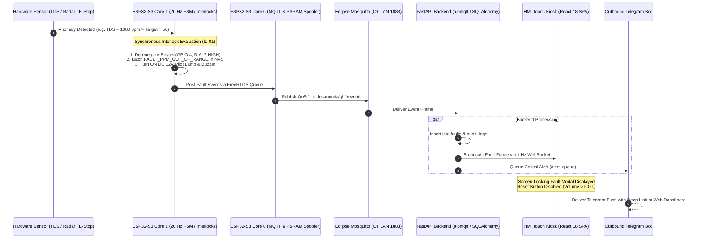
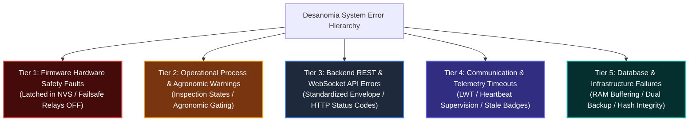
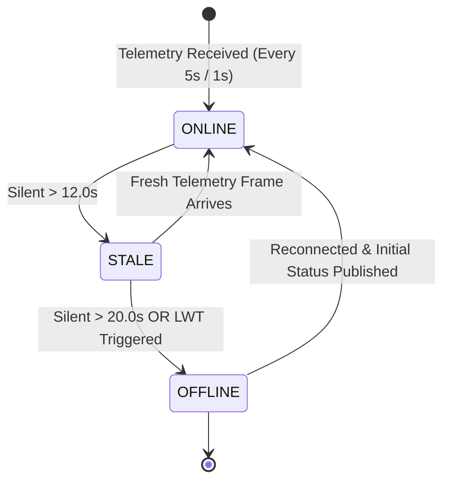
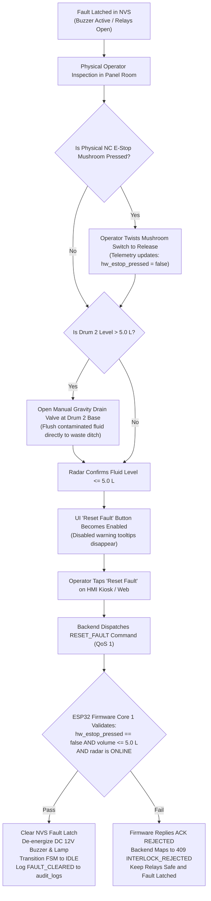
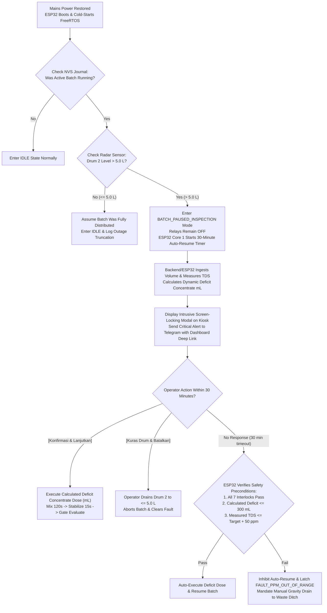

# 09 Error Handling

> **System:** DESANOMIA Greenhouse Automated Fertigation System  
> **Platform:** Beelink EQ12 Mini PC (Intel N100) + ESP32-S3 N16R8 Edge Microcontroller  
> **Authority:** Aligned with [00_MASTER_RULES.md](file:///home/maria_zahra/Documents/projects/greenhouse/desanomia/brain/00_MASTER_RULES.md), [01_PRD.md](file:///home/maria_zahra/Documents/projects/greenhouse/desanomia/brain/01_PRD.md), [02_APPFLOW.md](file:///home/maria_zahra/Documents/projects/greenhouse/desanomia/brain/02_APPFLOW.md), [04_TRD.md](file:///home/maria_zahra/Documents/projects/greenhouse/desanomia/brain/04_TRD.md), [05_ARCHITECTURE.md](file:///home/maria_zahra/Documents/projects/greenhouse/desanomia/brain/05_ARCHITECTURE.md), [06_DATA_MODEL.md](file:///home/maria_zahra/Documents/projects/greenhouse/desanomia/brain/06_DATA_MODEL.md), [07_DATA_SOURCES.md](file:///home/maria_zahra/Documents/projects/greenhouse/desanomia/brain/07_DATA_SOURCES.md), [08_SECURITY.md](file:///home/maria_zahra/Documents/projects/greenhouse/desanomia/brain/08_SECURITY.md), [10_FIRMWARE_SPEC.md](file:///home/maria_zahra/Documents/projects/greenhouse/desanomia/brain/10_FIRMWARE_SPEC.md), and [18_DECISIONS.md](file:///home/maria_zahra/Documents/projects/greenhouse/desanomia/brain/18_DECISIONS.md). [SPEC]

---

## 1. Error Philosophy & Primacy of Hardware Safety

Desanomia operates in a physical greenhouse environment where errors have tangible agronomic and equipment impacts. The error handling architecture is built on three core tenets:

1. **The Process Fails Safe in Firmware First:**  
   Safety interlocks operate autonomously on bare-metal microcontroller firmware (ESP32-S3 Core 1). All actuator relays are optoisolated, **Active LOW**, wired to Normally Open (NO) power contacts. A microcontroller crash, power interruption, communication failure, or safety interlock trip immediately drops relay coils to the un-energized open state, arresting fluid motion with zero reliance on edge server software, Python interpreters, or network routers.
2. **The Backend Reports Honestly Without Guessing:**  
   The FastAPI edge backend never masks physical errors, synthesizes missing sensor values, or assumes physical state. Inbound errors from MQTT telemetry or command timeouts are surfaced verbatim through typed error envelopes with rich contextual metadata.
3. **The UI Never Presents Phantom Certainty:**  
   The user interface displays operational reality. When communication is stale ($> 12\text{ s}$), the UI dims cards and displays a yellow badge; when offline ($> 20\text{ s}$), it presents an intrusive red warning banner and locks mutation controls (while keeping the physical and software E-Stop permanently active). Mutating buttons employ pessimistic UI locking (instant disable on tap) to prevent accidental double-dispatch.



---

## 2. Multi-Tier Fault Taxonomy & Error Code Hierarchy

Desanomia organizes all system anomalies into five distinct operational tiers:



### 2.1 Tier 1: Firmware Hardware Safety Faults & Precondition Rejections
Firmware safety anomalies are raised synchronously by Core 1 when evaluating one of the 7 safety interlocks (`IL-01` to `IL-07`). To eliminate semantic ambiguity, Tier 1 is formally subdivided into three distinct behavioral categories based on latching behavior, acoustic alarms, and recovery mechanics:

#### Tier 1A: Latched Hardware Safety Faults (Catastrophic / Emergency)
These faults represent active hazards or out-of-spec chemical conditions. They immediately de-energize all actuator relays (coil power severed), latch into ESP32 NVS, sound the local DC 12V piezo buzzer (GPIO 2) and red pilot lamp (GPIO 3), and strictly require **Gated Fault Reset** (physical gravity drain to $\le 5.0\text{ L}$ and/or mushroom switch release) before the FSM can transition back to `IDLE`.

| Canonical Fault Code | Interlock ID | Trigger Condition | Immediate Firmware Reaction | Recovery Precondition |
| :--- | :---: | :--- | :--- | :--- |
| `FAULT_PPM_OUT_OF_RANGE` | `IL-01` | Post-mixing mean TDS outside $[\text{Target} \pm 50\text{ ppm}]$ after top-up, or initial TDS $> \text{Target} + 50\text{ ppm}$. | Distribution pump locked OFF; mixer and dosing de-energized; latched in NVS; buzzer & red lamp ON. | Manual gravity drain of Drum 2 to $\le 5.0\text{ L}$ via waste ditch valve (`D-012`). |
| `FAULT_DRY_RUN` | `IL-02` | Drum 2 level $< 5.0\text{ L}$ while distribution pump is active. (Debounced with 5-sample median filter; normal batch end transitions to `BATCH_DEPLETED` without tripping). | Distribution pump instantly de-energized in $< 500\text{ ms}$; batch aborted; latched in NVS; buzzer & lamp ON. | Inspect plumbing and drippers; manual reset if batch was legitimately depleted (`D-003`). |
| `FAULT_TDS_INVALID` | `IL-05` | Clean water TDS reading $< 50\text{ ppm}$ (probe disconnected) or $> 2000\text{ ppm}$ (short circuit). | Batch aborted; fill solenoid closed; relays de-energized; latched in NVS; buzzer & lamp ON. | Inspect BNC connector, cable continuity, and probe submersion; run calibration wizard (`D-036`). |
| `FAULT_BASE_TDS_HIGH` | `IL-05` | Raw water baseline TDS $\ge 350\text{ ppm}$ during `CHECK_BASE` state. | Batch aborted; fill solenoid closed; relays de-energized; latched in NVS; buzzer & lamp ON. | Inspect raw water source filtration; flush source line; drain contaminated Drum 2. |
| `FAULT_RADAR_OFFLINE` | `IL-06` | FMCW radar UART1 silent or frame corrupted for $> 3.0\text{ seconds}$. | All active relays de-energized immediately; FSM halted; latched in NVS; buzzer & lamp ON. | Check UART1 wiring (GPIO 17/18), 5V power supply to radar, and cable integrity. `RESET_FAULT` rejected while radar is offline. |
| `FAULT_ESTOP` | `IL-07` | Physical NC mushroom switch opened (`hw_estop_pressed == true`) or software E-stop triggered. | All relays de-energized in 0 ms (coil power cut) and $< 5\text{ ms}$ (GPIO 21 ISR); latched in NVS; buzzer & lamp ON. | Twist-release physical mushroom switch (`hw_estop_pressed: false`) and drain Drum 2 to $\le 5.0\text{ L}$ if contaminated (`D-019`). |

#### Tier 1B: Transient Command Precondition Rejections (Non-Latched)
Precondition rejections occur when an operator commands an action that violates safety invariants before execution begins. The FSM remains in its current state (`IDLE`), zero physical relays are energized, zero alarms sound, and nothing is latched to NVS.

| Rejection Code | Interlock ID | Trigger Condition | Immediate Firmware Reaction | Backend & UI Reaction |
| :--- | :---: | :--- | :--- | :--- |
| `FAULT_BATCH_REJECTED` (`REJECT_DRUM_NOT_EMPTY`) | `IL-03` | `START_BATCH` command received while Drum 2 level $> 5.0\text{ L}$. | Command rejected over MQTT with QoS 1 ACK status `REJECTED`; FSM remains in `IDLE`; zero buzzer; zero NVS latch. | Backend maps to HTTP 409 `INTERLOCK_REJECTED`. UI displays amber toast: "Drum 2 Belum Kosong (Terukur: X L). Kuras drum terlebih dahulu". |

#### Tier 1C: Resumable Hydraulic Pause States (Non-Draining)
Hydraulic pauses protect water infrastructure during municipal supply disruptions. Because raw clean water in Drum 2 is uncontaminated, the system halts without discarding fluid. The 12V buzzer remains OFF (or emits a single intermittent chime), and the condition does NOT latch a fatal NVS lock.

| Pause State Code | Interlock ID | Trigger Condition | Immediate Firmware Reaction | Recovery Precondition |
| :--- | :---: | :--- | :--- | :--- |
| `PAUSED_FILL_NO_WATER` | `IL-04` | Water fill active, but radar level rise $< 1.0\text{ L}$ within 90 seconds. | Fill solenoid closed; fill watchdog paused; buzzer OFF; amber lamp blinking. | Verify municipal/well water pump; operator clicks `[Lanjutkan Pengisian]` (`RESUME_FILL`). Max 3 resume attempts. |
| `PAUSED_FILL_TIMEOUT` | `IL-04` | Total continuous filling duration exceeds 20 minutes ($1200\text{ s}$). | Fill solenoid closed; fill watchdog paused; buzzer OFF; amber lamp blinking. | Verify source flow rate; operator clicks `[Lanjutkan Pengisian]` without draining (`RESUME_FILL`). Cumulative watchdog capped at 20 min. |

---

### 2.2 Tier 2: Operational Process Warnings & Agronomic Gates
Process warnings and agronomic gates represent agricultural anomalies, hydraulic conflicts, or scheduled deferrals that do not trip emergency hardware cutoffs but enforce software state gates or require explicit human intervention.

| Warning / Gate Code | HTTP Status | Trigger Threshold / Condition | Operational System Reaction | Operator Notification & Action |
| :--- | :---: | :--- | :--- | :--- |
| `STARVATION_SUSPECTED` | — | Post-dosing TDS deficit $> 250\text{ ppm}$ below target ($< \text{Target} - 250\text{ ppm}$). | Top-up dosing is skipped to prevent dry pump wear; FSM halts at `GATE_EVALUATE`. Clean water in Drum 2 is retained. | Amber modal + Telegram alert: "Konsentrat Habis / Terbakar". Operator checks Drum 1 level and confirms refill (`D-001`, `D-022`), or drains Drum 2. |
| `LOW_STOCK_CONCENTRATE` | — | Concentrate Drum 1 calculated virtual stock $\le 3000\text{ mL}$ ($3.0\text{ L}$). | System permits current batch to finish, but flags amber status on tank card. | Floating amber toast + persistent notification drawer: "Stok Pupuk Menipis: Sisa < 3.0 L". Operator pre-mixes fertilizer (`D-025`). |
| `OUT_OF_STOCK_CONCENTRATE` | **409** | Concentrate Drum 1 calculated virtual stock $< 1500\text{ mL}$ ($1.5\text{ L}$). | Backend locks batch initiation (`POST /api/v1/batches` returns 409 `OUT_OF_STOCK_CONCENTRATE`). | High-friction modal: "Stok Pupuk Habis — Isi Ulang Drum 1". Mandates Refill Confirmation Gate resetting stock to 20.0 L (`D-025`). |
| `SCHEDULE_CONFLICT_IMMINENT` | **409** | Manual batch initiated while an automated schedule is imminent ($< 15\text{ minutes}$). | Batch setup dialog intercepts submission (`POST /api/v1/batches` returns 409 `SCHEDULE_CONFLICT_IMMINENT`). | Operator confirms whether to preempt schedule or cancel manual run (`D-024`). |
| `SAME_DAY_DOUBLE_DISTRIBUTION`| **409** | Second fertigation batch initiated on the same calendar day. | Interlocked by default (`POST /api/v1/batches` returns 409 `SAME_DAY_DOUBLE_DISTRIBUTION`); requires Hard Confirmation. | Operator must check checkbox acknowledging root asphyxiation / salinity risk before override (`D-039`). |
| `BATCH_PAUSED_INSPECTION` | — | Cold-boot / mid-batch recovery after power outage with Drum 2 level $> 5.0\text{ L}$. | ESP32 Core 1 initializes in unpowered paused mode, starts authoritative 30-min timer, and calculates deficit. | Screen-locking modal showing measured volume, PPM, and deficit mL with 30-min auto-resume countdown (`D-013`). |

---

### 2.3 Tier 3: Edge Backend REST & WebSocket Error Envelope
All HTTP 4xx and 5xx API errors strictly adhere to the unified JSON error envelope:

```json
{
  "error": {
    "code": "INTERLOCK_REJECTED",
    "message": "Distribution pump locked OFF: mean TDS (1180.4 ppm) outside allowable gate band 1200-1300 ppm",
    "detail": {
      "interlock_id": "IL-01",
      "fault_code": "FAULT_PPM_OUT_OF_RANGE",
      "measured_tds": 1180.4,
      "gate_band": [1200, 1300],
      "recipe_id": "REC-GEN-01",
      "timestamp": "2026-10-10T16:50:00Z"
    }
  }
}
```

#### Canonical HTTP Status Codes & Error Mappings
| HTTP Status | Error Code (`error.code`) | Semantics & Common Trigger Scenarios |
| :---: | :--- | :--- |
| **`400 Bad Request`** | `BAD_REQUEST` | Malformed JSON body, invalid query parameter format, or illegal date filter. |
| **`401 Unauthorized`** | `UNAUTHENTICATED` | Missing session cookie, expired token, or invalid Argon2id credentials. |
| **`403 Forbidden`** | `FORBIDDEN` | Role authorization failure (e.g., Viewer on Gazebo TV attempting batch control). |
| **`404 Not Found`** | `NOT_FOUND` | Referenced entity ID (`batch_id`, `recipe_id`, `schedule_id`) does not exist. |
| **`409 Conflict`** | `INTERLOCK_REJECTED` | Hardware interlock rejects command (e.g. Drum 2 $> 5.0\text{ L}$ on `START_BATCH` or invalid gated reset). |
| **`409 Conflict`** | `INVALID_STATE` | Command incompatible with active FSM state (e.g. manual actuator jog during active batch). |
| **`409 Conflict`** | `DEVICE_OFFLINE` | ESP32-S3 microcontroller is offline; command cannot be dispatched over MQTT. |
| **`409 Conflict`** | `OUT_OF_STOCK_CONCENTRATE` | Drum 1 virtual stock $< 1500\text{ mL}$; batch start prohibited until refill confirmation (`D-025`). |
| **`409 Conflict`** | `SCHEDULE_CONFLICT_IMMINENT`| Automated schedule due within 15 minutes; manual batch setup intercepted (`D-024`). |
| **`409 Conflict`** | `SAME_DAY_DOUBLE_DISTRIBUTION`| Fertigation already completed today; hard confirmation required (`D-039`). |
| **`422 Unprocessable`** | `VALIDATION_ERROR` | Pydantic v2 schema validation failure (e.g. `tds_target` outside bounds 500–1800 ppm). |
| **`429 Too Many Req`** | `RATE_LIMITED` | Rate limit exceeded (e.g. $> 5\text{ attempts/min}$ on `/api/v1/auth/login`). Formatted via Nginx `limit_req_status 429` custom error JSON. |
| **`500 Internal Error`**| `INTERNAL` | Unhandled backend server exception. Internal stack traces are logged but scrubbed from response. |
| **`503 Service Unavail`**| `DATABASE_UNAVAILABLE` | PostgreSQL connection failure or audit write failure. Physical mutations rejected to protect audit trail integrity. |
| **`504 Gateway Timeout`**| `COMMAND_TIMEOUT` | MQTT QoS 1 command ACK not received from ESP32 within $3.0\text{ seconds}$. Transitions UI to `OUTCOME_UNKNOWN`. |

---

### 2.4 Tier 4: Communication & Telemetry Liveness Timeouts
Microcontroller communication is supervised at the edge host backend via MQTT keep-alive, LWT (Last Will and Testament), and monotonic timestamp tracking:



- **`TELEMETRY_ONLINE` ($< 12.0\text{ s}$):** Green status badge. Full operational control enabled.
- **`TELEMETRY_STALE` ($> 12.0\text{ s}$):** Yellow status badge. Real-time telemetry cards visually dim. Mutation buttons display a confirmation spinner while waiting for fresher data.
- **`TELEMETRY_OFFLINE` ($> 20.0\text{ s}$ or MQTT LWT):** Red status banner across header. Operational and configuration mutation controls are hard-locked (`DEVICE_OFFLINE`). Critical alert dispatched to Telegram bot. **Software E-Stop Exemption:** The Kiosk and Web software Emergency Stop buttons are strictly exempt from the offline lock and remain 1-tap clickable 24/7. FSM continues running autonomously in ESP32 firmware.
- **`COMMAND_TIMEOUT` ($3.0\text{ s}$):** When a state-changing command is published over `desanomia/gh1/cmd`, backend waits up to 3.0 seconds for a matching `cmd_id` on `desanomia/gh1/ack`. If timeout expires, backend returns HTTP 504 `COMMAND_TIMEOUT` with status `OUTCOME_UNKNOWN`. The UI enters an `OUTCOME_UNKNOWN` ("Menunggu Rekonsiliasi Telemetri") state keeping mutation buttons locked while verifying FSM state via 1 Hz telemetry and `status` topic probe. Any manual operator retry must reuse the exact same `cmd_id`, ensuring ESP32's 32-slot circular RAM cache (`D-045`) suppresses duplicate actuation.

---

### 2.5 Tier 5: Database & Infrastructure Failures
- **`DB_WRITE_FAILURE`:** PostgreSQL 16 write failure or connection pool exhaustion. FastAPI buffers incoming telemetry in an in-memory RAM queue (5-second bulk write buffer, capacity 5000 frames) and retries asynchronously. If buffer fills, an explicit `TELEMETRY_GAP_MARKER` is logged to maintain honest reporting. Real-time WebSocket broadcasting and ESP32 physical execution continue unaffected. State-changing mutations are rejected with HTTP 503 `DATABASE_UNAVAILABLE` to guarantee audit trail integrity.
- **`DB_PARTITION_MISSING`:** Monthly range partition for the upcoming month is missing. Checked daily by background maintenance cron; alerts administrator via Telegram.
- **`AUDIT_IMMUTABILITY_VIOLATION`:** Attempted unauthorized `UPDATE` or `DELETE` intercepted by PostgreSQL PL/pgSQL trigger `trg_audit_logs_immutability` (`08_SECURITY.md`). Triggers transaction rollback, logs security exception, dispatches high-priority Telegram alert, and sets a persistent red banner on Kiosk (`D-039`, `TR-16`).
- **`BACKUP_VERIFICATION_FAILED`:** Daily automated `pg_dump` snapshot generation or off-site Tailscale rsync to Host 2 failed. Dispatches warning alert to administrator (`D-044`).

---

## 3. Gated Fault Reset & Physical Clearing Protocols (TR-10, D-012, D-019)

Safety faults latched in ESP32 NVS cannot be cleared by simply tapping a button on the UI. They enforce a **Dual-Condition Physical Clearance Protocol** grounded in physical reality.



### 3.1 Firmware Validation Rules
The ESP32 FreeRTOS firmware evaluates three conditions atomically upon receiving a `RESET_FAULT` command:
1. `hw_estop_pressed == false`: Physical NC mushroom contacts on GPIO 21 must be closed.
2. `drum2_volume <= 5.0 L`: FMCW radar sensor must confirm volume is below the dry sump threshold ($5.0\text{ L}$).
3. `radar_online == true`: FMCW radar UART communication must be active. If the radar is silent (`FAULT_RADAR_OFFLINE`), `RESET_FAULT` is strictly rejected because sump emptiness cannot be verified.

If any condition fails, the firmware immediately returns an ACK packet with status `REJECTED` and the specific interlock reason code. The edge backend maps this rejection to HTTP 409 `INTERLOCK_REJECTED`.

### 3.2 UI Instructive Feedback & Dynamic Badges
The UI `Reset Fault` button dynamically reflects physical hardware state:
- **Locked by Hardware E-Stop:** Button is disabled with an amber warning badge:  
  `Tombol E-Stop Fisik Masih Tertekan — Putar untuk Melepas`
- **Locked by Contaminated Drum 2 Fluid:** Button is disabled with a red warning badge:  
  `Kuras Drum Distribusi ke Parit hingga ≤ 5.0 L (Terukur: 138.4 L)`
- **Both Conditions Clear:** Button enables with high-contrast emerald styling:  
  `[Reset Fault]` (1-tap execution on Kiosk, logging user ID and clearance volume to `audit_logs`).

---

## 4. Mid-Batch Outage Recovery & Dynamic Deficit Dosing (D-013, TR-08)

If edge host or greenhouse utility AC power drops while a batch is in progress, the system recovers without discarding viable fertilizer solution.



### 4.1 Dynamic Deficit Calculation Formula
When resuming an interrupted batch with fluid in Drum 2, the system calculates the precise deficit volume of concentrate needed to bring the existing water volume to the target recipe PPM:

$$V_{\text{deficit\_mL}} = \frac{(\text{TDS}_{\text{target}} - \text{TDS}_{\text{measured}}) \times V_{\text{current\_L}}}{K_{\text{yield}}}$$

Where:
- $\text{TDS}_{\text{target}}$: Target PPM defined in active recipe preset (e.g. $1250\text{ ppm}$ for Generatif).
- $\text{TDS}_{\text{measured}}$: Average stable TDS reading measured after a 30-second settling window.
- $V_{\text{current\_L}}$: Current volume measured by FMCW radar sensor in Drum 2 (e.g. $140.0\text{ L}$).
- $K_{\text{yield}}$: Empirical concentrate yield calibration coefficient ($107.0\text{ ppm}\cdot\text{L}/\text{mL}$, verified in `DOSE_TEST_RESULT.md`).

**Dimensional Derivation & Top-Up Safety Bounds:**
- Drum 1 contains concentrated stock ($2\text{ kg}$ fertilizer dissolved in $20\text{ L}$, nominal yield $\approx 107,000\text{ ppm}$ effective TDS).
- In a full $140.0\text{ L}$ Distribution Drum, $1\text{ mL}$ of concentrate increases batch TDS by $\frac{107.0}{140.0} \approx 0.7643\text{ ppm}$.
- For a $150\text{ ppm}$ deficit in $140.0\text{ L}$:
  $$V_{\text{deficit\_mL}} = \frac{150 \times 140.0}{107.0} = 196.26\text{ mL}$$
  *(Directly matches the unit test in `13_TESTING.md:288`).*
- The **300 mL maximum top-up cap** corresponds to an allowable deficit of:
  $$\Delta\text{TDS}_{\text{max}} = \frac{300 \times 107.0}{140.0} \approx 229.3\text{ ppm}$$
  This safely covers the $50–250\text{ ppm}$ single-pass top-up band mandated by `00_MASTER_RULES.md` Rule 3 without exceeding pump delivery limits.

### 4.2 Deficit Recovery Constraints
- **Authoritative Timer Ownership:** ESP32 FreeRTOS Core 1 owns the authoritative 30-minute safety timer and local deficit calculation (`fsm.CalculateDeficitDose`). The edge backend and Kiosk UI mirror the timer countdown. If the edge host is offline, ESP32 autonomously executes the auto-resume (if preconditions hold) or halts safely.
- **Maximum Recovery Quota:** $V_{\text{deficit\_mL}}$ is strictly capped at **300 mL maximum**. If the calculated deficit exceeds 300 mL, the system flags `STARVATION_SUSPECTED`, inhibits auto-resume, and halts.
- **Catastrophic Salt Spike:** If $\text{TDS}_{\text{measured}} > \text{TDS}_{\text{target}} + 50\text{ ppm}$ (or catastrophic salt spike $> 1750\text{ ppm}$), dynamic recovery is prohibited. Auto-resume is strictly inhibited, and the UI modal locks to `[Kuras Drum]` only.

---

## 5. In-Flight Hydraulic Fill Recovery (IL-04, TR-19)

Unlike fertilizer-dosed water, raw municipal/well water in Drum 2 is uncontaminated. Premature drainage during water filling failures wastes resources.

### 5.1 Dual-Stage Fill Timeout Separation
1. **Early Rise Timeout (90 seconds):** If the fill solenoid is open but the radar level does not increase by $\ge 1.0\text{ L}$ within 90 seconds, the system flags `PAUSED_FILL_NO_WATER` (supply pump tripped, source valve closed, or line airlock).
2. **Total Fill Timeout (20 minutes):** If total continuous water filling exceeds 20 minutes ($1200\text{ s}$), the system flags `PAUSED_FILL_TIMEOUT` (low municipal supply pressure).

### 5.2 Recovery Without Tank Drainage
- In either fill timeout scenario, the ESP32 de-energizes the fill solenoid and pauses the fill timer. The DC 12V buzzer remains OFF (amber warning lamp blinking).
- **No Drainage Required:** The operator inspects source water supply valves or pumps.
- **`RESUME_FILL` Command:** The operator clicks `[Lanjutkan Pengisian]` in the UI. The fill solenoid re-opens, and the timer resumes accumulating from the existing water level until $140.0\text{ L}$ is reached.
- **Safety Limits on Resume:**
  - **Resume Attempt Cap:** A maximum of **3 resume attempts** are permitted per batch. If 3 attempts expire without reaching $140.0\text{ L}$, the system latches `FAULT_FILL_TIMEOUT` as a hard error requiring panel reset.
  - **Cumulative Fill Watchdog:** The 20-minute fill watchdog is cumulative across resumes, preventing endless trickling or hidden pipe leaks.

---

## 6. Operational Alert Escalation & Offline Queue Management (D-025, TR-15, TR-21, TR-22)

Alerts follow a 5W1H operational framework mapped across physical alarms, HMI touch audio, in-app notifications, and remote Telegram bots.

### 6.1 4-Tier Alert Severity Model

| Severity Level | Local Panel Alarms (DC 12V) | HMI Kiosk Audio Chime | In-App Hub & Drawer | Outbound Telegram Bot |
| :--- | :--- | :--- | :--- | :--- |
| **`CRITICAL`** | Red Pilot Lamp ON (GPIO 3)<br>Piezo Buzzer ON (GPIO 2) | Urgent double glass chime (`ping-ping.mp3`) | Screen-locking modal or sticky top toast with action button | High-priority push message with deep link to authenticated dashboard |
| **`WARNING`** | Pilot Lamp OFF<br>Piezo Buzzer OFF | Subtle single glass ping (`ping.mp3`) | Slide-out drawer + floating toast with action button | Standard Telegram message with dashboard deep link |
| **`SUCCESS`** | Pilot Lamp OFF<br>Piezo Buzzer OFF | Silent | Floating auto-dismiss toast (5s) | Standard Telegram notification |
| **`INFO`** | Pilot Lamp OFF<br>Piezo Buzzer OFF | Silent | Slide-out drawer history only | Muted / Silent push |

### 6.2 Offline Telegram Queue (`alert_queue`) (TR-22)
When 4G cellular connectivity drops (Orbit Star H2 down), outbound alerts are persisted to PostgreSQL:

```sql
-- Unified schema matching 06_DATA_MODEL.md
CREATE TABLE alert_queue (
    id BIGSERIAL PRIMARY KEY,
    notification_id BIGINT NULL REFERENCES notifications(id) ON DELETE SET NULL,
    severity TEXT NOT NULL CHECK (severity IN ('critical', 'warning')),
    alert_code TEXT NOT NULL,
    title TEXT NOT NULL,
    message TEXT NOT NULL,
    status TEXT NOT NULL CHECK (status IN ('pending', 'sent', 'failed')),
    retry_count INT NOT NULL DEFAULT 0,
    max_retries INT NOT NULL DEFAULT 5,
    created_at TIMESTAMPTZ NOT NULL DEFAULT NOW(),
    sent_at TIMESTAMPTZ NULL
);

CREATE INDEX idx_alert_queue_pending ON alert_queue(status, created_at ASC) WHERE status = 'pending';
```

- **Chronological Drain:** A background task polls `alert_queue`. Upon internet restoration, it drains pending records in exact chronological order, embedding the original occurrence timestamp in the message body:  
  `[TERTUNDA: Terjadi pada 14:12 WIB] ⚠️ Peringatan: Suplai Air Terhenti.`
- **Deduplication Window:** Identical alert codes generated within 10 minutes are consolidated into a single push to prevent notification spamming.
- **Retry Bounds:** Failed pushes are retried up to `max_retries = 5` before status transitions to `'failed'`.

### 6.3 Telegram Outbound Notifications & Remote Boundaries
The Telegram bot is strictly an **Outbound Alerting Channel**:
- **Zero Inbound Remote Execution:** Direct mutation buttons (e.g., remote batch starts or remote drain confirmation) are strictly prohibited from Telegram chat to prevent bypassing RBAC, CSRF tokens, physical safety gates, and same-day distribution limits.
- **Authenticated Deep Links:** Alert messages embed secure deep links to the Web Dashboard (accessed via Tailscale), directing the operator to perform verified actions on the authenticated UI (e.g. `https://desanomia.greenhouse/batches/recovery`).

---

## 7. Frontend Error Boundaries, Pessimistic UX & Network Recovery

The React 18 Single Page Application runs 24/7 on the Beelink EQ12 local touchscreen via Chromium and the Cage Wayland compositor.

### 7.1 Kiosk Root ErrorBoundary (`KioskErrorBoundary.tsx`)
Unhandled JavaScript exceptions or React component render failures are captured by a root Error Boundary to prevent an unattended blank white screen or compositor crash. 

**Architectural Safety Invariants:**
1. **Software E-Stop Redundancy:** The primary software Emergency Stop button is mounted in a persistent layout shell *outside* `KioskErrorBoundary`. As defense-in-depth, `KioskErrorBoundary`'s fallback UI also renders a dedicated 1-tap Emergency Stop button so physical safety is never eclipsed by UI errors.
2. **Watchdog Auto-Reload:** For unattended 24/7 operation, if a render crash occurs, a 10-second countdown automatically triggers `window.location.reload()` to recover the display without requiring physical keyboard intervention.

```tsx
import { Component, ErrorInfo, ReactNode } from "react";

interface Props {
  children: ReactNode;
}

interface State {
  hasError: boolean;
  error: Error | null;
  countdown: number;
}

export class KioskErrorBoundary extends Component<Props, State> {
  public state: State = { hasError: false, error: null, countdown: 10 };
  private timer: number | null = null;

  public static getDerivedStateFromError(error: Error): State {
    return { hasError: true, error, countdown: 10 };
  }

  public componentDidCatch(error: Error, errorInfo: ErrorInfo) {
    console.error("Kiosk Dashboard Uncaught Error:", error, errorInfo);
    this.timer = window.setInterval(() => {
      this.setState((prev) => {
        if (prev.countdown <= 1) {
          window.location.reload();
          return prev;
        }
        return { countdown: prev.countdown - 1 };
      });
    }, 1000);
  }

  public componentWillUnmount() {
    if (this.timer) clearInterval(this.timer);
  }

  public render() {
    if (this.state.hasError) {
      return (
        <div className="flex flex-col items-center justify-center min-h-screen bg-slate-950 text-slate-100 p-8 font-sans">
          <div className="max-w-lg w-full bg-slate-900 border border-red-500/40 rounded-2xl p-8 shadow-2xl text-center">
            <div className="w-16 h-16 bg-red-500/10 text-red-500 rounded-full flex items-center justify-center mx-auto mb-4 border border-red-500/20">
              <span className="text-3xl">⚠️</span>
            </div>
            <h1 className="text-2xl font-bold text-red-400 mb-2">Terjadi Kesalahan Antarmuka</h1>
            <p className="text-slate-400 text-sm mb-4 leading-relaxed">
              Sistem kontrol fisik ESP32 tetap beroperasi mandiri di latar belakang. Memuat ulang antarmuka otomatis dalam {this.state.countdown} detik...
            </p>
            <div className="bg-slate-950 border border-slate-800 rounded-xl p-3 text-left mb-6 overflow-auto max-h-32 text-xs font-mono text-red-300/80">
              {this.state.error?.message || "Unknown rendering exception"}
            </div>
            <div className="flex flex-col gap-3">
              <button
                onClick={() => window.location.reload()}
                className="w-full min-h-[56px] py-3 px-6 bg-slate-800 hover:bg-slate-700 active:scale-95 text-white font-semibold rounded-xl border border-slate-700 transition-all text-base"
              >
                Muat Ulang Sekarang (Reload)
              </button>
              {/* Fallback 1-Tap Software E-Stop inside crash view */}
              <button
                onClick={() => {
                  fetch("/api/v1/actuators/estop", {
                    method: "POST",
                    headers: { "Content-Type": "application/json" },
                    body: JSON.stringify({ reason: "CrashScreen_EmergencyStop" }),
                  }).catch(console.error);
                }}
                className="w-full min-h-[56px] py-3 px-6 bg-red-600 hover:bg-red-500 active:scale-95 text-white font-bold rounded-xl border border-red-400 shadow-lg text-base"
              >
                DARURAT / E-STOP (Matikan Semua Relai)
              </button>
            </div>
          </div>
        </div>
      );
    }
    return this.props.children;
  }
}
```

### 7.2 Pessimistic UI Mutation Hooks & Outcome Reconciliation (`usePessimisticMutation`)
To eliminate duplicate actuations, phantom double-clicks, and double-dosing risks:
1. When a user taps a mutation button (`Mulai Batch`, `Pause`, `Batal`, `Reset Fault`, Manual Relay Jog), the button immediately locks into a disabled `loading` state.
2. The button remains locked until either:
   - A correlated MQTT ACK frame arrives via WebSocket confirming success or rejection.
   - The $3.0\text{ s}$ command timeout expires.
3. **Outcome Reconciliation (`OUTCOME_UNKNOWN`):**  
   If the 3.0 s timeout expires without ACK, the UI does **not** simply re-enable the button. Instead, it enters an amber `OUTCOME_UNKNOWN` state (*"Menunggu Rekonsiliasi Telemetri..."*):
   - The button remains disabled while the frontend observes subsequent 1 Hz telemetry frames and queries `desanomia/gh1/status` to determine if the FSM transitioned or if relays changed state.
   - If telemetry confirms execution succeeded, the UI clears the lock and updates to the active state.
   - If reconciliation times out after an additional 5.0 s and confirms no change occurred, the button unlocks with an amber retry prompt. Any subsequent operator retry **must reuse the exact same `cmd_id`** to ensure ESP32's 32-slot circular RAM cache (`D-045`) suppresses duplicate execution.

### 7.3 WebSocket Reconnect Backoff & Stale Indicators
The dashboard client WebSocket automatically reconnects upon disconnection using exponential backoff:
- Intervals: $1\text{ s} \to 2\text{ s} \to 4\text{ s} \to 8\text{ s} \to \text{max } 15\text{ s}$.
- While disconnected, sensor cards dim by 40% opacity, display tabular figures in amber, and mount an unobtrusive banner: `Mencoba Menyambung Ulang ke Server...`.

---

## 8. Backend Error Architecture & Database Circuit Breakers

### 8.1 FastAPI Typed Exception Hierarchy & Global Handlers (`backend/core/errors.py`)

All FastAPI exceptions are wrapped to guarantee strict conformance to the canonical error envelope (`{"error": {"code": "...", "message": "...", "detail": {...}}}`):

```python
from fastapi import FastAPI, Request, status
from fastapi.exceptions import RequestValidationError
from fastapi.responses import JSONResponse
from starlette.exceptions import HTTPException as StarletteHTTPException
import logging

logger = logging.getLogger("desanomia.errors")

class DesanomiaException(Exception):
    """Base exception for all domain-specific edge errors."""
    def __init__(self, code: str, message: str, status_code: int, detail: dict | None = None):
        self.code = code
        self.message = message
        self.status_code = status_code
        self.detail = detail or {}
        super().__init__(message)

class InterlockRejectedError(DesanomiaException):
    def __init__(self, interlock_id: str, fault_code: str, message: str, detail: dict | None = None):
        super().__init__(
            code="INTERLOCK_REJECTED",
            message=message,
            status_code=status.HTTP_409_CONFLICT,
            detail={"interlock_id": interlock_id, "fault_code": fault_code, **(detail or {})},
        )

class InvalidStateError(DesanomiaException):
    def __init__(self, current_state: str, attempted_action: str):
        super().__init__(
            code="INVALID_STATE",
            message=f"Action '{attempted_action}' is invalid in current FSM state '{current_state}'",
            status_code=status.HTTP_409_CONFLICT,
            detail={"current_state": current_state, "action": attempted_action},
        )

class DeviceOfflineError(DesanomiaException):
    def __init__(self, last_seen_seconds: float):
        super().__init__(
            code="DEVICE_OFFLINE",
            message=f"Microcontroller is offline (last seen {last_seen_seconds:.1f}s ago)",
            status_code=status.HTTP_409_CONFLICT,
            detail={"last_seen_seconds": last_seen_seconds},
        )

class AgronomicGateError(DesanomiaException):
    def __init__(self, code: str, message: str, detail: dict | None = None):
        super().__init__(
            code=code,
            message=message,
            status_code=status.HTTP_409_CONFLICT,
            detail=detail or {},
        )

class CommandTimeoutError(DesanomiaException):
    def __init__(self, cmd_id: str, timeout_seconds: float = 3.0):
        super().__init__(
            code="COMMAND_TIMEOUT",
            message=f"Command '{cmd_id}' timed out after {timeout_seconds}s without ACK (status OUTCOME_UNKNOWN)",
            status_code=status.HTTP_504_GATEWAY_TIMEOUT,
            detail={"cmd_id": cmd_id, "timeout_seconds": timeout_seconds, "status": "OUTCOME_UNKNOWN"},
        )

class DatabaseUnavailableError(DesanomiaException):
    def __init__(self, message: str = "Database connection offline; audit logging unavailable"):
        super().__init__(
            code="DATABASE_UNAVAILABLE",
            message=message,
            status_code=status.HTTP_503_SERVICE_UNAVAILABLE,
            detail={"retry_after_seconds": 5},
        )

class BadRequestError(DesanomiaException):
    def __init__(self, message: str, detail: dict | None = None):
        super().__init__(
            code="BAD_REQUEST",
            message=message,
            status_code=status.HTTP_400_BAD_REQUEST,
            detail=detail or {},
        )

# Global Exception Handlers Registered with FastAPI
def register_error_handlers(app: FastAPI):
    @app.exception_handler(DesanomiaException)
    async def desanomia_exception_handler(request: Request, exc: DesanomiaException):
        return JSONResponse(
            status_code=exc.status_code,
            content={
                "error": {
                    "code": exc.code,
                    "message": exc.message,
                    "detail": exc.detail,
                }
            },
        )

    @app.exception_handler(RequestValidationError)
    async def validation_exception_handler(request: Request, exc: RequestValidationError):
        return JSONResponse(
            status_code=status.HTTP_422_UNPROCESSABLE_ENTITY,
            content={
                "error": {
                    "code": "VALIDATION_ERROR",
                    "message": "Pydantic payload schema validation failed",
                    "detail": {"errors": exc.errors()},
                }
            },
        )

    @app.exception_handler(StarletteHTTPException)
    async def http_exception_handler(request: Request, exc: StarletteHTTPException):
        code_map = {
            401: "UNAUTHENTICATED",
            403: "FORBIDDEN",
            404: "NOT_FOUND",
            429: "RATE_LIMITED",
            503: "SERVICE_UNAVAILABLE",
        }
        return JSONResponse(
            status_code=exc.status_code,
            content={
                "error": {
                    "code": code_map.get(exc.status_code, "HTTP_ERROR"),
                    "message": str(exc.detail),
                    "detail": {},
                }
            },
        )

    @app.exception_handler(Exception)
    async def unhandled_exception_handler(request: Request, exc: Exception):
        logger.exception("Unhandled backend exception: %s", exc)
        return JSONResponse(
            status_code=status.HTTP_500_INTERNAL_SERVER_ERROR,
            content={
                "error": {
                    "code": "INTERNAL",
                    "message": "Internal edge server exception occurred",
                    "detail": {},
                }
            },
        )
```

### 8.2 Database Resilience & Asynchronous RAM Write Buffer (D-044)
- **High-Frequency Ingestion Protection:** Telemetry arrives at 1 Hz during active batches. Direct per-second disk writes degrade NVMe SSD endurance.
- **5-Second Bulk RAM Buffer:** FastAPI aggregates sensor frames in an in-memory queue and flushes bulk records every 5 seconds via SQLAlchemy async sessions.
- **Circuit Breaker on DB Outage & Honest Gap Reporting:**  
  If PostgreSQL becomes unresponsive, the buffer expands up to 5000 frames (~83 minutes of telemetry) in RAM before dropping oldest records.
  - To preserve data honesty, whenever frames are dropped, the backend logs a persistent warning and inserts an explicit `TELEMETRY_GAP_MARKER` record noting the lost frame sequence count and timestamp window upon reconnection.
  - **Audit Protection Invariant:** While telemetry frames are buffered in RAM, **hardware state-changing mutations (`POST /batches`, `POST /actuators`, `POST /faults/reset`) are strictly rejected with HTTP 503 `DATABASE_UNAVAILABLE`** if audit logging cannot write to PostgreSQL. No physical state mutation is permitted without persistent audit commit.

---

## 9. Comprehensive 15-Scenario System Failure & Resilience Playbook

The master reference playbook detailing 15 concrete failure modes across firmware, backend, database, network, and physical hardware:

| # | Trigger Event | Primary Detection Node | Immediate Firmware Reaction | Backend Reaction | UI / Kiosk UX | Operator Action & Recovery |
| :-: | :--- | :--- | :--- | :--- | :--- | :--- |
| **1** | **TDS Out of Range at Gate** | ESP32 Core 1 (`GATE_EVALUATE`) | De-energizes distribution pump; latches `FAULT_PPM_OUT_OF_RANGE` in NVS; sounds 12V buzzer. | Records fault in DB; dispatches Critical alert to Telegram with deep link. | Intrusive red modal; `Reset Fault` button disabled (`volume > 5.0 L`). | Open manual gravity drain valve; flush Drum 2 to ditch $\le 5.0\text{ L}$; click `Reset Fault` (`D-012`). |
| **2** | **Dry-Run During Distribution** | ESP32 Core 1 (`IL-02`) | Instantly de-energizes distribution pump in $< 500\text{ ms}$; latches `FAULT_DRY_RUN`; buzzer ON. (Debounced 5-sample median). | Records fault in DB; dispatches Critical alert. | Red dry-run banner; highlights tank card. | Verify dripper line discharge; click `Reset Fault` to return to `IDLE` (`D-003`). |
| **3** | **Pre-Batch Drum 2 Not Empty** | ESP32 Core 1 (`IL-03`) | Rejects `START_BATCH` command; publishes QoS 1 ACK status `REJECTED`. FSM stays `IDLE`; zero buzzer; zero NVS latch. | Maps to 409 `INTERLOCK_REJECTED`. | Amber toast: "Drum 2 Belum Kosong (Terukur: X L). Kuras drum terlebih dahulu". | Drain residual liquid from Drum 2 via gravity valve until $\le 5.0\text{ L}$; re-trigger batch. |
| **4** | **Water Supply Failure (Early)** | ESP32 Core 1 (`IL-04`) | Closes fill solenoid in 90s; enters `PAUSED_FILL_NO_WATER`; buzzer OFF; amber lamp blinks. | Records warning; sends Telegram notification with deep link. | Amber toast: "Air Masuk Terhenti (< 1.0 L / 90s)". | Inspect source water pump and piping valves; tap `[Lanjutkan Pengisian]` (`TR-19`). Max 3 resumes. |
| **5** | **Fill Timeout Exceeded (> 20m)** | ESP32 Core 1 (`IL-04`) | Closes fill solenoid at 20 min; enters `PAUSED_FILL_TIMEOUT`; buzzer OFF; pauses fill watchdog. | Records warning; sends Telegram notification with deep link. | Amber modal: "Waktu Pengisian Maksimum 20 Menit Terlampaui". | Inspect municipal line pressure; tap `[Lanjutkan Pengisian]` without draining (`TR-19`). Cumulative 20 min cap. |
| **6** | **TDS Probe Disconnected/Short** | ESP32 Core 1 (`IL-05`) | Aborts batch; shuts fill solenoid; latches `FAULT_TDS_INVALID`; buzzer ON. | Records fault; sends Critical Telegram alert. | Red modal: "Sensor TDS Tidak Valid (< 50 atau > 2000 ppm)". | Inspect BNC connector, probe cable, and liquid immersion; run calibration wizard (`D-036`). |
| **7** | **High Raw Water Baseline TDS** | ESP32 Core 1 (`IL-05`) | Aborts batch at `CHECK_BASE`; closes solenoid; latches `FAULT_BASE_TDS_HIGH`; buzzer ON. | Records fault; sends Critical Telegram alert. | Red modal: "Air Baku Tercemar (TDS >= 350 ppm)". | Inspect raw source filtration; flush water lines; drain Drum 2 to ditch. |
| **8** | **FMCW Radar UART Silence (> 3s)**| ESP32 Core 1 (`IL-06`) | Cuts all active relays immediately; latches `FAULT_RADAR_OFFLINE`; buzzer ON. | Records fault; sends Critical Telegram alert. | Red banner: "Sensor Radar Level Terputus". `Reset Fault` rejected while radar is offline. | Inspect UART1 wiring (GPIO 17/18) and 5V power supply to radar board. |
| **9** | **Physical E-Stop Mushroom Tripped**| ESP32 GPIO 21 ISR (`IL-07`) | De-energizes all relays in 0 ms (coil power) and $< 5\text{ ms}$ (software); turns on pilot lamp & buzzer. | Records fault; broadcasts E-Stop event to all clients. | Full-screen red hazard overlay: "DARURAT DIAKTIFKAN". | Twist-release mushroom button (`hw_estop_pressed = false`); drain Drum 2 if dirty; click `Reset Fault`. |
| **10**| **Mid-Batch Power Outage Recovery** | ESP32 Core 1 Cold Boot | Detects active batch in NVS with level $> 5.0\text{ L}$; boots into `BATCH_PAUSED_INSPECTION`. Core 1 owns 30-min timer & deficit calculation. | Mirrors 30-min timer; displays recovery modal. | Screen-locking modal showing measured volume, PPM, and deficit mL. | Tap `[Konfirmasi & Lanjutkan]` to dose deficit, or let 30-min timer auto-resume if deficit $\le 300\text{ mL}$ and no salt spike (`D-013`). |
| **11**| **Concentrate Drum 1 Starvation** | ESP32 Core 1 / Backend | Skips top-up dose; raises `STARVATION_SUSPECTED`; halts at `GATE_EVALUATE`. Clean water in Drum 2 retained. | Flags virtual stock depletion; sends Critical alert. | Amber modal: "Konsentrat Habis / Terbakar. Top-Up Dibatalkan". | Inspect Drum 1; prepare 20 L concentrate; confirm Refill Gate resetting stock (`D-022`, `D-025`), or drain Drum 2. |
| **12**| **ESP32 Telemetry Silence / Offline**| Backend aiomqtt Ingest | Continues running batch autonomously on ESP32 Core 1. | Marks device `STALE` at 12s, `OFFLINE` at 20s; dispatches Telegram alert. | Yellow badge at 12s; red offline banner at 20s. Mutation controls locked, **Software E-Stop remains active**. | Inspect W5500 Ethernet cable, industrial switch power, and OT LAN IP `192.168.10.20`. |
| **13**| **Edge Server Reboot Mid-Batch** | ESP32 Core 0 Spooler | FSM finishes batch autonomously; spools events into 500-slot PSRAM buffer. | Backend reboots; re-subscribes to MQTT; ingests backlog from PSRAM. | Kiosk Chromium reloads; resumes live telemetry snapshot in $< 500\text{ ms}$. | Zero operator action needed; agricultural process runs uninterrupted (`D-014`). |
| **14**| **4G Cellular Internet Outage** | Backend Telegram Worker | Unaffected (OT fieldbus is air-gapped on `ETH0`). | Persists alerts into PostgreSQL `alert_queue` with monotonic sequence (`id BIGSERIAL`). | Kiosk operates 100% locally via loopback `127.0.0.1:8080`. | Inspect Orbit Star H2 4G modem; alerts flush automatically upon internet recovery (`TR-22`). |
| **15**| **Audit Log Tampering / Backup Gap**| PostgreSQL Trigger / Backup Cron | Unaffected (physical fertigation runs normally). | Trigger `trg_audit_logs_immutability` blocks UPDATE/DELETE (`AUDIT_IMMUTABILITY_VIOLATION`); cron checks offsite sync. | Red security notification banner on Kiosk top header: "Peringatan Keamanan Database / Backup Gagal". | Inspect PostgreSQL logs for unauthorized SQL execution; verify Tailscale rsync to Host 2 (`D-044`). |
