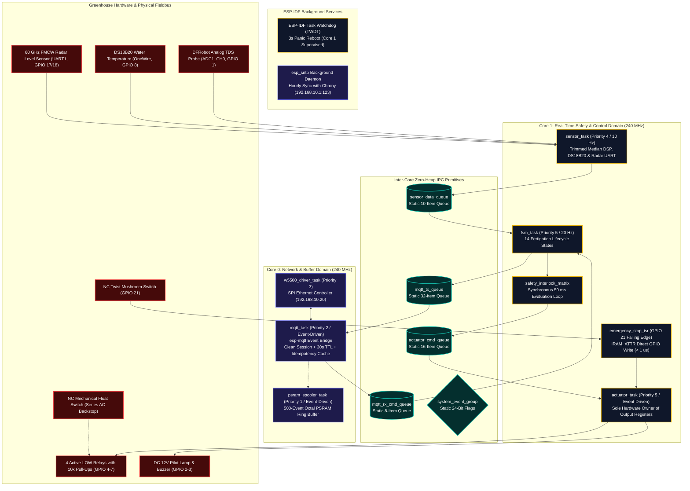
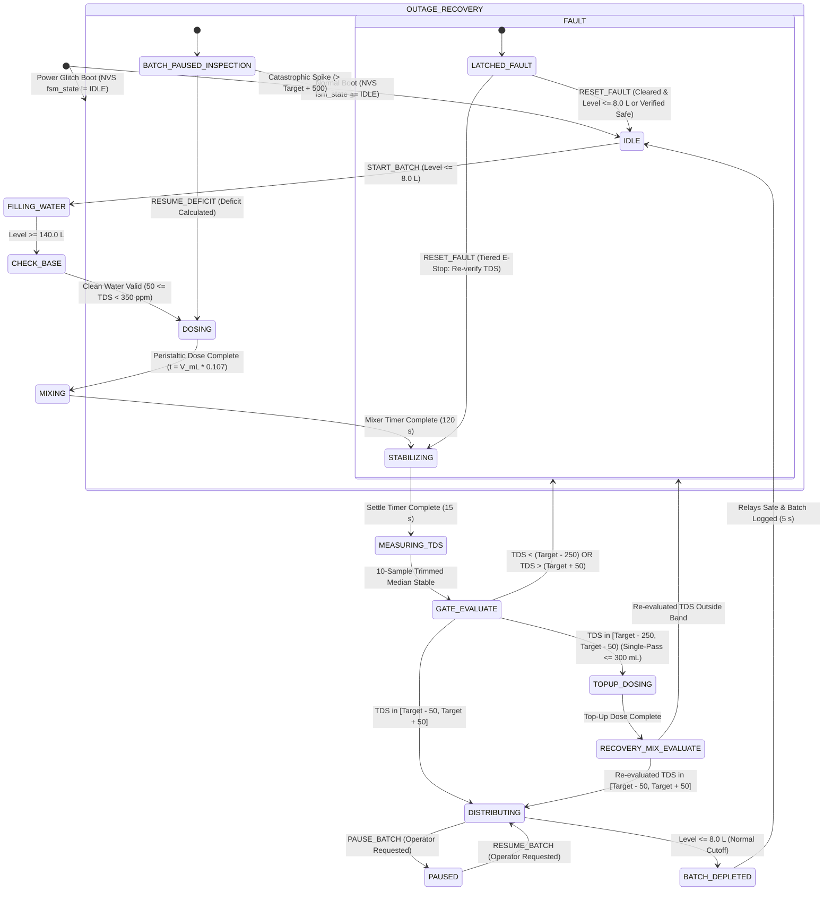

# 10 Firmware Spec

> **System:** DESANOMIA Greenhouse Automated Fertigation System  
> **Platform:** ESP32-S3 N16R8 Edge Microcontroller (16MB Quad SPI Flash, 8MB Octal PSRAM)  
> **Toolchain:** PlatformIO / Espressif 32 (ESP-IDF / FreeRTOS SMP / C++17)  
> **Authority:** Aligned with [00_MASTER_RULES.md](file:///home/maria_zahra/Documents/projects/greenhouse/desanomia/brain/00_MASTER_RULES.md), [01_PRD.md](file:///home/maria_zahra/Documents/projects/greenhouse/desanomia/brain/01_PRD.md), [02_APPFLOW.md](file:///home/maria_zahra/Documents/projects/greenhouse/desanomia/brain/02_APPFLOW.md), [04_TRD.md](file:///home/maria_zahra/Documents/projects/greenhouse/desanomia/brain/04_TRD.md), [05_ARCHITECTURE.md](file:///home/maria_zahra/Documents/projects/greenhouse/desanomia/brain/05_ARCHITECTURE.md), [06_DATA_MODEL.md](file:///home/maria_zahra/Documents/projects/greenhouse/desanomia/brain/06_DATA_MODEL.md), [07_DATA_SOURCES.md](file:///home/maria_zahra/Documents/projects/greenhouse/desanomia/brain/07_DATA_SOURCES.md), [08_SECURITY.md](file:///home/maria_zahra/Documents/projects/greenhouse/desanomia/brain/08_SECURITY.md), [09_ERROR_HANDLING.md](file:///home/maria_zahra/Documents/projects/greenhouse/desanomia/brain/09_ERROR_HANDLING.md), [18_DECISIONS.md](file:///home/maria_zahra/Documents/projects/greenhouse/desanomia/brain/18_DECISIONS.md) (D-003, D-010, D-019, D-045, D-047, D-048, D-050), and [20_GLOSSARY.md](file:///home/maria_zahra/Documents/projects/greenhouse/desanomia/brain/20_GLOSSARY.md). [SPEC]

---

## 1. Asymmetric Dual-Core FreeRTOS Architecture

Desanomia firmware runs on the **ESP32-S3 N16R8** featuring dual Xtensa 32-bit LX7 cores operating at 240 MHz. To ensure deterministic, jitter-free execution of physical safety loops and eliminate task starvation from network latency, firmware tasks are partitioned strictly across cores.



### 1.1 FreeRTOS Task Scheduling & Memory Table
All task stacks and control structures are allocated statically in `.bss` memory during `app_main()` initialization:

| Task Name | Core Affinity | Priority | Execution Rate | Stack Size (Bytes) | Allocation Type | Primary Functional Responsibility |
| :--- | :---: | :---: | :---: | :---: | :---: | :--- |
| `fsm_task` | Core 1 | 5 | 20 Hz (50 ms) | 8,192 | `xTaskCreateStaticPinnedToCore` | 14-state fertigation state machine, recipe timing, deficit dosing, and safety interlocks. Subscribed to TWDT. |
| `actuator_task` | Core 1 | 5 | Event-Driven | 4,096 | `xTaskCreateStaticPinnedToCore` | Sole hardware owner of GPIO output registers; enforces mutual exclusion and dead-band delays. Subscribed to TWDT. |
| `sensor_task` | Core 1 | 4 | 10 Hz (100 ms) | 4,096 | `xTaskCreateStaticPinnedToCore` | ADC1_CH0 trimmed median filtering, 1 Hz DS18B20 OneWire acquisition, radar UART1 parsing. Subscribed to TWDT. |
| `w5500_driver_task`| Core 0 | 3 | Interrupt/10ms | 4,096 | `xTaskCreateStaticPinnedToCore` | W5500 SPI Ethernet bus handler and hardware interrupt ISR processor. |
| `mqtt_task` | Core 0 | 2 | Event-Driven | 8,192 | `xTaskCreateStaticPinnedToCore` | Event bridge wrapping `esp-mqtt`. Enforces `clean_session = true`, 30s command TTL, and 32-slot idempotency cache. |
| `psram_spooler_task`| Core 0 | 1 | Event-Driven | 4,096 | `xTaskCreateStaticPinnedToCore` | Offlines event journaling into 8MB Octal PSRAM ring buffer during network disconnections. |

> [!NOTE] Native Services (Pruned Tasks)
> - **Task Watchdog (TWDT):** Built-in ESP-IDF Task Watchdog (`esp_task_wdt`) replaces dedicated monitor tasks. Configured with a 3-second timeout and panic reboot (`CONFIG_ESP_TASK_WDT_PANIC=y`). Tasks `fsm_task`, `actuator_task`, and `sensor_task` subscribe directly and kick the watchdog in each cycle.
> - **Time Synchronization (SNTP):** Built-in `esp_sntp` background service operates automatically inside lwIP. Synchronizes with Chrony on Beelink (`192.168.10.1:123`, `D-020`) every 60 minutes.

---

## 2. Zero-Heap Allocation & Scoped Deterministic Memory Discipline

Heap fragmentation in embedded C/C++ firmware causes sporadic allocation failures and watchdog panics during long continuous runs. Desanomia strictly mandates a **Zero-Heap Rule in Control Loops**.

### 2.1 Boot-Time Initialization vs Recurring Control Loops
1. **Scoped Rule:** Dynamic allocations (`malloc`, `calloc`, `new`, `xTaskCreate`, `xQueueCreate`) are strictly permitted **only during the boot initialization phase (`app_main()`)**, as required by third-party drivers (`esp-mqtt`, `lwIP`, `esp_eth_spi`).
2. **Strictly Prohibited in Recurring Control Loops Post-Initialization:**
   - NO `malloc()`, `calloc()`, `realloc()`, or `free()`.
   - NO C++ `new` or `delete` operators.
   - NO dynamic `std::string` concatenation or resizing.
   - NO dynamic containers (`std::vector::push_back`, `std::map`, `std::list`).
   - NO dynamic Arduino `String` class usage.
   - NO dynamic JSON DOM allocations (e.g. `DynamicJsonDocument`); all JSON serialization uses fixed static stack/global buffers formatted with `snprintf()`.
3. **CI Enforcement & Telemetry Audit:**
   - Pre-commit and CI scripts run a static grep checking for `malloc`, `calloc`, `new `, and dynamic containers inside `firmware/src/fsm/`, `firmware/src/safety/`, and `firmware/src/actuators/`.
   - Firmware publishes `heap_caps_get_minimum_free_size(MALLOC_CAP_INTERNAL)` in 1 Hz telemetry. Backend alerts if minimum free internal SRAM drops below 40 KB.

---

## 3. Conflict-Free GPIO Mapping & Hardware Safety Layer (Frozen Invariant)

Hardware pin assignments for the ESP32-S3 N16R8 are frozen to prevent electrical contention with native USB-JTAG controllers and internal Octal memory buses:

| Pin ESP32-S3 | Hardware Function | Circuit Logic / Electrical Standard | Engineering Safety Notes |
| :--- | :--- | :--- | :--- |
| **GPIO 1** | Analog TDS Probe Input | Analog Input (ADC1_CH0, 0–3.3V) | Connected to DFRobot Gravity Analog TDS AFE conditioner board. |
| **GPIO 2** | Panel Acoustic Piezo Buzzer | Digital Output (Active HIGH via NPN Transistor) | Dedicated to error and fault annunciation; moved from GPIO 20 (`USB_D+`). |
| **GPIO 3** | Red Industrial Panel Pilot Lamp | Digital Output (Active HIGH via NPN Transistor) | Strapping pin on ESP32-S3. Base pulldown resistor keeps pin LOW at reset to guarantee normal boot. |
| **GPIO 4** | Relay 1: Clean Water Fill Solenoid | Digital Output (Active LOW Optoisolated) | Interlock `IL-04` & `IL-05` cutoff. Solenoid rated AC 220V / 10W. External 10k pull-up to logic VCC. |
| **GPIO 5** | Relay 2: Peristaltic Dosing Pump | Digital Output (Active LOW Optoisolated) | Concentrate dosing protection. DC 12V / 1.5A peristaltic motor. External 10k pull-up to logic VCC. |
| **GPIO 6** | Relay 3: Submersible Mixing Pump | Digital Output (Active LOW Optoisolated) | Circulation & homogenization. AC 220V / 25W submersible pump. External 10k pull-up to logic VCC. |
| **GPIO 7** | Relay 4: High-Pressure Distribution Pump | Digital Output (Active LOW Optoisolated) | Interlock `IL-01`, `IL-02`, `IL-07` cutoff. AC 220V / 125W pump. External 10k pull-up to logic VCC. |
| **GPIO 8** | DS18B20 Water Temperature Sensor | Digital Input/Output (OneWire Bus) | Dedicated water temperature acquisition for ATC (`D-048`). External 4.7 kΩ pull-up to 3.3V. |
| **GPIO 10** | W5500 SPI Chip Select (CS) | Digital Output (Active LOW) | Dedicated SPI bus for W5500 Ethernet module. |
| **GPIO 11** | W5500 SPI MOSI | Digital Output (SPI Bus) | High-speed SPI data transmission to W5500. |
| **GPIO 12** | W5500 SPI MISO | Digital Input (SPI Bus) | High-speed SPI data reception from W5500. |
| **GPIO 13** | W5500 SPI SCK | Digital Output (SPI Clock) | SPI Clock generated by ESP32-S3 master. |
| **GPIO 14** | W5500 Hardware Reset (RST) | Digital Output (Active LOW) | Dedicated hardware reset line to recover frozen PHY controller. |
| **GPIO 15** | W5500 Interrupt (INT) | Digital Input (Active LOW Falling Edge) | Hardware interrupt line for incoming Ethernet frame notifications. |
| **GPIO 17** | 60 GHz Radar UART1 TX | Digital Output (UART @ 115200 bps) | Sensor configuration and keep-alive query line. |
| **GPIO 18** | 60 GHz Radar UART1 RX | Digital Input (UART @ 115200 bps) | Binary level frame reception (10 Hz). |
| **GPIO 19** | **ESP32-S3 Native USB D-** | **Dedicated USB-JTAG / Serial Controller** | **Strictly reserved for PlatformIO UART/JTAG debugging (`D-027`).** |
| **GPIO 20** | **ESP32-S3 Native USB D+** | **Dedicated USB-JTAG / Serial Controller** | **Strictly reserved for PlatformIO UART/JTAG debugging (`D-027`).** |
| **GPIO 21** | Emergency Stop Sensing Contact | Digital Input (Pulled-Up, RC Filter $\le 1\text{ ms}$) | Secondary NC contact sensing. Active open indicates pressed switch (`D-019`). |
| **GPIO 35–37**| **Internal Octal PSRAM Bus** | **Reserved Memory Bus** | **STRICTLY FORBIDDEN FOR EXTERNAL GPIO ON N16R8 MODULE.** |

### 3.1 Hardware Fail-Safe Protections (Hung CPU & High-Z Defense)
1. **Relay Board Pull-Up Resistors:** Each active-LOW relay input (GPIO 4–7) is equipped with a hardware external 10 kΩ pull-up resistor to the relay module's logic VCC (+5V or +3.3V). During MCU reset, bootloader execution, or high-Z unconfigured states, relay inputs are pulled HIGH, guaranteeing all relays remain mechanically DE-ENERGIZED (OFF).
2. **Watchdog Panic Reset:** If CPU Core 1 locks or hangs, the FreeRTOS Task Watchdog Timer (TWDT) panics after 3 seconds (`CONFIG_ESP_TASK_WDT_PANIC=y`), issuing a hardware system reboot. The reboot transitions GPIOs to high-Z, immediately de-energizing relays via the external pull-ups.
3. **Hardware NC Float Switch Backstop:** An independent mechanical Normally Closed (NC) liquid level float switch is installed at the bottom of Drum 2 (mounted at 6.0 L height) and wired in series with the AC power supply to Relay 4 (distribution pump). If the water level drops below 6.0 L, the float switch mechanically breaks the AC power circuit to the pump, providing an un-bypassable hardware dry-run cutoff even if firmware, radar, MCU, or relay contacts freeze.

### 3.2 Actuator Hardware Register Mutual Exclusion
The `actuator_task` enforces mutual exclusion at the register write level to prevent incompatible hydraulic operations:

```cpp
// Hardware register lockout mask enforced before updating GPIO pins
void update_relays_safe(uint8_t desired_relay_state) {
    // Bit 0: Fill (GPIO 4), Bit 1: Dose (GPIO 5), Bit 2: Mix (GPIO 6), Bit 3: Dist (GPIO 7)
    
    // Invariant 1: Fill Solenoid and Distribution Pump CANNOT be active together
    if ((desired_relay_state & (RELAY_FILL | RELAY_DIST)) == (RELAY_FILL | RELAY_DIST)) {
        desired_relay_state &= ~RELAY_DIST; // Force distribution pump OFF
    }
    
    // Invariant 2: Dosing Pump and Distribution Pump CANNOT be active together
    if ((desired_relay_state & (RELAY_DOSE | RELAY_DIST)) == (RELAY_DOSE | RELAY_DIST)) {
        desired_relay_state &= ~RELAY_DIST; // Force distribution pump OFF
    }

    // Invariant 3: Active LOW inversion - Low pin voltage energizes relay
    gpio_set_level(GPIO_RELAY_FILL, (desired_relay_state & RELAY_FILL) ? 0 : 1);
    gpio_set_level(GPIO_RELAY_DOSE, (desired_relay_state & RELAY_DOSE) ? 0 : 1);
    gpio_set_level(GPIO_RELAY_MIX,  (desired_relay_state & RELAY_MIX)  ? 0 : 1);
    gpio_set_level(GPIO_RELAY_DIST, (desired_relay_state & RELAY_DIST) ? 0 : 1);
}
```

---

## 4. The Seven Autonomous Safety Interlocks (`IL-01` to `IL-07`)

The 7 safety interlocks execute autonomously on Core 1 inside the 20 Hz loop before any actuator state is altered. They cannot be bypassed in either AUTO or MANUAL mode (`D-003`, `D-048`).

| Interlock ID | Interlock Name | Sampling Window / Threshold | Latched Fault Code | Hardware Reaction | Clearing Precondition (Gated Reset) |
| :---: | :--- | :--- | :--- | :--- | :--- |
| **`IL-01`** | **TDS Safety Gate** | Final mean TDS $< (\text{Target} - 50\text{ ppm})$ or $> (\text{Target} + 50\text{ ppm})$ after top-up dose. | `FAULT_PPM_OUT_OF_RANGE` | Distribution pump (GPIO 7) locked OFF; mixer de-energized; alarms ON. | Manual gravity drain to waste ditch until radar confirms level $\le 8.0\text{ L}$ (`D-012`, `D-048`). |
| **`IL-02`** | **Radar Dry-Run Cutoff** | Drum 2 level $< 6.0\text{ L}$ while distribution pump is commanded active (debounced over 2 consecutive frames, $\le 200\text{ ms}$). | `FAULT_DRY_RUN` | De-energizes distribution pump in $\le 200\text{ ms}$; batch aborted; alarms ON. | FSM returns to `IDLE`; manual fault reset permitted after inspection (`D-003`, `D-048`). |
| **`IL-03`** | **Batch Depletion Guard** | `START_BATCH` command received while Drum 2 level $> 8.0\text{ L}$. | `FAULT_BATCH_REJECTED` | Command rejected via MQTT ACK; all relays remain de-energized. | Drain residual liquid from Drum 2 until $\le 8.0\text{ L}$ before re-triggering (`D-048`). |
| **`IL-04`** | **Dual-Stage Fill Guard** | Water level rise $< 1.0\text{ L}$ in 90 s OR total continuous fill $> 20\text{ min}$ ($1200\text{ s}$). | `FAULT_NO_WATER_SUPPLY` / `FAULT_FILL_TIMEOUT` | Closes fill solenoid (GPIO 4); pauses fill timer; sounds buzzer. | Operator inspects source line; sends `RESUME_FILL` command without draining (`TR-19`). |
| **`IL-05`** | **Water Baseline Plausibility**| Clean water TDS $< 50\text{ ppm}$, $> 2000\text{ ppm}$, or baseline $\ge 350\text{ ppm}$ at `CHECK_BASE`. | `FAULT_TDS_INVALID` / `FAULT_BASE_TDS_HIGH` | Closes fill solenoid; aborts batch; de-energizes all relays. | Inspect probe immersion/cable; check raw water filtration; flush contaminated tank. |
| **`IL-06`** | **Radar Liveness Watchdog** | FMCW radar UART1 silent / missing valid frames for $> 3.0\text{ s}$. | `FAULT_RADAR_OFFLINE` | Cuts all 4 actuator relays immediately; halts FSM; latches fault. | **Gated Reset:** Valid binary frames received continuously for $\ge 3.0\text{ s}$ and level reading stable. Operator sends `RESET_FAULT` (no tank dump required, `D-048`). |
| **`IL-07`** | **Emergency Stop Guard** | Physical NC switch contact opened (GPIO 21 HIGH) OR software E-Stop command. | `FAULT_ESTOP` | Mechanical relay coil power cut in 0 ms; `emergency_stop_isr` sets GPIO 4-7 HIGH in $< 1\text{ }\mu\text{s}$. | Twist physical mushroom switch NC (`hw_estop_pressed == false`). Operator selects **Tiered Recovery**: (a) Re-verify TDS & Resume, or (b) Abort & Drain to $\le 8.0\text{ L}$ (`D-019`, `D-048`). |

### 4.1 Zero-Latency Emergency Stop ISR (`IRAM_ATTR`)
To eliminate flash stall latency during SPI flash writes or NVS commits, the E-Stop ISR is compiled into internal IRAM:

```cpp
// Placed in internal SRAM to run without flash cache dependencies
void IRAM_ATTR emergency_stop_isr(void* arg) {
    // 1. Direct hardware register write: force all active-LOW relay pins HIGH (< 1 us)
    GPIO.out_w1ts.val = (1 << GPIO_RELAY_FILL) |
                        (1 << GPIO_RELAY_DOSE) |
                        (1 << GPIO_RELAY_MIX)  |
                        (1 << GPIO_RELAY_DIST);

    // 2. Notify actuator_task from ISR
    BaseType_t xHigherPriorityTaskWoken = pdFALSE;
    vTaskNotifyGiveFromISR(actuator_task_handle, &xHigherPriorityTaskWoken);
    portYIELD_FROM_ISR(xHigherPriorityTaskWoken);
}
```

Registered during `app_main()` with `ESP_INTR_FLAG_IRAM`.

---

## 5. The Authoritative 14-State Fertigation FSM Engine

The system executes batch fertigation through an authoritative **14-state** finite state machine running at 20 Hz on Core 1:



### 5.1 FSM State Execution & Actuator Truth Table

| State Enum | Active Actuators | Timing / Exit Trigger | Next Normal State | Anomaly / Fault State |
| :--- | :--- | :--- | :--- | :--- |
| `IDLE` | All Relays OFF | Valid `START_BATCH` command | `FILLING_WATER` | Rejects with `FAULT_BATCH_REJECTED` if level $> 8.0\text{ L}$. |
| `FILLING_WATER` | Fill Solenoid (GPIO 4) | Level reaches $\ge 140.0\text{ L}$ | `CHECK_BASE` | `FAULT_NO_WATER_SUPPLY` (90s) / `FAULT_FILL_TIMEOUT` (20m). |
| `CHECK_BASE` | All Relays OFF | 10s baseline sample complete | `DOSING` | `FAULT_TDS_INVALID` ($< 50$ or $> 2000$) / `FAULT_BASE_TDS_HIGH` ($\ge 350$). |
| `DOSING` | Dosing Pump (GPIO 5) | Dosing duration $t_{\text{sec}} = V_{\text{mL}} \times 0.107$ | `MIXING` | `FAULT_ESTOP` if emergency stop triggered. |
| `MIXING` | Mixing Pump (GPIO 6) | 120 seconds countdown complete | `STABILIZING` | `FAULT_ESTOP` if emergency stop triggered. |
| `STABILIZING` | All Relays OFF | 15 seconds settling complete | `MEASURING_TDS` | `FAULT_ESTOP` if emergency stop triggered. |
| `MEASURING_TDS` | All Relays OFF | 10 seconds DSP median sample | `GATE_EVALUATE` | `FAULT_TDS_INVALID` if signal noise out of bounds. |
| `GATE_EVALUATE` | All Relays OFF | Instantaneous logic comparison | `DISTRIBUTING` (Pass)<br>`TOPUP_DOSING` (Deficit $\le 229.3\text{ ppm}$) | `FAULT_PPM_OUT_OF_RANGE` (Over-concentration) or `STARVATION_SUSPECTED` (Deficit $> 229.3\text{ ppm} \implies V_{\text{calc}} > 300\text{ mL}$, zero dose injected, `D-051`). |
| `TOPUP_DOSING` | Dosing Pump (GPIO 5) | Top-up dose $t = V_{\text{topup\_mL}} \times 0.107$ | `RECOVERY_MIX_EVALUATE` | Capped strictly at $\le 300\text{ mL}$ maximum ($K_{\text{yield}} = 107.0$, `D-001`, `D-051`). |
| `RECOVERY_MIX_EVALUATE`| Mixing Pump (GPIO 6) | Mix 60s $\to$ Settle 15s $\to$ Measure 10s | `DISTRIBUTING` (Pass) | `FAULT_PPM_OUT_OF_RANGE` (Zero secondary top-up allowed). |
| `DISTRIBUTING` | Dist Pump (GPIO 7) | Drum 2 level $\le 8.0\text{ L}$ (Normal Cutoff) | `BATCH_DEPLETED` | `FAULT_DRY_RUN` if level $< 6.0\text{ L}$ while pump ON.<br>`PAUSED` if operator issues `PAUSE_BATCH`. |
| `PAUSED` | All Relays OFF | `RESUME_BATCH` command | `DISTRIBUTING` | `FAULT_ESTOP` if emergency stop triggered. |
| `BATCH_DEPLETED` | All Relays OFF | 5 seconds cleanup & NVS clear | `IDLE` | Transitions to `IDLE` and logs batch completion. |
| `FAULT` | **All Relays OFF** | Gated `RESET_FAULT` | `IDLE` or `STABILIZING` | Enforces latched hardware safe-state; sounds buzzer/lamp. |
| `OUTAGE_RECOVERY` | **All Relays OFF** | Operator confirmation / auto-resume | `DOSING` or `FAULT` | Persists unpowered inspection state until evaluated (`D-013`). |

---

## 6. Sensor Signal Conditioning & DSP Filtering Chains

### 6.1 Temperature-Compensated Analog TDS Conditioning Chain (GPIO 1 & GPIO 8)
To eliminate electrical noise from AC pump inductive kicks and mains hum:
1. **Sampling Rate:** 10 Hz acquisition loop inside `sensor_task` for ADC1_CH0; 1 Hz non-blocking acquisition for DS18B20 OneWire temperature.
2. **10-Sample Moving Trimmed Median Filter:**
   - Buffers the latest 10 consecutive ADC samples in SRAM.
   - Sorts the 10 samples in ascending order.
   - Discards the single lowest sample and single highest sample.
   - Averages the remaining 8 samples to produce conditioned raw voltage $V_{\text{raw}}$.
3. **Automatic Temperature Compensation (ATC) & Cubic Polynomial Curve-Fitting:**
   The DFRobot Gravity Analog TDS probe output is non-linear and strongly temperature dependent (2.0% / °C). Firmware applies temperature compensation to raw voltage before calculating TDS:
   $$V_{\text{compensation}} = \frac{V_{\text{raw}}}{1.0 + 0.02 \times (T_{\text{water}} - 25.0)}$$
   $$\text{TDS}_{\text{ppm}} = \left(133.42 \times V_{\text{compensation}}^3 - 255.86 \times V_{\text{compensation}}^2 + 857.39 \times V_{\text{compensation}}\right) \times 0.5 \times K_{\text{cell}}$$
   Where:
   - $T_{\text{water}}$ is the live solution temperature from DS18B20 on GPIO 8 (defaults to 25.0 °C if sensor disconnected).
   - $K_{\text{cell}}$ is the calibrated probe cell constant loaded from NVS namespace `calib_tds` (default $1.00$).

### 6.2 60 GHz FMCW Radar Level Sensor Frame Parser (UART1)
1. **Baud Rate & Pins:** 115200 bps, 8N1 on GPIO 17 (TX) and GPIO 18 (RX).
2. **Binary Frame Parser:**
   - Frame Header: `0xAA 0x55` (2 bytes).
   - Payload: 4-byte little-endian raw distance measurement in millimeters ($D_{\text{measured\_mm}}$).
   - Checksum: 1-byte XOR of payload bytes.
3. **Distance-to-Volume Conversion Geometry:**
   $$V_{\text{drum2\_L}} = \left(\frac{H_{\text{tank\_mm}} - D_{\text{measured\_mm}}}{H_{\text{tank\_mm}} - H_{\text{sump\_mm}}}\right) \times 140.0\text{ L} + 5.0\text{ L}$$
   Where $H_{\text{tank\_mm}} = 950\text{ mm}$ and $H_{\text{sump\_mm}} = 50\text{ mm}$.
4. **Formula Floor & Threshold Separation (`D-048`):**
   - At the bottom of the drum ($D = 950\text{ mm}$), the mathematical formula outputs exactly $5.0\text{ L}$.
   - **Normal Distribution Cutoff:** The FSM cleanly stops the distribution pump when $V \le 8.0\text{ L}$, preventing pump air-intake and vortex cavitation.
   - **Dry-Run Safety Cutoff (`IL-02`):** Trips if level drops $< 6.0\text{ L}$ while the pump is commanded ON, debounced over 2 consecutive frames ($\le 200\text{ ms}$).
   - **Batch Precondition Gate (`IL-03`):** Accepts new batches when level is $\le 8.0\text{ L}$, eliminating false rejections caused by mm-level sensor jitter on an empty drum.
5. **Watchdog Supervision:** If no valid frame is received for $> 3.0\text{ s}$, `IL-06` triggers `FAULT_RADAR_OFFLINE` immediately.

---

## 7. Command Idempotency, MQTT Protocols, Autonomy & PSRAM Spooling

### 7.1 MQTT Connection, 30s TTL & Stale Command Protection (`D-048`)
1. **Clean Session Mandate:** Firmware connects to Mosquitto with `clean_session = true` to prevent the broker from queueing stale commands during extended offline periods.
2. **30-Second Command TTL:** All incoming mutation commands (`START_BATCH`, `RESUME_FILL`, `PAUSE_BATCH`, `RESUME_BATCH`) must include a UTC Unix timestamp in seconds. The command is rejected if:
   $$\text{now}_{\text{sntp}} - \text{timestamp} > 30\text{ s}$$
   Or if the ESP32 internal SNTP clock has not yet completed initial synchronization (`ERROR_CLOCK_UNSYNCED`).
3. **Safety Command TTL Exemption:** `ESTOP`, `CANCEL`, and `RESET_FAULT` commands are strictly **exempt** from the 30s TTL and clock synchronization check, ensuring instant safety action regardless of time sync state.

### 7.2 QoS 1 Command Idempotency Protocol (`D-045`)
Every command from the backend carries a UUID `cmd_id`:

```cpp
struct IdempotencyCache {
    char cmd_ids[32][37]; // 32 UUID slots in internal SRAM
    uint8_t write_idx = 0;
};
```

1. **Circular RAM Cache:** Firmware maintains the last 32 executed `cmd_id`s in internal SRAM.
2. **NVS Persistence:** The most recent `last_executed_cmd_id` is committed to NVS flash upon state completion.
3. **Replay Check:** If a command packet arrives with a `cmd_id` present in RAM or NVS:
   - Firmware returns an immediate ACK packet on `desanomia/gh1/ack` with status `ALREADY_EXECUTED`.
   - The command payload is discarded without advancing the FSM or re-energizing actuators.

### 7.3 OT Fieldbus Comm-Loss Autonomy (`D-048`)
If W5500 Ethernet or the MQTT connection drops during an active batch:
1. **Autonomous Execution:** The running batch continues execution to completion under local ESP32 Core 1 safety interlocks (`IL-01` through `IL-07`). Relays are **NOT** de-energized merely due to MQTT loss (the former 10s rule is explicitly removed).
2. **Local Annunciation:** The local pilot lamp blinks (1 Hz) to signal loss of telemetry uplink.
3. **New Batch Lockout:** New batches cannot start until the network connection is restored.
4. **PSRAM Event Spooling:** Up to 500 state change and interlock events are buffered into the 8MB Octal PSRAM ring buffer (`EXT_RAM_ATTR`) during uptime. Upon reconnection, `psram_spooler_task` drains the queue chronologically with QoS 1. (Reboot and power loss recovery rely on the NVS flash journal).

---

## 8. Non-Volatile Storage (NVS) Flash Partitioning

Flash memory namespaces are strictly separated:

| NVS Namespace | Key Name | Data Type | Description |
| :--- | :--- | :--- | :--- |
| `fsm_journal` | `active_batch` | `uint32_t` | Active batch sequence ID (0 if idle). |
| `fsm_journal` | `fsm_state` | `uint8_t` | Numeric enum of currently active FSM lifecycle state. |
| `fsm_journal` | `target_ppm` | `uint16_t` | Active batch target TDS recipe value. |
| `fsm_journal` | `accum_dose_ml`| `float` | Accumulated concentrate volume dosed in current batch. |
| `calib_tds` | `k_cell` | `float` | Calibrated TDS cell constant slope (default $1.00$). |
| `calib_tds` | `v_offset` | `float` | Calibrated voltage zero offset (default $0.00$). |
| `calib_tds` | `base_offset` | `float` | Calibrated clean water baseline offset (`D-036`). |
| `idempotency` | `last_cmd_id` | `string` | UUID string of the last successfully completed command. |
| `net_config` | `mqtt_user` | `string` | MQTT client username (`esp32_gateway`). |
| `net_config` | `mqtt_pass` | `string` | MQTT client password. |

---

## 9. PlatformIO Build Configuration, Partitions & OTA Strategy

### 9.1 `platformio.ini` Authoritative Specification
```ini
[env:esp32s3_n16r8]
platform = espressif32 @ 6.6.0
board = esp32-s3-devkitc-1
framework = espidf
monitor_speed = 115200
upload_speed = 921600

# 16MB Flash Hardware Target (DevKitC-1 default is 8MB)
board_upload.flash_size = 16MB
board_build.flash_mode = qio
board_build.psram_type = opi
board_build.partitions = partitions_16mb.csv

# ESP-IDF Configuration
build_flags =
    -Wall
    -Wextra
    -Werror

# Memory Bus Protection: Octal PSRAM GPIOs Locked
extra_scripts = pre:scripts/protect_psram_pins.py

[env:native]
platform = native
build_flags =
    -std=gnu++17
    -O0
    --coverage
    -DUNIT_TEST
    -Wl,--wrap=malloc
    -Wl,--wrap=calloc
    -Wl,--wrap=realloc
    -Wl,--wrap=free
test_build_src = yes
extra_scripts = test/coverage_script.py
```

### 9.2 Native `sdkconfig.defaults` Specification
ESP-IDF native symbols must be configured in `sdkconfig.defaults` (verified via `pio run -t menuconfig`):

```ini
# Octal PSRAM Configuration
CONFIG_SPIRAM=y
CONFIG_SPIRAM_MODE_OCT=y

# Native USB Serial/JTAG Console
CONFIG_ESP_CONSOLE_USB_SERIAL_JTAG=y

# Task Watchdog Panic and Auto-Reboot
CONFIG_ESP_TASK_WDT_PANIC=y
CONFIG_ESP_TASK_WDT_TIMEOUT_S=3
CONFIG_ESP_SYSTEM_PANIC_PRINT_REBOOT=y

# IRAM Safety Execution
CONFIG_GPIO_CTRL_FUNC_IN_IRAM=y

# Bootloader Dual-App OTA Rollback Protection
CONFIG_BOOTLOADER_APP_ROLLBACK_ENABLE=y
```

### 9.3 16MB Flash Partition Table (`partitions_16mb.csv`)
```csv
# Name,   Type, SubType, Offset,   Size,     Flags
nvs,      data, nvs,     0x9000,   0x10000,  # 64 KB NVS Journal & Calibration
otadata,  data, ota,     0x19000,  0x2000,   # 8 KB OTA Selection Data
phy_init, data, phy,     0x1b000,  0x1000,   # 4 KB PHY Calibration
ota_0,    app,  ota_0,   0x20000,  0x300000, # 3 MB Primary Application Partition
ota_1,    app,  ota_1,   0x320000, 0x300000, # 3 MB Secondary Application Partition
coredump, data, coredump,0x620000, 0x20000,  # 128 KB Core Dump for Crash Analysis
storage,  data, spiffs,  0x640000, 0x9C0000, # ~9.7 MB Local Storage / Diagnostic Logs
```

### 9.4 Boot Self-Test & OTA Rollback Protocol
On every system boot, the firmware executes a self-test sequence:
1. Validates internal SRAM and Octal PSRAM integrity (`heap_caps_check_integrity_all`).
2. Validates I2C ADC and OneWire DS18B20 bus presence.
3. Validates W5500 SPI Ethernet controller responsiveness.
4. If self-test passes, calls `esp_ota_mark_app_valid_cancel_rollback()`.
5. If initialization crashes or triggers TWDT panic before self-test completion, the bootloader rolls back automatically to the previous working OTA partition.

### 9.5 Host-Native Unit Testing Suite (`test/`)
1. **`test_level_boundaries.cpp`:** Tests level conversions and boundaries: normal cutoff at 8.0 L, dry-run trip at < 6.0 L, precondition reject at > 8.0 L.
2. **`test_radar_parser.cpp`:** Tests binary frame parsing, corrupted XOR checksum rejection, packet resynchronization, and over-range noise clamping.
3. **`test_idempotency_ttl.cpp`:** Tests 32-slot circular cache duplicate suppression, 30-second timestamp TTL expiration, and unsynced clock gating.
4. **`test_interlock_latching.cpp`:** Tests IL-06 radar liveness latched behavior, asserting that valid frames alone do not re-energize pumps until `RESET_FAULT` is sent.
5. **`test_trimmed_median_filter.cpp`:** Validates 10-sample trimmed median filter rejection and the DFRobot cubic polynomial ATC formula.
