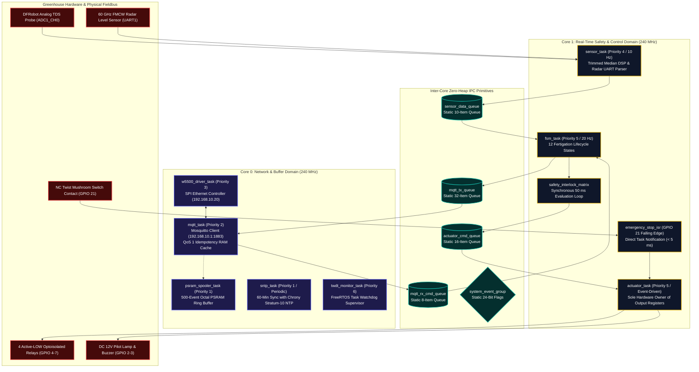
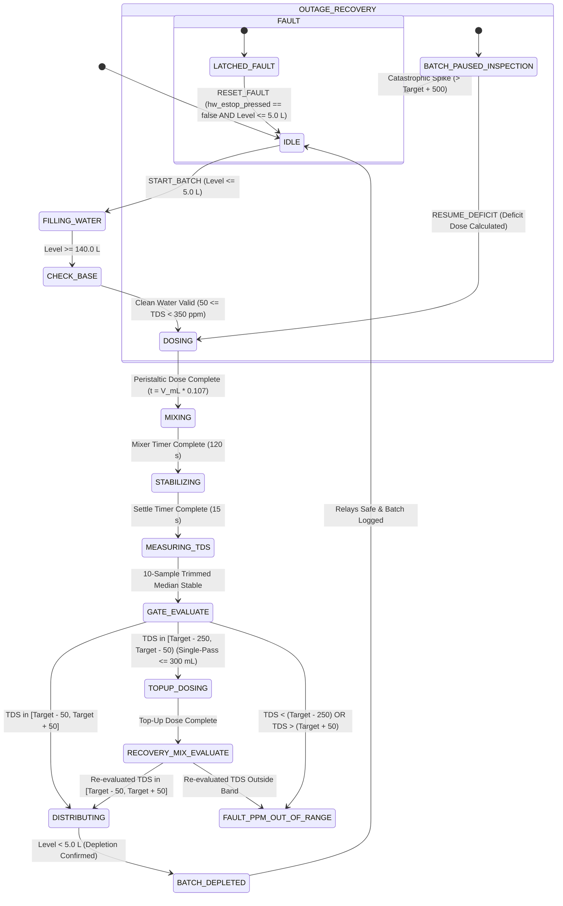

# 10 Firmware Spec

> **System:** DESANOMIA Greenhouse Automated Fertigation System  
> **Platform:** ESP32-S3 N16R8 Edge Microcontroller (16MB Quad SPI Flash, 8MB Octal PSRAM)  
> **Toolchain:** PlatformIO / Espressif 32 (ESP-IDF / FreeRTOS SMP / C++17)  
> **Authority:** Aligned with [00_MASTER_RULES.md](file:///home/maria_zahra/Documents/projects/greenhouse/desanomia/brain/00_MASTER_RULES.md), [01_PRD.md](file:///home/maria_zahra/Documents/projects/greenhouse/desanomia/brain/01_PRD.md), [02_APPFLOW.md](file:///home/maria_zahra/Documents/projects/greenhouse/desanomia/brain/02_APPFLOW.md), [04_TRD.md](file:///home/maria_zahra/Documents/projects/greenhouse/desanomia/brain/04_TRD.md), [05_ARCHITECTURE.md](file:///home/maria_zahra/Documents/projects/greenhouse/desanomia/brain/05_ARCHITECTURE.md), [06_DATA_MODEL.md](file:///home/maria_zahra/Documents/projects/greenhouse/desanomia/brain/06_DATA_MODEL.md), [07_DATA_SOURCES.md](file:///home/maria_zahra/Documents/projects/greenhouse/desanomia/brain/07_DATA_SOURCES.md), [08_SECURITY.md](file:///home/maria_zahra/Documents/projects/greenhouse/desanomia/brain/08_SECURITY.md), [09_ERROR_HANDLING.md](file:///home/maria_zahra/Documents/projects/greenhouse/desanomia/brain/09_ERROR_HANDLING.md), [18_DECISIONS.md](file:///home/maria_zahra/Documents/projects/greenhouse/desanomia/brain/18_DECISIONS.md), and [SPEC.md](file:///home/maria_zahra/Documents/projects/greenhouse/desanomia/docs/SPEC.md). [SPEC]

---

## 1. Asymmetric Dual-Core FreeRTOS Architecture

Desanomia firmware runs on the **ESP32-S3 N16R8** featuring dual Xtensa 32-bit LX7 cores operating at 240 MHz. To ensure deterministic, jitter-free execution of physical safety loops and eliminate task starvation from network latency, firmware tasks are partitioned strictly across cores.



### 1.1 FreeRTOS Task Scheduling & Memory Table
All task stacks and control structures are allocated statically in `.bss` memory during `app_main()` initialization:

| Task Name | Core Affinity | Priority | Execution Rate | Stack Size (Bytes) | Allocation Type | Primary Functional Responsibility |
| :--- | :---: | :---: | :---: | :---: | :---: | :--- |
| `fsm_task` | Core 1 | 5 | 20 Hz (50 ms) | 8,192 | `xTaskCreateStaticPinnedToCore` | 12-state fertigation state machine, recipe timing, and deficit calculation. |
| `actuator_task` | Core 1 | 5 | Event-Driven | 4,096 | `xTaskCreateStaticPinnedToCore` | Sole hardware owner of GPIO output registers; enforces mutual exclusion. |
| `sensor_task` | Core 1 | 4 | 10 Hz (100 ms) | 4,096 | `xTaskCreateStaticPinnedToCore` | ADC1_CH0 oversampling with trimmed median filter; radar UART1 parsing. |
| `w5500_driver_task`| Core 0 | 3 | Interrupt/10ms | 4,096 | `xTaskCreateStaticPinnedToCore` | W5500 SPI Ethernet bus handler and hardware interrupt ISR processor. |
| `mqtt_task` | Core 0 | 2 | 100 Hz (10 ms) | 8,192 | `xTaskCreateStaticPinnedToCore` | Mosquitto connection, QoS 1 ACK processing, and 32-slot idempotency cache. |
| `psram_spooler_task`| Core 0 | 1 | Event-Driven | 4,096 | `xTaskCreateStaticPinnedToCore` | Offlines event journaling into 8MB Octal PSRAM ring buffer. |
| `sntp_task` | Core 0 | 1 | Hourly (3600s) | 2,048 | `xTaskCreateStaticPinnedToCore` | Syncs internal clock via SNTP with Chrony on Beelink (`192.168.10.1:123`, `D-020`). |
| `twdt_monitor_task` | Core 0 | 6 | 1 Hz (1000 ms) | 2,048 | `xTaskCreateStaticPinnedToCore` | FreeRTOS Task Watchdog Timer (TWDT) supervising core health. |

---

## 2. Zero-Heap Allocation & Deterministic Memory Discipline

Heap fragmentation in embedded C/C++ firmware leads to sudden runtime crashes and panic reboots after days of continuous operation. Desanomia strictly mandates a **Zero-Heap Rule** inside all recurring control loops.

### 2.1 Boot-Time Static Allocation Rules
1. **Static Tasks & Queues:** Dynamic `xTaskCreate()` and `xQueueCreate()` are forbidden. All tasks use `xTaskCreateStaticPinnedToCore()` with statically declared stack arrays (`StackType_t`) and control blocks (`StaticTask_t`).
2. **Fixed Buffers:** Telemetry payloads, ACK responses, and event logs are formatted into statically allocated `char[512]` buffers using `snprintf()`.
3. **Prohibited C++ Constructs in Control Loops:**
   - NO `malloc()`, `calloc()`, `realloc()`, or `free()`.
   - NO C++ `new` or `delete` operators.
   - NO dynamic `std::string` concatenation or resizing.
   - NO dynamic containers (`std::vector::push_back`, `std::map`, `std::list`).
   - NO dynamic Arduino `String` class usage.
   - NO dynamic JSON DOM allocations (e.g. `DynamicJsonDocument`); all JSON serialization uses fixed stack-allocated schemas.

---

## 3. Conflict-Free GPIO Mapping & Bus Protection (Frozen Invariant)

Hardware pin assignments for the ESP32-S3 N16R8 are frozen to prevent electrical contention with native USB-JTAG controllers and internal Octal memory buses:

| Pin ESP32-S3 | Hardware Function | Circuit Logic / Electrical Standard | Engineering Safety Notes |
| :--- | :--- | :--- | :--- |
| **GPIO 1** | Analog TDS Probe Input | Analog Input (ADC1_CH0, 0–3.3V) | Connected to DFRobot Gravity Analog TDS AFE conditioner board. |
| **GPIO 2** | Panel Acoustic Piezo Buzzer | Digital Output (Active HIGH via NPN Transistor) | Dedicated to error and fault annunciation; moved from GPIO 20 (`USB_D+`). |
| **GPIO 3** | Red Industrial Panel Pilot Lamp | Digital Output (Active HIGH via NPN Transistor) | Dedicated to latched fault indicator; moved from GPIO 19 (`USB_D-`). |
| **GPIO 4** | Relay 1: Clean Water Fill Solenoid | Digital Output (Active LOW Optoisolated) | Interlock `IL-04` & `IL-05` cutoff. Solenoid rated AC 220V / 10W. |
| **GPIO 5** | Relay 2: Peristaltic Dosing Pump | Digital Output (Active LOW Optoisolated) | Concentrate dosing protection. DC 12V / 1.5A peristaltic motor. |
| **GPIO 6** | Relay 3: Submersible Mixing Pump | Digital Output (Active LOW Optoisolated) | Circulation & homogenization. AC 220V / 25W submersible pump. |
| **GPIO 7** | Relay 4: High-Pressure Distribution Pump | Digital Output (Active LOW Optoisolated) | Interlock `IL-01`, `IL-02`, `IL-07` cutoff. AC 220V / 125W pump. |
| **GPIO 10** | W5500 SPI Chip Select (CS) | Digital Output (Active LOW) | Dedicated SPI bus for W5500 Ethernet module. |
| **GPIO 11** | W5500 SPI MOSI | Digital Output (SPI Bus) | High-speed SPI data transmission to W5500. |
| **GPIO 12** | W5500 SPI MISO | Digital Input (SPI Bus) | High-speed SPI data reception from W5500. |
| **GPIO 13** | W5500 SPI SCK | Digital Output (SPI Clock) | SPI Clock generated by ESP32-S3 master. |
| **GPIO 14** | W5500 Hardware Reset (RST) | Digital Output (Active LOW) | Dedicated hardware reset line to recover frozen PHY controller. |
| **GPIO 15** | W5500 Interrupt (INT) | Digital Input (Active LOW Falling Edge) | Hardware interrupt line for incoming Ethernet frame notifications. |
| **GPIO 17** | 60 GHz Radar UART1 TX | Digital Output (UART @ 115200 bps) | Sensor configuration and keep-alive query line. |
| **GPIO 18** | 60 GHz Radar UART1 RX | Digital Input (UART @ 115200 bps) | Binary level frame reception (10 Hz). |
| **GPIO 19** | **ESP32-S3 Native USB D-** | **Dedicated USB-JTAG / Serial Controller** | **Strictly reserved for PlatformIO UART/JTAG debugging (`D-027`).** |
| **GPIO 20** | **ESP32-S3 Native USB D+** | **Dedicated USB-JTAG / Serial Controller** | **Strictly reserved for PlatformIO UART/JTAG debugging (`D-027`).** |
| **GPIO 21** | Emergency Stop Sensing Contact | Digital Input (Pulled-Up, RC Filter $\le 1\text{ ms}$) | Secondary NC contact sensing. Active open indicates pressed switch (`D-019`). |
| **GPIO 35–37**| **Internal Octal PSRAM Bus** | **Reserved Memory Bus** | **STRICTLY FORBIDDEN FOR EXTERNAL GPIO ON N16R8 MODULE.** |

### 3.1 Actuator Hardware Register Mutual Exclusion
The `actuator_task` enforces mutual exclusion at the register write level to prevent incompatible hydraulic operations:

```cpp
// Hardware register lockout mask enforced before updating GPIO pins
void update_relays_safe(uint8_t desired_relay_state) {
    // Bit 0: Fill (GPIO 4), Bit 1: Dose (GPIO 5), Bit 2: Mix (GPIO 6), Bit 3: Dist (GPIO 7)
    
    // Invariant 1: Fill Solenoid and Distribution Pump CANNOT be active together
    if ((desired_relay_state & (RELAY_FILL | RELAY_DIST)) == (RELAY_FILL | RELAY_DIST)) {
        desired_relay_state &= ~RELAY_DIST; // Force distribution pump OFF
    }
    
    // Invariant 2: Dosing Pump and Distribution Pump CANNOT be active together
    if ((desired_relay_state & (RELAY_DOSE | RELAY_DIST)) == (RELAY_DOSE | RELAY_DIST)) {
        desired_relay_state &= ~RELAY_DIST; // Force distribution pump OFF
    }

    // Invariant 3: Active LOW inversion - Low pin voltage energizes relay
    gpio_set_level(GPIO_RELAY_FILL, (desired_relay_state & RELAY_FILL) ? 0 : 1);
    gpio_set_level(GPIO_RELAY_DOSE, (desired_relay_state & RELAY_DOSE) ? 0 : 1);
    gpio_set_level(GPIO_RELAY_MIX,  (desired_relay_state & RELAY_MIX)  ? 0 : 1);
    gpio_set_level(GPIO_RELAY_DIST, (desired_relay_state & RELAY_DIST) ? 0 : 1);
}
```

---

## 4. The Seven Autonomous Safety Interlocks (`IL-01` to `IL-07`)

The 7 safety interlocks execute autonomously on Core 1 inside the 20 Hz loop before any actuator state is altered. They cannot be bypassed in either AUTO or MANUAL mode.

| Interlock ID | Interlock Name | Sampling Window / Threshold | Latched Fault Code | Hardware Reaction | Clearing Precondition (Gated Reset) |
| :---: | :--- | :--- | :--- | :--- | :--- |
| **`IL-01`** | **TDS Safety Gate** | Final mean TDS $< (\text{Target} - 50\text{ ppm})$ or $> (\text{Target} + 50\text{ ppm})$ after top-up dose. | `FAULT_PPM_OUT_OF_RANGE` | Distribution pump (GPIO 7) locked OFF; mixer de-energized; alarms ON. | Manual gravity drain to waste ditch until radar confirms level $\le 5.0\text{ L}$ (`D-012`). |
| **`IL-02`** | **Radar Dry-Run Cutoff** | Drum 2 level $< 5.0\text{ L}$ while distribution pump is active. | `FAULT_DRY_RUN` | De-energizes distribution pump in $< 50\text{ ms}$; batch aborted. | FSM returns to `IDLE`; manual fault reset permitted (`D-003`). |
| **`IL-03`** | **Batch Depletion Guard** | `START_BATCH` command received while Drum 2 level $> 5.0\text{ L}$. | `FAULT_BATCH_REJECTED` | Command rejected via MQTT ACK; all relays remain de-energized. | Drain residual liquid from Drum 2 until $\le 5.0\text{ L}$ before re-triggering. |
| **`IL-04`** | **Dual-Stage Fill Guard** | Water level rise $< 1.0\text{ L}$ in 90 s OR total continuous fill $> 20\text{ min}$ ($1200\text{ s}$). | `FAULT_NO_WATER_SUPPLY` / `FAULT_FILL_TIMEOUT` | Closes fill solenoid (GPIO 4); pauses fill timer; sounds buzzer. | Operator inspects source line; sends `RESUME_FILL` command without draining (`TR-19`). |
| **`IL-05`** | **Water Baseline Plausibility**| Clean water TDS $< 50\text{ ppm}$, $> 2000\text{ ppm}$, or baseline $\ge 350\text{ ppm}$ at `CHECK_BASE`. | `FAULT_TDS_INVALID` / `FAULT_BASE_TDS_HIGH` | Closes fill solenoid; aborts batch; de-energizes all relays. | Inspect probe immersion/cable; check raw water filtration; flush contaminated tank. |
| **`IL-06`** | **Radar Liveness Watchdog** | FMCW radar UART1 silent / missing valid frames for $> 3.0\text{ s}$. | `FAULT_RADAR_OFFLINE` | Cuts all 4 actuator relays immediately; halts FSM. | Auto-clears immediately upon receiving valid radar binary frame (`0xAA 0x55`). |
| **`IL-07`** | **Emergency Stop Guard** | Physical NC switch contact opened (GPIO 21 HIGH) OR software E-Stop command. | `FAULT_ESTOP` | Mechanical relay coil power cut in 0 ms; GPIO pins set HIGH in $< 5\text{ ms}$. | Twist physical mushroom switch NC (`hw_estop_pressed == false`) AND Drum 2 level $\le 5.0\text{ L}$ (`D-019`). |

---

## 5. The Authoritative 12-State Fertigation FSM Engine

The system executes batch fertigation through an authoritative 12-state finite state machine running at 20 Hz on Core 1:



### 5.1 FSM State Execution & Actuator Truth Table

| State Enum | Active Actuators | Timing / Exit Trigger | Next Normal State | Anomaly / Fault State |
| :--- | :--- | :--- | :--- | :--- |
| `IDLE` | All Relays OFF | Valid `START_BATCH` command | `FILLING_WATER` | Rejects with `FAULT_BATCH_REJECTED` if level $> 5.0\text{ L}$. |
| `FILLING_WATER` | Fill Solenoid (GPIO 4) | Level reaches $\ge 140.0\text{ L}$ | `CHECK_BASE` | `FAULT_NO_WATER_SUPPLY` (90s) / `FAULT_FILL_TIMEOUT` (20m). |
| `CHECK_BASE` | All Relays OFF | 10s baseline sample complete | `DOSING` | `FAULT_TDS_INVALID` ($< 50$ or $> 2000$) / `FAULT_BASE_TDS_HIGH` ($\ge 350$). |
| `DOSING` | Dosing Pump (GPIO 5) | Dosing duration $t_{\text{sec}} = V_{\text{mL}} \times 0.107$ | `MIXING` | `FAULT_ESTOP` if emergency stop triggered. |
| `MIXING` | Mixing Pump (GPIO 6) | 120 seconds countdown complete | `STABILIZING` | `FAULT_ESTOP` if emergency stop triggered. |
| `STABILIZING` | All Relays OFF | 15 seconds settling complete | `MEASURING_TDS` | `FAULT_ESTOP` if emergency stop triggered. |
| `MEASURING_TDS` | All Relays OFF | 10 seconds DSP median sample | `GATE_EVALUATE` | `FAULT_TDS_INVALID` if signal noise out of bounds. |
| `GATE_EVALUATE` | All Relays OFF | Instantaneous logic comparison | `DISTRIBUTING` (Pass)<br>`TOPUP_DOSING` (Deficit) | `FAULT_PPM_OUT_OF_RANGE` (Out of bounds or Starvation). |
| `TOPUP_DOSING` | Dosing Pump (GPIO 5) | Top-up dose $t = V_{\text{topup\_mL}} \times 0.107$ | `RECOVERY_MIX_EVALUATE` | Capped at $\le 300\text{ mL}$ maximum. |
| `RECOVERY_MIX_EVALUATE`| Mixing Pump (GPIO 6) | Mix 60s $\to$ Settle 15s $\to$ Measure 10s | `DISTRIBUTING` (Pass) | `FAULT_PPM_OUT_OF_RANGE` (Zero secondary top-up allowed). |
| `DISTRIBUTING` | Dist Pump (GPIO 7) | Drum 2 level $< 5.0\text{ L}$ | `BATCH_DEPLETED` | `FAULT_DRY_RUN` if pump runs with level $< 5.0\text{ L}$. |
| `BATCH_DEPLETED` | All Relays OFF | 5 seconds cleanup & NVS clear | `IDLE` | Transitions to `IDLE` and logs batch completion. |

---

## 6. Sensor Signal Conditioning & DSP Filtering Chains

### 6.1 Analog TDS Conditioning Chain (ADC1_CH0, GPIO 1)
To eliminate electrical noise from AC pump inductive kicks and mains hum:
1. **Sampling Rate:** 10 Hz acquisition loop inside `sensor_task`.
2. **10-Sample Moving Trimmed Median Filter:**
   - Buffers the latest 10 consecutive ADC samples in SRAM.
   - Sorts the 10 samples in ascending order.
   - Discards the single lowest sample and single highest sample.
   - Averages the remaining 8 samples to produce the conditioned raw voltage $V_{\text{raw}}$.
3. **Automatic Temperature Compensation (ATC):**
   $$T_{\text{comp}} = 1.0 + 0.02 \times (T_{\text{water}} - 25.0) \implies \text{Baseline: } 27.0^\circ\text{C} \implies T_{\text{comp}} = 1.04$$
   $$\text{TDS}_{\text{ppm}} = \left(\frac{V_{\text{raw}} \times K_{\text{cell}}}{T_{\text{comp}}}\right) + V_{\text{offset}}$$
   Where $K_{\text{cell}}$ (probe slope) and $V_{\text{offset}}$ are loaded from NVS namespace `calib_tds`.

### 6.2 60 GHz FMCW Radar Level Sensor Frame Parser (UART1)
1. **Baud Rate & Pins:** 115200 bps, 8N1 on GPIO 17 (TX) and GPIO 18 (RX).
2. **Binary Frame Parser:**
   - Frame Header: `0xAA 0x55` (2 bytes).
   - Payload: 4-byte little-endian raw distance measurement in millimeters ($D_{\text{measured\_mm}}$).
   - Checksum: 1-byte XOR of payload bytes.
3. **Distance-to-Volume Conversion Geometry:**
   $$V_{\text{drum2\_L}} = \left(\frac{H_{\text{tank\_mm}} - D_{\text{measured\_mm}}}{H_{\text{tank\_mm}} - H_{\text{sump\_mm}}}\right) \times 140.0\text{ L} + 5.0\text{ L}$$
   Where $H_{\text{tank\_mm}} = 950\text{ mm}$ and $H_{\text{sump\_mm}} = 50\text{ mm}$.
4. **Watchdog Supervision:** If no valid frame is received for $> 3.0\text{ s}$, `IL-06` triggers `FAULT_RADAR_OFFLINE` immediately.

---

## 7. Command Idempotency, MQTT Protocols & PSRAM Spooling (D-015, D-045)

### 7.1 QoS 1 Command Idempotency Protocol (D-045)
Every command from the backend carries a UUID `cmd_id`:

```cpp
struct IdempotencyCache {
    char cmd_ids[32][37]; // 32 UUID slots
    uint8_t write_idx = 0;
};
```

1. **Circular RAM Cache:** Firmware maintains the last 32 executed `cmd_id`s in internal SRAM.
2. **NVS Persistence:** The most recent `last_executed_cmd_id` is committed to NVS flash upon state completion.
3. **Replay Check:** If a command packet arrives with a `cmd_id` present in RAM or NVS:
   - Firmware returns an immediate ACK packet on `desanomia/gh1/ack` with status `ALREADY_EXECUTED`.
   - The command payload is discarded without advancing the FSM or re-energizing actuators.

### 7.2 Static JSON Payload Formatting
All outbound payloads are serialized using `snprintf()` into static buffers:

```cpp
// Static telemetry serialization
void publish_telemetry_frame() {
    static char payload[512];
    snprintf(payload, sizeof(payload),
        "{\"ts\":%lld,\"fsm\":\"%s\",\"sensors\":{\"tds\":%.1f,\"vol\":%.1f},"
        "\"actuators\":{\"fill\":%d,\"dose\":%d,\"mix\":%d,\"dist\":%d},"
        "\"safety\":{\"estop\":%s,\"fault\":\"%s\"}}",
        esp_timer_get_time() / 1000,
        fsm_state_to_str(current_state),
        current_tds_ppm, current_volume_l,
        is_relay_on(RELAY_FILL), is_relay_on(RELAY_DOSE),
        is_relay_on(RELAY_MIX), is_relay_on(RELAY_DIST),
        hw_estop_pressed ? "true" : "false",
        active_fault_code
    );
    mqtt_publish("desanomia/gh1/telemetry", payload, 0); // QoS 0
}
```

### 7.3 Octal PSRAM Offline Event Ring Buffer
- **Capacity:** 500 discrete lifecycle events (state changes, gate evaluations, fault trips).
- **Storage Medium:** Statically allocated ring buffer in 8MB Octal PSRAM (`EXT_RAM_ATTR`).
- **Drain Policy:** When W5500 Ethernet reconnects to Mosquitto, `psram_spooler_task` drains queued events chronologically over `desanomia/gh1/events` with QoS 1, ensuring 100% audit trail recovery without losing transient state changes.

---

## 8. Non-Volatile Storage (NVS) Flash Partitioning

Flash memory namespaces are strictly separated:

| NVS Namespace | Key Name | Data Type | Description |
| :--- | :--- | :--- | :--- |
| `fsm_journal` | `active_batch` | `uint32_t` | Active batch sequence ID (0 if idle). |
| `fsm_journal` | `fsm_state` | `uint8_t` | Numeric enum of currently active FSM lifecycle state. |
| `fsm_journal` | `target_ppm` | `uint16_t` | Active batch target TDS recipe value. |
| `fsm_journal` | `accum_dose_ml`| `float` | Accumulated concentrate volume dosed in current batch. |
| `calib_tds` | `k_cell` | `float` | Calibrated TDS cell constant slope (default $1.00$). |
| `calib_tds` | `v_offset` | `float` | Calibrated voltage zero offset (default $0.00$). |
| `calib_tds` | `base_offset` | `float` | Calibrated clean water baseline offset (`D-036`). |
| `idempotency` | `last_cmd_id` | `string` | UUID string of the last successfully completed command. |
| `net_config` | `mqtt_user` | `string` | MQTT client username (`esp32_gateway`). |
| `net_config` | `mqtt_pass` | `string` | MQTT client password. |

---

## 9. PlatformIO Build Configuration & Host-Native Unit Testing

### 9.1 `platformio.ini` Authoritative Specification
```ini
[env:esp32s3_n16r8]
platform = espressif32 @ 6.6.0
board = esp32-s3-devkitc-1
framework = espidf
monitor_speed = 115200
upload_speed = 921600

# Hardware Feature Flags: 16MB Flash + 8MB Octal PSRAM
board_build.flash_size = 16MB
board_build.flash_mode = qio
board_build.psram_type = opi
board_build.partitions = partitions_16mb.csv

build_flags =
    -D BOARD_HAS_PSRAM
    -D ARDUINO_USB_MODE=1
    -D ARDUINO_USB_CDC_ON_BOOT=1
    -D CONFIG_SPIRAM_MODE_OCT=1
    -D CORE_DEBUG_LEVEL=3
    -Wall
    -Wextra
    -Werror

# Memory Bus Protection: Octal PSRAM GPIOs Locked
extra_scripts = pre:scripts/protect_psram_pins.py
```

### 9.2 Host-Native Unit Testing Strategy (`test/`)
Firmware logic components are hardware-abstracted to enable 100% host-native testing on development workstations without physical microcontrollers:
1. **`test_fsm_engine.cpp`:** Tests all 12 FSM state transitions, timeout behaviors, and gate evaluations using mock sensor feeds.
2. **`test_safety_interlocks.cpp`:** Simulates sensor fault injections (TDS spike, dry-run, radar disconnect, E-stop) and asserts that the `actuator_task` immediately forces all relay bits HIGH (un-energized).
3. **`test_trimmed_median_filter.cpp`:** Feeds known noisy ADC sequences and verifies outlier rejection and temperature compensation mathematical accuracy.
