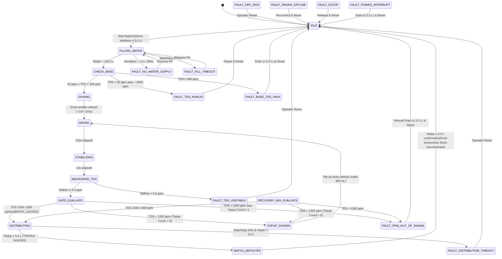
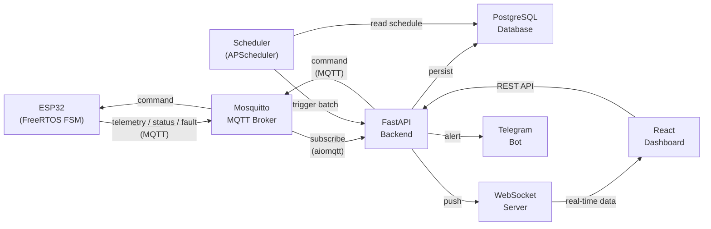

# SPEC.md — DESANOMI Greenhouse Automated Fertigation System

> **Version:** 1.0.0
> **Date:** 2026-09-12
> **Status:** IN PROGRESS
> **Scope:** Phase 1 — Automated Fertigation Only

---

## Table of Contents

1. [Product Purpose](#1-product-purpose)
2. [Users and Permissions](#2-users-and-permissions)
3. [Greenhouse Structure](#3-greenhouse-structure)
4. [Current Fertigation Workflow (FSM)](#4-current-fertigation-workflow-fsm)
5. [Empirical Constants](#5-empirical-constants)
6. [Hardware Inventory](#6-hardware-inventory)
7. [Eliminated Components](#7-eliminated-components)
8. [Safety Interlocks](#8-safety-interlocks)
9. [Functional Requirements](#9-functional-requirements)
10. [Non-Functional Requirements](#10-non-functional-requirements)
11. [Non-Goals](#11-non-goals)
12. [Open Decisions / Unknowns](#12-open-decisions--unknowns)
13. [Acceptance Criteria](#13-acceptance-criteria)
14. [Future Roadmap & Extensibility Considerations](#14-future-roadmap--extensibility-considerations)

---

## 1. Product Purpose

A web-controlled automated fertigation system for **Greenhouse DESANOMI** that:

- Automates the batch mixing and distribution of liquid fertilizer to 980 planting points across 6 raised beds (B1–B6).
- Uses an **open-loop feedforward** architecture with a **one-way safety gate** — the system follows a fixed dosing recipe derived from field calibration, then validates the result via TDS sensor before allowing distribution.
- Provides a real-time web dashboard for operators to monitor, schedule, and control fertigation batches.
- Enforces safety interlocks that **cannot be bypassed** by either AUTO or MANUAL mode.

---

## 2. Users and Permissions

### 2.1 Roles

| Role | Permissions |
| --- | --- |
| **Admin** | Full system access: manage users, edit schedules, control batches, view all data, reset faults, configure system parameters. |
| **Operator** | Control batches (start, monitor, reset fault), edit schedules, control individual actuators (MANUAL mode), view all dashboard data. |
| **Viewer** | Read-only access: view dashboard telemetry, batch history, event logs, charts. No control actions. |

### 2.2 Authentication

- **Method:** Username + password, session-based authentication.
- **Scope:** Internal greenhouse network (accessed via Tailscale for remote access).
- Credentials stored securely in PostgreSQL (hashed, never plaintext).

---

## 3. Greenhouse Structure

### 3.1 Physical Layout

| Attribute | Value |
| --- | --- |
| Greenhouses | 1 (DESANOMI) |
| Raised Beds | 6 (B1–B6) |
| Zones | 2 (logical only) |
| Total Planting Points | 980 (~163 per bed) |

### 3.2 Zone Mapping

| Zone | Beds | Notes |
| --- | --- | --- |
| Zone 1 | B1, B2, B3 | Logical grouping only |
| Zone 2 | B4, B5, B6 | Logical grouping only |

> **Important:** Zone division is administrative only. Distribution is **simultaneous to all 6 beds** via a single distribution pump.

### 3.3 Tank Infrastructure

| Tank | Capacity | Purpose | Sensors |
| --- | --- | --- | --- |
| **Drum konsentrasi** | 20 L | Concentrated fertilizer solution (2 kg fertilizer dissolved manually by operator) | None (manual preparation) |
| **Drum distribusi** | 140 L | Final mixed solution tank / reservoir | TDS/EC sensor, Radar level sensor |

---

## 4. Current Fertigation Workflow (FSM)

### 4.1 Architecture

**Controlled Closed-Loop Feedback Dosing** dengan gerbang verifikasi kualitas dan toleransi pemulihan:
- Dosis konsentrat dihitung secara dinamis berbasis volume analitis (mL) dari data empiris `references/DOSE_TEST_RESULT.md` untuk mencapai target 1200–1300 ppm pada volume air 140 L.
- Jika hasil pengukuran TDS pada GATE_EVALUATE berada di bawah batas bawah (< 1200 ppm), sistem mengizinkan maksimal 1 (satu) kali penyesuaian dosis otomatis (*Single-Pass Top-Up Recovery*) dengan kuota maksimal 300 mL.
- Jika setelah penyesuaian nilai TDS tetap di luar jendela 1200–1300 ppm atau sejak awal terdeteksi > 1300 ppm, pompa distribusi dikunci mati dan sistem masuk ke status kegagalan `FAULT_PPM_OUT_OF_RANGE`.
- Checkpoint state batch disimpan di Non-Volatile Storage (NVS) ESP32. Jika sistem pulih dari mati listrik saat Drum distribusi > 5.0 L, FSM masuk ke state `RECOVERY_MIX_EVALUATE` untuk mengaduk, mengukur ulang TDS, dan menentukan apakah dosis perlu dilengkapi atau dibatalkan.

### 4.2 State Machine (12 States)

```
IDLE → FILLING_WATER → CHECK_BASE → DOSING → MIXING → STABILIZING
  → MEASURING_TDS → GATE_EVALUATE ──[TDS < 1200 & Try=0]──> TOPUP_DOSING ──> MIXING
                         │
                 [1150 <= TDS <= 1250]
                         │
                         ▼
                    DISTRIBUTING → BATCH_DEPLETED → IDLE
```
*(Serta state `RECOVERY_MIX_EVALUATE` yang aktif jika ESP32 cold-boot saat Drum distribusi > 5.0 L).*

| # | State | Description | Exit Condition |
| --- | --- | --- | --- |
| 1 | **IDLE** | Awaiting "Mulai Batch" command (manual or scheduled). Verifies Drum distribusi is empty (radar ≤ 5.0 L). | Batch command received AND Drum distribusi empty (radar ≤ 5.0 L) |
| 2 | **FILLING_WATER** | Opens solenoid valve to fill Drum distribusi with clean water. Monitored by Dual-Stage Fill Guard. | Radar reads 140.0 L OR no flow in 90s (rise < 1.0 L) → `FAULT_NO_WATER_SUPPLY` OR 20 min watchdog → `FAULT_FILL_TIMEOUT` |
| 3 | **CHECK_BASE** | Reads baseline TDS of clean water in Drum distribusi. | 50 ppm ≤ TDS < 350 ppm → proceed; TDS < 50 ppm or > 2000 ppm → `FAULT_TDS_INVALID`; TDS ≥ 350 ppm → `FAULT_BASE_TDS_HIGH` |
| 4 | **DOSING** | Injects concentrate from Drum konsentrasi using peristaltic pump based on calibrated volume (~1.378–1.440 mL, ~147–154s). | Calculated dose timer elapsed |
| 5 | **MIXING** | Runs submersible mixer pump for 120 seconds to homogenize solution. | Timer 120s elapsed |
| 6 | **STABILIZING** | All pumps off. Liquid settles for 15 seconds. | Timer 15s elapsed |
| 7 | **MEASURING_TDS** | Takes 10 TDS samples, computes mean and StdDev. Cap at 2000 ppm per reading. | StdDev ≤ 5.0 ppm → proceed; StdDev > 5.0 ppm → `FAULT_TDS_UNSTABLE` |
| 8 | **GATE_EVALUATE** | Closed-loop safety gate. Evaluates mean TDS against 1200–1300 ppm window. | 1200–1300 ppm → BATCH_LOCKED & enter `DISTRIBUTING`; TDS < 1200 ppm & topup_count == 0 → enter `TOPUP_DOSING`; outside tolerance → `FAULT_PPM_OUT_OF_RANGE` |
| 9 | **TOPUP_DOSING** | Injects calculated incremental concentrate ($\Delta mL$, max 300 mL) to reach 1250 ppm. Increments topup_count. | Incremental dose timer elapsed → transition to `MIXING` |
| 10 | **RECOVERY_MIX_EVALUATE** | Activated on boot if Drum distribusi > 5.0 L and previous batch interrupted. Runs mixer 120s, settles 15s, then reads TDS. | TDS 1200–1300 ppm → `DISTRIBUTING`; TDS < 1200 ppm & topup_count == 0 → `TOPUP_DOSING`; TDS > 1300 ppm → `FAULT_PPM_OUT_OF_RANGE` |
| 11 | **DISTRIBUTING** | Runs distribution pump to deliver solution to B1–B6. Monitored continuously by radar/ultrasonic level sensor. | Radar/ultrasonic level ≤ 5.0 L → transition to `BATCH_DEPLETED` (SUCCESS) OR Watchdog 240s elapsed & radar > 5.0 L → `FAULT_DISTRIBUTION_TIMEOUT` |
| 12 | **BATCH_DEPLETED** | Radar confirms tank is empty (≤ 5.0 L). Finalizes batch telemetry, decrements Drum konsentrasi virtual stock tracker. | Confirmed empty (radar ≤ 5.0 L) → return to `IDLE` |

### 4.3 Fault States

| Fault | Trigger | Recovery Protocol |
| --- | --- | --- |
| `FAULT_FILL_TIMEOUT` | Radar doesn't reach 140 L within 20 minutes | Operator: periksa sumber air, tekan "Resume Fill" via dashboard |
| `FAULT_NO_WATER_SUPPLY` | Kenaikan level < 1.0 L dalam 90 detik pertama pengisian | Operator: buka kran/periksa pompa toren, tekan "Resume Fill" via dashboard |
| `FAULT_BASE_TDS_HIGH` | Baseline TDS ≥ 350 ppm | Operator: cek sumber air baku; kuras Drum distribusi via kran manual, lalu "Reset Fault" |
| `FAULT_TDS_INVALID` | Baseline TDS < 50 ppm (kabel lepas) atau > 2000 ppm (kabel short) | Operator: periksa koneksi kabel/probe sensor TDS, lalu "Reset Fault" |
| `FAULT_TDS_UNSTABLE` | TDS reading StdDev > 5.0 ppm | Operator: cek probe sensor & aliran cairan, lalu "Reset Fault" |
| `FAULT_PPM_OUT_OF_RANGE` | Mean TDS outside 1200–1300 ppm (setelah kuota top-up habis) | Operator: buka kran drain manual dasar Drum distribusi ke parit hingga level ≤ 5.0 L, lalu "Reset Fault" |
| `FAULT_DISTRIBUTION_TIMEOUT` | Distribusi berjalan > 240s tetapi radar masih membaca > 5.0 L | Automatic pump shutoff (indikasi pipa tersumbat/debit drop); operator: periksa pipa bedeng, lalu "Reset Fault" |
| `FAULT_DRY_RUN` | Pompa menyala saat tangki terdeteksi kosong (< 5.0 L) di awal | Automatic pump shutoff; operator: verifikasi tandon, lalu "Reset Fault" |
| `FAULT_RADAR_OFFLINE` | Data UART radar tidak diterima > 3 detik saat aktuator aktif | Automatic actuators shutoff; periksa kabel radar, lalu "Reset Fault" |
| `FAULT_ESTOP` | Tombol E-Stop ditekan (sakelar jamur fisik NC atau tombol antarmuka) | Seluruh relai mati seketika; pastikan kondisi fisik aman, putar reset tombol jamur, lalu "Reset Fault" di UI |
| `FAULT_POWER_INTERRUPT` | Kegagalan daya saat batch kritis tidak dapat dipulihkan otomatis | Operator inspeksi fisik isi tangki, kuras jika perlu (≤ 5.0 L), lalu "Reset Fault" |

> **Gated Recovery Protocol:** Tombol "Reset Fault" di dashboard terkunci (*disabled*) selama sensor radar membaca volume Drum distribusi > 5.0 L (kecuali untuk fault pasokan air yang menyediakan tombol "Resume Fill"). Sistem hanya dapat di-reset kembali ke IDLE setelah tangki terkuras tuntas (≤ 5.0 L) guna mencegah kontaminasi larutan.

### 4.4 State Diagram



---

## 5. Empirical Constants

> **Status:** FROZEN — derived from field calibration (`references/DOSE_TEST_RESULT.md`). Do not modify without new empirical testing.

| Constant | Value | Unit | Notes |
| --- | --- | --- | --- |
| `TARGET_WATER_VOLUME_L` | 140.0 | L | Target pengisian air bersih Drum distribusi |
| `TARGET_TDS_PPM` | 1250 | ppm | Titik tengah toleransi nutrisi |
| `TDS_TOLERANCE_MIN` | 1200 | ppm | Batas bawah gerbang kelolosan distribusi |
| `TDS_TOLERANCE_MAX` | 1300 | ppm | Batas atas gerbang kelolosan distribusi |
| `TDS_SENSOR_CAP` | 2000 | ppm | Batas potong nilai maksimal sensor TDS |
| `TDS_PLAUSIBILITY_MIN_PPM` | 50 | ppm | Batas bawah plausibilitas air baku bersih |
| `WATER_BASELINE_MAX_PPM` | 350 | ppm | Batas maksimal kontaminasi air baku bersih |
| `TARGET_CONCENTRATE_DOSE_ML` | ~1378–1440 | mL | Target volume injeksi konsentrat 1250 ppm di 140 L |
| `DOSE_PUMP_RUN_DURATION_SEC` | ~147–154 | s | Durasi kerja pompa peristaltik (dihitung dinamis: $V_{mL} \times 0.107\text{ s/mL}$) |
| `DOSE_PUMP_FLOW_RATE` | 107 | s/L | Laju alir terkalibrasi pompa peristaltik (~9.35 mL/s) |
| `MAX_RECOVERY_TOPUP_ML` | 300 | mL | Kuota maksimal penambahan konsentrat saat recovery |
| `MAX_TOPUP_ATTEMPTS` | 1 | kali | Batas maksimal percobaan top-up tertutup per batch |
| `PIPE_PRIMING_DURATION_SEC` | 13 | s | Manual SOP only (5 m pipe, 130 mL) |
| `MIXING_DURATION_SEC` | 120 | s | Submersible mixer run time |
| `STABILIZE_DELAY_SEC` | 15 | s | Quiet settling period before TDS read |
| `TDS_SAMPLE_COUNT` | 10 | samples | Multi-sample TDS measurement |
| `TDS_MAX_STDDEV` | 5.0 | ppm | Maximum acceptable StdDev |
| `DISTRIBUTION_WATCHDOG_SEC` | 240 | s | Watchdog pengaman maksimal pompa distribusi (pemutus utama: level ≤ 5.0 L) |
| `DRUM1_CAPACITY_L` | 20.0 | L | Kapasitas jerigen stok pupuk pekat Drum konsentrasi |
| `DRUM1_BATCH_CAPACITY` | 14 | batch | Estimasi jumlah batch per isi ulang Drum konsentrasi (~1.4 L per batch) |
| `DRUM1_LOW_STOCK_THRESHOLD` | 2 | batch | Ambang peringatan stok menipis Drum konsentrasi untuk operator |
| `EARLY_FILL_CHECK_SEC` | 90 | s | Jendela evaluasi deteksi dini aliran air masuk |
| `EARLY_FILL_MIN_RISE_L` | 1.0 | L | Kenaikan volume minimum Drum distribusi dalam 90 detik |
| `WATER_FILL_WATCHDOG_SEC` | 1200 | s | 20-minute absolute fill timeout |
| `DRY_RUN_CUTOFF_L` | 5.0 | L | Radar/ultrasonic level for pump shutoff & normal completion |
| `DRUM_EMPTY_THRESHOLD_L` | 5.0 | L | Ambang konfirmasi tangki kosong untuk batch depletion |
| `RADAR_LIVENESS_TIMEOUT_SEC` | 3 | s | Batas toleransi terputusnya frame UART radar |
| `TDS_CLEANING_INTERVAL_DAYS` | 30 | hari | Ambang batas waktu pengingat pembersihan kerak garam probe TDS |
| `TDS_CLEANING_INTERVAL_BATCHES` | 50 | batch | Ambang akumulasi batch pengingat pembersihan kerak garam probe TDS |

### 5.1 Concentrate Preparation (Manual SOP & Priming Helper)

| Parameter | Value |
| --- | --- |
| Drum konsentrasi capacity | 20 L |
| Fertilizer mass | 2 kg |
| Preparation | Manual dissolution by operator (100 g/L stock concentration) |
| Pipe priming | 13 s / 130 mL — diotomasi via tombol bantuan "Prime Pipa (13s)" di dashboard/kiosk sebelum memulai batch pertama pasca isi ulang |

---

## 6. Hardware Inventory

### 6.1 Controller

| Component | Specification |
| --- | --- |
| **Microcontroller** | ESP32 (WiFi-enabled, FreeRTOS, NVS state persistence) |
| **OTA** | ESP32 built-in OTA update via WiFi |

### 6.2 Actuators (Controlled by ESP32 via Relay)

| Actuator | Function | Control Type | Key Parameters |
| --- | --- | --- | --- |
| **Solenoid Valve (Clean Water)** | Fills Drum distribusi with clean water to 140 L | ON/OFF relay | Early check: 90s, Watchdog: 20 min |
| **Peristaltic Pump (DC 12V)** | Injects concentrate from Drum konsentrasi | Analytical-timer relay | Dynamic: $V_{mL} \times 0.107\text{ s/mL}$ (~147–154s), top-up max 300 mL |
| **Submersible Mixer Pump** | Homogenizes solution in Drum distribusi | Fixed-timer relay | Run: 120 s |
| **Distribution Pump** | Delivers fertigation to B1–B6 simultaneously | Gated relay (TDS interlock) | Run: 180 s, dry-run cutoff: < 5.0 L |

### 6.3 Sensors (Read by ESP32)

| Sensor | Location | Interface | Key Specs |
| --- | --- | --- | --- |
| **TDS & EC Sensor** | Drum distribusi | Analog | Cap 2000 ppm, non-ATC (ambient ~29–30 °C), 10-sample measurement, plausibility floor 50 ppm |
| **Radar Level Sensor** | Drum distribusi | UART / Digital | Measures liquid level in liters, used for fill control, dry-run protection, batch depletion, 3s liveness watchdog |

### 6.4 Additional Safety & Maintenance Hardware

| Component | Location | Interface | Purpose |
| --- | --- | --- | --- |
| **Physical E-Stop Push Button** | Panel Box Door | Hardwired NC Contact | Direct mechanical power cut to relay coils + GPIO interrupt to ESP32 |
| **Manual Gravity Drain Valve** | Drum distribusi Bottom | Manual Ball Valve (3/4" - 1") | Discharges failed batch directly to waste ditch; isolates distribution pump |

---

## 7. Eliminated Components

> **DO NOT REINVENT** — These components were evaluated and intentionally removed from the design.

| Component | Replaced By | Rationale |
| --- | --- | --- |
| Motor Stepper & Driver | Peristaltic pump DC 12V | Simpler, cheaper, sufficient for calibrated volume dosing |
| Dual Flow Meters | Radar Level Sensor | Single sensor handles fill detection, dry-run protection, and batch depletion |
| Sensor Suhu DS18B20 & ATC | Non-ATC direct TDS reading | Greenhouse ambient ~29–30 °C is stable; ATC complexity unjustified |
| Solenoid Valve Manifold (per-zone) | Single distribution pump to all B1–B6 | Per-zone control eliminated; distribution is simultaneous |

---

## 8. Safety Interlocks

> **CRITICAL:** These interlocks are enforced at the **ESP32 firmware level** and **cannot be bypassed** by either AUTO or MANUAL mode.

### 8.1 Interlock Matrix

| # | Interlock | Condition | Action | Bypass Allowed |
| --- | --- | --- | --- | --- |
| 1 | **TDS Gate** | Mean TDS outside 1200–1300 ppm (after max 1 top-up) | Distribution pump **LOCKED OFF**, system enters `FAULT_PPM_OUT_OF_RANGE` | **NO** |
| 2 | **Radar Dry-Run Cutoff** | Radar level < 5.0 L during distribution | Distribution pump **INSTANT SHUTOFF**, enters `FAULT_DRY_RUN` | **NO** |
| 3 | **Batch Depletion Rule** | Drum distribusi radar > 5.0 L when new batch requested | New batch **REJECTED** | **NO** |
| 4 | **Dual-Stage Fill Guard** | Early: rise < 1.0 L in 90s; Late: duration > 20 min | Solenoid **CLOSED**, enters `FAULT_NO_WATER_SUPPLY` or `FAULT_FILL_TIMEOUT` | **NO** |
| 5 | **Water Baseline & Plausibility** | Baseline TDS < 50 ppm or > 2000 ppm (invalid) / ≥ 350 ppm (high) | Batch **ABORTED**, enters `FAULT_TDS_INVALID` or `FAULT_BASE_TDS_HIGH` | **NO** |
| 6 | **Radar Liveness Watchdog** | Radar UART silent > 3s during active actuator | Actuators **SHUTOFF**, enters `FAULT_RADAR_OFFLINE` | **NO** |
| 7 | **Emergency Stop Guard** | E-Stop triggered (hardware button NC or UI) | All 4 relays **DE-ENERGIZED**, enters `FAULT_ESTOP` | **NO** |

### 8.2 MANUAL Mode Interlock Enforcement

MANUAL mode allows individual actuator control for **testing and maintenance only**:
- Operator can toggle: solenoid valve, peristaltic pump, mixer pump, distribution pump.
- All 7 interlocks remain **fully active** during MANUAL mode.
- MANUAL mode does **not** execute the full batch FSM sequence — it is for single-actuator testing only.

### 8.3 Gated Fault Reset Invariant

- Tombol `Reset Fault` pada dashboard terkunci (*disabled*) selama sensor radar membaca volume Drum distribusi > 5.0 L pasca `FAULT_PPM_OUT_OF_RANGE` atau `FAULT_POWER_INTERRUPT`.
- Operator wajib menguras Drum distribusi via kran drain manual gravitasi ke parit pembuangan hingga volume ≤ 5.0 L sebelum sistem diizinkan kembali ke state `IDLE`.

---

## 9. Functional Requirements

### 9.1 Firmware (ESP32)

| ID | Requirement |
| --- | --- |
| FW-01 | Implement 12-state closed-loop FSM using FreeRTOS tasks with state transitions and NVS state persistence as specified in §4. |
| FW-02 | Drive all 4 actuators via relay output with analytical timing from empirical constants (§5) and dynamic volume conversion ($V_{mL} \times 0.107\text{ s/mL}$). |
| FW-03 | Read radar level sensor and implement fill control (target 140.0 L), dry-run cutoff (< 5.0 L), batch depletion detection (≤ 5.0 L), and 3s liveness watchdog. |
| FW-04 | Read TDS analog sensor with 10-sample multi-read, compute mean and StdDev, enforce plausibility floor (50–2000 ppm), cap individual readings at 2000 ppm. |
| FW-05 | Enforce all 7 safety interlocks locally on ESP32 — no dependency on backend connectivity for safety. |
| FW-06 | **Smart Adaptive Telemetry:** Publish MQTT telemetry adaptively: every 30–60 s during IDLE (heartbeat/passive); every 5 s during static active states (`MIXING`, `STABILIZING`); every 2–3 s during dynamic fluid movement (`FILLING_WATER`, `DISTRIBUTING`); and instant publish (0 ms) on state transitions, actuator toggles, or faults. |
| FW-07 | Publish MQTT heartbeat every 10 seconds. |
| FW-08 | Accept MQTT commands: start-batch, reset-fault, resume-fill, prime-pipe, manual actuator control. |
| FW-09 | **Event-Only Ring Buffer (Offline Resilience):** Continue running active batch FSM if MQTT/WiFi is lost. Buffer only state transitions, interlock triggers, and fault events in a fixed circular ring buffer (max 50 events, ~5 KB RAM). Discard continuous 2s sensor stream during offline to prevent FreeRTOS heap exhaustion (OOM crash); resume live streaming immediately on reconnect. |
| FW-10 | Reject new batch start commands when MQTT/WiFi is disconnected. |
| FW-11 | Support OTA firmware updates via WiFi (ESP32 built-in OTA). |
| FW-12 | Support MANUAL mode for individual actuator testing with all 7 interlocks enforced. |
| FW-13 | Safe Cold-Boot Inspection: On reboot, check Drum distribusi volume. If > 5.0 L and previous batch unfinished, transition to `RECOVERY_MIX_EVALUATE` to assess TDS and perform single-pass top-up if needed. |
| FW-14 | Emergency Stop Interrupt: Dedicated GPIO ISR connected to physical NC mushroom button. De-energizes all 4 relays immediately on trigger and enters `FAULT_ESTOP`. |
| FW-15 | **Pipe Priming Helper:** Implement MQTT command `prime-pipe` for IDLE/MANUAL mode. Runs peristaltic pump for exactly 13 seconds (130 mL) and automatically shuts off to prime the 5m line after concentrate preparation. |
| FW-16 | **Pre-Dispatch Safety Sequence:** Support MQTT command `pre-dispatch-warning` for scheduled batches. Activates panel buzzer for 15 seconds as physical audible alarm in greenhouse, followed by 60 seconds submersible mixer re-homogenization prior to energizing distribution pump. |
| FW-17 | **Local Alarm Signaling:** On any FAULT state transition, pulse physical buzzer output and activate red pilot lamp on panel box to provide immediate acoustic and visual warning locally, independent of network or server connectivity. |

### 9.2 Backend (FastAPI)

| ID | Requirement |
| --- | --- |
| BE-01 | MQTT bridge via aiomqtt: subscribe to ESP32 telemetry, heartbeat, status, fault topics. |
| BE-02 | Publish MQTT commands: start-batch, reset-fault, resume-fill, manual actuator toggle. |
| BE-03 | WebSocket server: push real-time telemetry updates to connected dashboard clients. |
| BE-04 | REST API: `/api/fertigation/start-batch`, `/api/fertigation/status`, `/api/fertigation/reset-fault`, `/api/fertigation/resume-fill`, `/api/fertigation/prime-pipe`. |
| BE-05 | REST API: `/api/schedule/*` — CRUD for flexible fertigation schedules (multiple times per day, specific days of week). |
| BE-06 | REST API: `/api/batches/*` — batch history query with filtering. |
| BE-07 | REST API: `/api/auth/*` — login, logout, session management. |
| BE-08 | REST API: `/api/users/*` — user CRUD (Admin only). |
| BE-09 | **Scheduler Engine with JIT Prep & Opt-Out Dispatch:** APScheduler executes scheduled batches by verifying pre-flight conditions (Drum konsentrasi Virtual Stock > 0, Drum distribusi ≤ 5.0 L, ESP32 online) and initiating batch preparation 20 minutes prior to the target distribution time (e.g. at 08:40 for a 09:00 schedule). Upon reaching `BATCH_LOCKED & READY` at 09:00, sends Telegram notification with inline action buttons `[Siram Sekarang]` and `[Tunda 1 Jam]`. If `[Siram Sekarang]` is pressed, distributes immediately. If no response within 30 minutes (09:30), executes safety pre-dispatch sequence: sounds panel buzzer for 15 seconds to warn personnel in greenhouse, runs submersible mixer for 60 seconds to re-homogenize solution, then automatically dispatches distribution pump to prevent crop water stress. |
| BE-10 | ESP32 connectivity monitoring: detect offline status if no heartbeat received for > 30 seconds. |
| BE-11 | Telegram Bot integration: send alerts for all defined event types (see §9.4). |
| BE-12 | Database persistence: store all batch records, dose events, fertigation runs, telemetry snapshots, and event logs. |
| BE-13 | Session-based authentication with hashed password storage. |
| BE-14 | Role-based access control: Admin, Operator, Viewer (see §2). |
| BE-15 | **Drum konsentrasi Virtual Stock Tracker:** Track remaining concentrate batches in Drum konsentrasi (20 L / ~1.4 L = ~14 batches). Provide REST endpoint `/api/fertigation/drum1-refill` to record refill, and automatically decrement batch count upon successful `BATCH_DEPLETED` transition. |
| BE-16 | **Offline Alert Queue (Store-and-Forward):** Implement persistent buffer (`offline_alert_queue`) for Telegram notifications during network/internet outages. Automatically re-transmits queued alerts in FIFO order with preserved event timestamps upon detecting internet connection restored. |
| BE-17 | **TDS Maintenance Tracker:** Track cumulative batches and elapsed days since last TDS probe cleaning. When threshold reached (50 batches or 30 days), trigger `TDS_MAINTENANCE_DUE` Telegram alert and provide REST endpoint `/api/fertigation/tds-maintenance-reset` to record operator cleaning confirmation. |

### 9.3 Frontend (React Dashboard)

| ID | Requirement |
| --- | --- |
| FE-01 | **FSM Status Card:** Current state name, elapsed time in current state, visual indicator (including recovery & top-up states). |
| FE-02 | **TDS Live Card:** Real-time PPM reading with color-coded gauge (green: 1200–1300, yellow: near bounds, red: out of range). |
| FE-03 | **Drum distribusi Tank Visualization:** Radar level in liters and percentage, with visual tank fill indicator. |
| FE-04 | **Actuator Status Panel:** ON/OFF indicator for each of the 4 actuators. |
| FE-05 | **Batch Event Timeline:** Log of state transitions for the current/latest batch. |
| FE-06 | **Batch History Table:** Paginated table of past batches with final TDS, volume, duration, status (success/fault). |
| FE-07 | **TDS History Chart:** Apache ECharts line/bar chart of historical TDS readings per batch. |
| FE-08 | **ESP32 Connectivity Indicator:** Online/Offline status with last-seen timestamp. Prominent visual warning when offline to indicate stale data. |
| FE-09 | **"Mulai Batch" Button:** Protected — disabled when FSM is not IDLE, or Drum distribusi is not empty (> 5.0 L), or ESP32 is offline. Requires Operator or Admin role. |
| FE-10 | **"Reset Fault" Button:** Gated — disabled during `FAULT_PPM_OUT_OF_RANGE` if Drum distribusi > 5.0 L, displaying clear instruction to drain tank via manual bottom valve. Visible only during FAULT states. |
| FE-11 | **"Resume Fill" Button:** Displayed during `FAULT_NO_WATER_SUPPLY` and `FAULT_FILL_TIMEOUT` to resume water fill after water source is restored. |
| FE-12 | **Emergency Stop Control:** Dual behavior: Instant 1-tap on local touchscreen kiosk; focus-trapped confirmation modal (`aria-modal="true"`) on remote mobile web. |
| FE-13 | **Manual Actuator Controls:** Individual toggle buttons for each actuator (testing/maintenance) plus dedicated "Prime Pipa (13s)" helper button. Protected by role (Operator/Admin) and all 7 safety interlocks. |
| FE-14 | **Schedule Management UI:** Create, edit, delete fertigation schedules (days of week + times of day). Requires Operator or Admin role. |
| FE-15 | **Login Page:** Username + password authentication. |
| FE-16 | **User Management Page:** Admin-only CRUD for user accounts and role assignment. |
| FE-17 | **Drum konsentrasi Virtual Stock Card:** Display remaining estimated batches and volume for Drum konsentrasi with visual progress bar, "Catat Refill Drum konsentrasi (20L)" action button, and alert banner when remaining batches ≤ 2. |
| FE-18 | **TDS Maintenance Card / Banner:** Display days and batch count since last probe cleaning on the control page. Display an amber warning banner and "Catat Pembersihan Probe" action button when maintenance threshold is reached. |

### 9.4 Telegram Alert Events

| # | Event Type | Severity | Trigger |
| --- | --- | --- | --- |
| 1 | `FAULT_PPM_OUT_OF_RANGE` | 🔴 FAULT | Mean TDS outside 1200–1300 ppm (post top-up tolerance) |
| 2 | `FAULT_FILL_TIMEOUT` | 🔴 FAULT | Water fill watchdog timeout (20 min) |
| 3 | `FAULT_NO_WATER_SUPPLY` | 🔴 FAULT | Water rise < 1.0 L in 90 seconds (water supply cut off) |
| 4 | `FAULT_DISTRIBUTION_TIMEOUT` | 🔴 FAULT | Distribusi berjalan > 240s tetapi radar masih membaca > 5.0 L (indikasi pipa tersumbat) |
| 5 | `FAULT_DRY_RUN` | 🔴 FAULT | Radar < 5.0 L terdeteksi saat pompa menyala tanpa fluida di awal |
| 6 | `FAULT_BASE_TDS_HIGH` | 🔴 FAULT | Baseline water TDS ≥ 350 ppm |
| 7 | `FAULT_TDS_INVALID` | 🔴 FAULT | Baseline TDS < 50 ppm or > 2000 ppm (sensor detached/shorted) |
| 8 | `FAULT_RADAR_OFFLINE` | 🔴 FAULT | Radar UART frame timeout > 3 seconds |
| 9 | `FAULT_ESTOP` | 🔴 CRITICAL | Emergency Stop button triggered |
| 10 | `FAULT_POWER_INTERRUPT` | 🔴 FAULT | Power failure recovery failure / manual inspection required |
| 11 | `BATCH_DEPLETED` | 🟢 SUCCESS | Batch completed and tank empty (≤ 5.0 L) |
| 12 | `BATCH_STARTED` | 🔵 INFO | Batch initiated (entering FILLING_WATER) |
| 13 | `TDS_UNSTABLE` | 🟡 WARNING | TDS reading StdDev > 5.0 ppm |
| 14 | `TOPUP_INITIATED` | 🟡 INFO | Single-pass top-up recovery triggered for TDS < 1200 ppm |
| 15 | `DRUM1_LOW_STOCK` | 🟡 WARNING | Stok konsentrat Drum konsentrasi tersisa ≤ 2 batch (~2.8 L) |
| 16 | `SCHEDULE_READY_DISPATCH` | 🔵 INFO | Batch jadwal siap disiram; konfirmasi via inline button `[Siram Sekarang]` / `[Tunda 1 Jam]`. Jika 30 menit tanpa respons: buzzer 15s + re-homogenisasi 60s lalu auto-dispatch |
| 17 | `SCHEDULE_PREP_FAILED` | 🔴 FAULT | Kegagalan pre-flight saat auto-prep jadwal dimulai pada H-20 menit (air mati / Drum konsentrasi kosong / Drum distribusi > 5.0 L) |
| 18 | `TDS_MAINTENANCE_DUE` | 🟡 WARNING | Probe TDS telah mencapai 50 batch atau 30 hari operasional; pengingat pembersihan kerak garam dan verifikasi kalibrasi |

---

## 10. Non-Functional Requirements

| ID | Category | Requirement | Source |
| --- | --- | --- | --- |
| NFR-01 | **Deployment** | All backend services (FastAPI, PostgreSQL, Mosquitto) deployed via Docker Compose on Raspberry Pi / Beelink EQ12 at greenhouse site. | Confirmed |
| NFR-02 | **Remote Access** | Remote dashboard access via Tailscale VPN. | Confirmed |
| NFR-03 | **Data Retention** | All batch history, telemetry, and event logs retained indefinitely (no automatic purge). | Confirmed |
| NFR-04 | **Storage** | PostgreSQL data directory should reside on NVMe SSD to avoid storage wear from write-intensive database operations. | Confirmed |
| NFR-05 | **Modularity** | Backend (FastAPI routers) and database schema (PostgreSQL) must be designed modular to support future feature additions without architectural rework. | Confirmed |
| NFR-06 | **Safety Independence** | All 7 safety interlocks enforced locally on ESP32 firmware — zero dependency on backend, network, or dashboard for safety enforcement. | Confirmed |
| NFR-07 | **Offline Resilience** | ESP32 continues active batch FSM execution during network outage. Telemetry buffered and retransmitted on reconnect. Local Kiosk operates 100% offline. | Confirmed |
| NFR-08 | **Edge Offline Alerting & Store-and-Forward** | During internet outages, system enforces three-layer notification: (1) Local audible buzzer pattern and red pilot lamp on panel box door, (2) Prominent high-contrast red fault banner on 15.6" Kiosk and Gazebo TV running 100% locally via LAN, and (3) In-memory and PostgreSQL `offline_alert_queue` that automatically flushes delayed Telegram alerts with original event timestamps immediately upon internet reconnection. | Confirmed |

---

## 11. Non-Goals

> The following are **explicitly out of scope** for Phase 1 (current implementation).

| # | Non-Goal | Rationale |
| --- | --- | --- |
| NG-01 | Per-zone valve control / independent bed distribution | Zone manifold eliminated; distribution is simultaneous to all B1–B6 |
| NG-02 | Multi-stage continuous closed-loop hunting | Closed-loop is strictly constrained to single-pass top-up (max 300 mL) to prevent infinite loops |
| NG-03 | Multi-greenhouse support | Single greenhouse only (DESANOMI) |
| NG-04 | Crop / plant management (species, planting schedule, harvest tracking) | Not in scope |
| NG-05 | Environmental monitoring (temperature, humidity, light, soil pH) | Not in scope for Phase 1 |
| NG-06 | Mobile native app | Web dashboard only (responsive mobile-first design) |
| NG-07 | E-commerce / harvest sales | Not in scope |
| NG-08 | AI/ML predictive dosing | Not in scope for Phase 1 |

---

## 12. Open Decisions / Unknowns

| # | Decision | Status | Notes |
| --- | --- | --- | --- |
| OD-01 | Exact ESP32 board model / variant | RESOLVED | ESP32 WROOM-32 38-Pin DevKit with hardware pull-down and dedicated E-Stop ISR pin. |
| OD-02 | Radar level sensor exact model & protocol | OPEN | Interface confirmed UART/Digital — exact frame parser to be finalized in firmware driver. |
| OD-03 | TDS sensor exact model & ADC calibration | RESOLVED | Analog interface confirmed with 50 ppm plausibility floor and calibrated curve from `DOSE_TEST_RESULT.md`. |
| OD-04 | Telegram Bot token & chat ID provisioning | OPEN | Bot provisioning via BotFather for greenhouse operations team. |
| OD-05 | Distribution timer (180s) marked "temporary" | OPEN | Final distribution duration may be adjusted based on field flow testing on beds B1–B6. |
| OD-06 | Scheduler library choice | RESOLVED | APScheduler inside FastAPI service. |
| OD-07 | Backend task runner for MQTT bridge | RESOLVED | FastAPI lifespan event with aiomqtt client. |
| OD-08 | MQTT broker authentication | RESOLVED | Mosquitto authenticated with username and password on isolated IoT VLAN / local network. |
| OD-09 | ESP32 telemetry buffer size during offline | RESOLVED | Ring buffer of 100 critical state transition/fault events in FreeRTOS memory. |
| OD-10 | Dashboard responsive breakpoints | RESOLVED | Mobile-first 390x844 layout for phones + 1080p kiosk layout for 15.6" panel touchscreen. |

---

## 13. Acceptance Criteria

### 13.1 Automated Batch Sequence

| # | Test | Pass Condition |
| --- | --- | --- |
| AC-01 | **Water Fill Control** | Solenoid valve closes precisely when radar reads 140.0 L. |
| AC-02 | **Dual-Stage Fill Guard (Early)** | Solenoid valve closes and system enters `FAULT_NO_WATER_SUPPLY` if radar rises < 1.0 L in first 90 seconds. |
| AC-03 | **Dual-Stage Fill Guard (Late)** | Solenoid valve closes and system enters `FAULT_FILL_TIMEOUT` if radar doesn't reach 140.0 L within 20 minutes. |
| AC-04 | **Baseline TDS & Plausibility** | Batch aborts with `FAULT_TDS_INVALID` if clean water TDS < 50 ppm or > 2000 ppm; aborts with `FAULT_BASE_TDS_HIGH` if TDS ≥ 350 ppm. |
| AC-05 | **Analytical Dosing** | Peristaltic pump runs for calculated duration (~147–154s), injecting ~1.378–1.440 mL concentrate. |
| AC-06 | **Mixing & Stabilization** | Submersible pump runs exactly 120 s, followed by 15 s quiet period before TDS measurement. |
| AC-07 | **TDS Multi-Sample** | System takes 10 samples, computes mean and StdDev. Proceeds only if StdDev ≤ 5.0 ppm. |
| AC-08 | **Single-Pass Top-Up Recovery** | If mean TDS < 1200 ppm, FSM transitions to `TOPUP_DOSING`, adds calculated $\Delta mL$ (max 300 mL), re-mixes, and re-evaluates. |

### 13.2 Safety Interlocks

| # | Test | Pass Condition |
| --- | --- | --- |
| AC-09 | **TDS Gate PASS** | TDS = 1250 ppm (within 1200–1300) → distribution pump allowed to run. |
| AC-10 | **TDS Gate FAIL** | TDS outside 1200–1300 ppm after top-up → distribution pump locked OFF, `FAULT_PPM_OUT_OF_RANGE`, Telegram alert sent. |
| AC-11 | **Dry-Run Protection** | During distribution, simulate radar < 5.0 L → distribution pump shuts off instantly before 180 s timer ends (`FAULT_DRY_RUN`). |
| AC-12 | **Batch Depletion Enforcement** | New "Mulai Batch" command rejected if Drum distribusi radar > 5.0 L. |
| AC-13 | **Radar Liveness Watchdog** | Disconnect radar UART during filling/distribution → actuators shut off within 3s, entering `FAULT_RADAR_OFFLINE`. |
| AC-14 | **Emergency Stop** | Press E-Stop mushroom button or kiosk E-Stop → all relays cut off instantly, FSM enters `FAULT_ESTOP`. |
| AC-15 | **Gated Reset Enforcement** | In `FAULT_PPM_OUT_OF_RANGE`, "Reset Fault" button is disabled until Drum distribusi radar ≤ 5.0 L. |
| AC-16 | **MANUAL Mode Interlock** | In MANUAL mode, attempting to activate distribution pump while TDS is outside 1200–1300 ppm → pump remains OFF. |

### 13.3 Connectivity & Alerting

| # | Test | Pass Condition |
| --- | --- | --- |
| AC-17 | **Offline Batch Continuity** | Disconnect WiFi mid-batch → ESP32 completes FSM with all interlocks enforced. Telemetry sent on reconnect. |
| AC-18 | **Offline Batch Rejection** | While ESP32 is offline, backend rejects new batch start requests. |
| AC-19 | **Heartbeat Monitoring** | No heartbeat for > 30 s → dashboard shows ESP32 as "Offline" with last-seen timestamp. |
| AC-20 | **Telegram Alerts** | All 18 defined event types (§9.4) trigger correct Telegram messages to operator group. |
| AC-21 | **Scheduled Batch Auto-Dispatch & Safety Sequence** | Schedule at 09:00 → JIT prep at 08:40 → batch ready at 09:00 → Telegram notification sent → user confirms or 30-min timeout elapses → panel buzzer sounds 15s → mixer runs 60s → distribution completes to ≤ 5.0 L. |
| AC-22 | **Offline Alerting & Store-and-Forward** | Disconnect internet router → trigger water supply fault (`FAULT_NO_WATER_SUPPLY`) → panel buzzer sounds, pilot lamp lights up, Kiosk displays red fault banner → reconnect internet → Telegram Bot automatically delivers queued alert with original fault timestamp. |
| AC-23 | **TDS Maintenance Reminder** | Accumulate 50 batches or 30 days → amber banner appears on dashboard and Telegram alert is sent → operator clicks "Catat Pembersihan Probe" → maintenance counter resets to 0. |

---

## 14. Future Roadmap & Extensibility Considerations

> These items are **NOT in Phase 1 scope** but the architecture must be designed to accommodate them without major rework.

### Phase 2: Environmental Monitoring
- Temperature, humidity, light sensors throughout greenhouse.
- Soil moisture / pH sensors per bed.
- Historical environmental data charting.
- **Architecture note:** Modular FastAPI router + separate DB tables. MQTT topic hierarchy already supports additional sensor devices.

### Phase 3: Per-Zone Distribution & Crop Management
- Individual solenoid valves per zone or bed for independent irrigation control.
- Crop type, planting date, harvest tracking per bed.
- Zone-specific fertigation schedules.
- **Architecture note:** Database schema should have a `beds` table with FK relationships ready. Distribution logic should be abstracted behind a strategy pattern.

### Phase 4: Advanced Intelligence
- Closed-loop feedback dosing (automatic concentrate adjustment based on TDS reading).
- Multi-greenhouse support (multiple ESP32 controllers, greenhouse-level aggregation).
- AI/ML: plant disease detection, predictive dosing optimization, yield forecasting.
- **Architecture note:** MQTT topic hierarchy (`greenhouse/{gh_id}/esp32/{device_id}/...`) already supports multi-greenhouse. Dosing logic should be behind a pluggable strategy interface.

### Extensibility Design Principles
1. **FastAPI Routers:** Each feature domain (fertigation, scheduling, users, monitoring) in its own router module.
2. **PostgreSQL Schema:** Normalized tables with clear FK relationships. Use Alembic migrations for schema evolution.
3. **MQTT Topics:** Hierarchical structure (`greenhouse/{gh_id}/esp32/{device_id}/...`) supports future multi-device and multi-greenhouse.
4. **Frontend:** Component-based React architecture with feature-level code splitting.

---

## Appendix A: Technology Stack

| Layer | Technology |
| --- | --- |
| **Firmware** | ESP32 + FreeRTOS + Arduino/ESP-IDF + OTA |
| **MQTT Broker** | Mosquitto |
| **Backend** | FastAPI (Python 3.11+) + aiomqtt + WebSocket |
| **Scheduler** | APScheduler or Celery Beat (TBD) |
| **Database** | PostgreSQL (Docker, USB SSD storage) |
| **Frontend** | React + Vite + TypeScript + Tailwind CSS + shadcn/ui + Apache ECharts |
| **Deployment** | Docker Compose on Raspberry Pi 4/5 |
| **Remote Access** | Tailscale VPN |
| **Alerting** | Telegram Bot API |

## Appendix B: MQTT Topic Structure

```
greenhouse/{gh_id}/esp32/{device_id}/
├── telemetry          # QoS 0 — periodic sensor data (JSON)
├── heartbeat          # QoS 0 — every 10s liveness ping
├── status             # QoS 1 — FSM state transitions
├── fault              # QoS 1 — fault events
└── command            # QoS 1 — start-batch, reset-fault, manual actuator
```

**Telemetry publish rates:**
- IDLE: every 30 seconds
- Active batch: every 2 seconds
- State transition / fault: instant (event-driven, in addition to periodic)

## Appendix C: Communication Architecture


